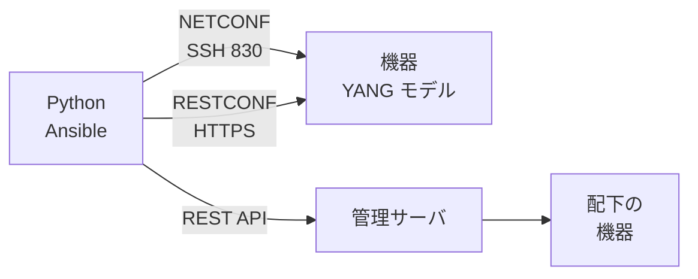

# 00-OVERVIEW.md
## ENCOR 勉強シート（全体像）

***

ENCOR で何を勉強するのかを、ネスペの知識と比べながらつかむためのシート。分野ごとの詳しい勉強シートは、このあと1枚ずつ作る。

## ENCOR とは

| 項目 | 内容 |
| --- | --- |
| 試験 | **350-401 ENCOR**（Implementing and Operating Cisco Enterprise Network Core Technologies） |
| 位置づけ | **CCNP Enterprise の必須試験**（コア試験）。これと専門試験1つで CCNP Enterprise になる |
| 時間 | 約2時間 |
| 問われること | 理論に加えて、**Cisco の機器でどう設定し、どう確かめるか** |

ネスペは「**なぜその設計にするのか**」を記述で答える試験だった。ENCOR は「**その技術を Cisco の機器でどう動かすか**」を選択式などで問う。理論はかなり重なるが、**Cisco 独自の技術**と**自動化**は新しく勉強する必要がある。

## 6つの分野

- 配点は目安。改定されることがあるので、Cisco 公式の出題範囲（Exam Topics）で最新版を確認する
- **インフラ（30%）とセキュリティ（20%）でほぼ半分**。ここはネスペの知識がよく効く

| 分野 | 配点 | ネスペとの重なり | 新しく勉強するもの |
| --- | --- | --- | --- |
| アーキテクチャ | 15% | △ | CEF・TCAM、SSO・NSF、**SD-Access**、SD-WAN の構成要素 |
| 仮想化 | 10% | △ | **VRF**、**LISP**、ハイパーバイザ・コンテナ |
| インフラ | **30%** | ○ | **EIGRP**、**HSRP**・GLBP、**PVST+**、**PAgP**、Cisco の無線の構成 |
| 監視・保証 | 10% | △ | **SPAN・RSPAN・ERSPAN**、**IP SLA**、NetFlow、条件付き debug |
| セキュリティ | **20%** | ○ | **TACACS+**、**CoPP**、MAB、TrustSec、MACsec |
| 自動化 | 15% | **×** | **Python**、JSON、**YANG**、**NETCONF・RESTCONF**、REST API、EEM、Ansible |

## ネスペの知識がそのまま使えるもの

ここは**理論の勉強はほぼ不要**。Cisco のコマンドで設定と確認ができるようにするだけでよい。

| ENCOR の範囲 | 使えるネスペの暗記シート |
| --- | --- |
| STP・RSTP・MST、EtherChannel（LACP） | [L2 冗長化](../../network/lan/l2-redundancy.md) |
| OSPF | [OSPF](../../network/routing/ospf.md) |
| eBGP | [BGP](../../network/routing/bgp-cheatsheet.md) |
| VRRP | [VRRP](../../network/redundancy/vrrp.md) |
| VXLAN | [VXLAN](../../network/lan/vxlan.md) |
| GRE・IPsec | [IPsec](../../network/wan-vpn/ipsec.md) |
| マルチキャスト（PIM・IGMP） | [マルチキャスト](../../network/routing/multicast.md) |
| QoS（マーキング・キューイング・シェーピング） | [TCP・QoS](../../network/protocol/tcp-qos.md) |
| 無線（電波、802.1X、WPA3、ローミング） | [無線LAN](../../network/lan/wifi-cheatsheet.md) |
| SNMP・Syslog・NTP | [運用・監視](../../network/operation/ops-monitoring.md) |
| RADIUS・802.1X、証明書 | [認証・PKI](../../network/security/auth-pki.md) |
| SD-WAN の考え方 | [SD-WAN](../../network/wan-vpn/sd-wan.md) |

## 新しく勉強するもの

### インフラ：Cisco 独自のプロトコル

| 技術 | ひとことで | ネスペで近いもの |
| --- | --- | --- |
| **EIGRP** | Cisco が作った IGP。**帯域と遅延**からメトリックを計算し、**DUAL** というしくみで、予備の経路（フィージブルサクセサ）を前もって用意しておくので**切替えが速い** | OSPF・RIP |
| **HSRP** | Cisco 独自のゲートウェイの冗長化。**アクティブ／スタンバイ**の2台で仮想 IP アドレスを持つ。**プリエンプトは既定で無効** | VRRP（こちらは既定で有効） |
| GLBP | Cisco 独自。1つの仮想 IP アドレスで、**複数のルータに負荷分散**できる | VRRP |
| **PVST+** | **VLAN ごとに** STP のツリーを作る、Cisco の STP | MSTP |
| **PAgP** | Cisco 独自の EtherChannel のネゴシエーション（desirable・auto） | LACP（active・passive） |

### アーキテクチャ・仮想化：機器の中のしくみと新しい構成

| 技術 | ひとことで |
| --- | --- |
| **CEF** | ルータが高速に転送するしくみ。経路表から作った **FIB** と、次ホップの L2 情報の**隣接テーブル**を使う |
| SSO・NSF | 冗長化した制御部（スーパーバイザ）が切り替わっても、**転送を止めない**しくみ |
| **VRF** | 1台のルータの中に**複数の経路表**を作る。顧客や部署ごとに経路を分け、**アドレスが重なってもよい** |
| **LISP** | 「端末の ID（**EID**）」と「その端末がいる場所（**RLOC**）」を分けて管理するしくみ。SD-Access で使う |
| **SD-Access** | 社内 LAN を**ファブリック**として集中管理する構成。制御は **LISP**、データの運搬は **VXLAN**、ポリシーは **TrustSec（SGT）** |
| SD-WAN | ネスペで学んだ SD-WAN を、Cisco の製品の役割名（管理・制御・認証・エッジ）と、経路を配る **OMP** で覚え直す |

### 監視・保証：調べるための道具

| 技術 | ひとことで |
| --- | --- |
| **SPAN・RSPAN・ERSPAN** | ミラーポート。**SPAN は同じスイッチ内**、**RSPAN は VLAN で別のスイッチへ**、**ERSPAN は GRE で L3 を越えて**コピーを送る |
| **IP SLA** | ルータが**自分で試験用の通信を出し**、到達性や遅延を測る。結果に応じて**経路や HSRP を切り替える**こともできる（トラッキング） |
| NetFlow | フロー情報をコレクタへ送る（ネスペの IPFIX と同じ考え方） |
| 条件付き debug | 特定のインタフェースやアドレスに絞って debug を出し、**機器の負荷を抑える** |

### セキュリティ：機器を守る設定

| 技術 | ひとことで |
| --- | --- |
| **TACACS+** | Cisco が作った認証プロトコル。**TCP 49**。**中身全体を暗号化**し、認証・認可・アカウンティングを**別々に**扱える → **機器へのログイン管理**に使う |
| RADIUS との違い | RADIUS は **UDP**、暗号化は**パスワードだけ**、認証と認可が一体 → **ネットワークへの接続の認証**（802.1X など）に使う |
| **CoPP** | 機器の **CPU に届く通信**（制御プレーン）を QoS で制限し、**大量の通信で CPU が止まる**のを防ぐ |
| MAB | 802.1X に対応しない機器を、**MAC アドレス**で認証する |
| TrustSec（SGT） | 通信に**グループのタグ**を付け、IP アドレスではなく**グループ単位**でアクセス制御する |
| MACsec | **L2 で隣の機器との間を暗号化**する（IEEE 802.1AE） |

### 自動化：いちばん新しい分野



| 技術 | ひとことで |
| --- | --- |
| **YANG** | 機器の設定や状態を表す**データの型（モデル）** |
| **NETCONF** | YANG のデータを **XML** で読み書きするプロトコル。**SSH の 830番** |
| **RESTCONF** | YANG のデータを **HTTPS** で読み書きする。形式は **JSON か XML** |
| REST API | HTTP の **GET・POST・PUT・DELETE** で操作する。**ステータスコード**（200 成功、201 作成、401 認証が必要、404 見つからない など）がよく問われる |
| JSON | `{"name": "R1", "vlan": 10}` のような、キーと値でデータを表す書き方 |
| Python | 上の API を呼び出すスクリプトを書くのに使う。**読めれば十分**で、書けなくてもよい |
| **EEM** | 機器の**中で動く**自動化。「このログが出たら、このコマンドを実行する」などを設定する |
| Ansible | **エージェント不要**（SSH で接続）の構成管理ツール。手順を **YAML** で書く。Puppet・Chef は**エージェントを入れる**方式 |

## Cisco のコマンドの雰囲気

ネスペにはなかった「**設定して、show で確かめる**」作業の例。

**HSRP の設定**（VLAN 10 のゲートウェイを冗長化）

```
interface Vlan10
 ip address 192.168.10.2 255.255.255.0
 standby 10 ip 192.168.10.1
 standby 10 priority 110
 standby 10 preempt
```

- `standby 10 ip` が仮想 IP アドレス（PC のデフォルトゲートウェイ）
- 優先度は既定 100。110 にしたこの機器がアクティブになる
- HSRP は**プリエンプトが既定で無効**なので、`preempt` を明示する

```
show standby brief
```

→ グループ番号、優先度、状態（Active / Standby）、仮想 IP アドレスが一覧で出る

**EIGRP の確認**

```
show ip eigrp neighbors
show ip eigrp topology
```

- `neighbors` で隣接しているルータを、`topology` で**サクセサ（いま使う経路）とフィージブルサクセサ（予備の経路）**を確かめる

## 確認問題

<details>
<summary>1. HSRP と VRRP で、既定の動きが違う設定は何か</summary>

**プリエンプト**。HSRP は既定で無効、VRRP は既定で有効。HSRP で優先度の高い機器を復旧後にアクティブへ戻したいなら、`standby <グループ> preempt` を設定する。
</details>

<details>
<summary>2. 機器へのログインの管理に、RADIUS より TACACS+ が向く理由</summary>

TACACS+ は**通信の中身全体を暗号化**し、**認証・認可・アカウンティングを別々に**扱えるので、「どの管理者に、どのコマンドを許すか」を細かく制御し、記録できるから。
</details>

<details>
<summary>3. SD-Access で、制御・データの運搬・ポリシーに使う技術は何か</summary>

制御は **LISP**、データの運搬は **VXLAN**、ポリシーは **TrustSec（SGT）**。
</details>

<details>
<summary>4. NETCONF と RESTCONF の違い</summary>

NETCONF は **SSH（830番）**の上で **XML** を使う。RESTCONF は **HTTPS** の上で **JSON か XML** を使い、HTTP のメソッドで操作する。どちらも **YANG** のモデルに沿ってデータを読み書きする。
</details>

<details>
<summary>5. ERSPAN が SPAN・RSPAN と違うところ</summary>

コピーしたフレームを **GRE で包んで L3 のネットワークを越えて**送れる。SPAN は同じスイッチの中だけ、RSPAN は専用の VLAN で L2 の範囲だけ。
</details>

## 次に読むシート

勉強計画の順番どおり、次は**インフラの L2（STP・EtherChannel の Cisco での設定）**から1枚ずつ作る。
