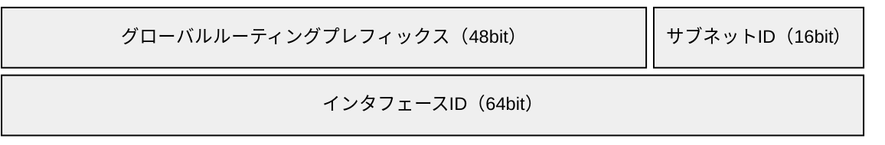

# IPV6.md
## IPv6 暗記シート

***

## IPv4 との違い

| 項目 | IPv4 | IPv6 |
| --- | --- | --- |
| アドレス長 | 32bit | **128bit**（約 3.4×10^38 個） |
| 表記 | 10進数を `.` で4つに区切る | **16進数を16bitずつ `:` で8つに区切る** |
| ヘッダ長 | 20〜60Byte（可変） | **40Byte 固定**（オプションは拡張ヘッダへ） |
| ヘッダチェックサム | あり | **なし**（その代わり **UDP のチェックサムが必須**） |
| フラグメント | 送信元・ルータの両方 | **送信元だけ**（ルータは分割しない） |
| 最小 MTU | 68Byte | **1280Byte** |
| 生存時間 | TTL | **Hop Limit** |
| ブロードキャスト | あり | **なし**（マルチキャストで代替） |
| アドレス解決 | ARP（ブロードキャスト） | **NDP**（ICMPv6・マルチキャスト） |
| マルチキャスト管理 | IGMP | **MLD**（ICMPv6） |
| アドレス自動設定 | DHCP | **SLAAC**（RA）/ DHCPv6 |
| NAT | NAPT が一般的 | **NAPT を使わない**（端末ごとにグローバルアドレス） |
| IPsec | オプション | 対応が前提とされた（現在は推奨） |
| イーサネットのタイプ値 | 0x0800 | **0x86DD** |
| DNS レコード | A | **AAAA** |
| 逆引きドメイン | in-addr.arpa | **ip6.arpa** |

## アドレスの表記と省略

`2001:0db8:0000:0000:0000:0000:0000:0001` → **`2001:db8::1`**

| ルール | 例 |
| --- | --- |
| 各フィールドの**先頭の0は省略**できる | `0db8` → `db8`、`0000` → `0` |
| **連続する0のフィールドは `::` に1回だけ**まとめられる | `2001:db8:0:0:0:0:0:1` → `2001:db8::1` |
| `::` は**2回使えない**（何個の0か分からなくなる） | ✕ `2001::1::1` |
| （RFC 5952 の推奨）**最も長い0の連続**を `::` にする。同じ長さなら**前のほう** | `2001:db8:0:0:1:0:0:1` → `2001:db8::1:0:0:1` |
| （RFC 5952 の推奨）**0が1フィールドだけなら `::` にしない**、英字は**小文字** | `2001:db8:0:1:1:1:1:1` のまま |

- URL に書くときは `[ ]` で囲む: `http://[2001:db8::1]:8080/`
- 16進数1桁 = **4bit**（ニブル）。1フィールド = 4桁 = 16bit

## アドレスの構成とプレフィックス

- 上の段が**前半 64bit のネットワーク部（プレフィックス）**、下の段が**後半 64bit のインタフェースID**（図は /48 で割り当てられた場合）
- サブネットの大きさは基本 **/64**（**SLAAC は /64 が前提**）。インタフェースIDは **64bit**
- ユーザーへの割当て例: **/48** や **/56**（その中を /64 に分けて使う）

| 割当て | その中の /64 の数 | 計算 |
| --- | --- | --- |
| /48 | **65,536** 個 | 2^(64−48) = 2^16 |
| /56 | **256** 個 | 2^(64−56) = 2^8 |
| /60 | 16 個 | 2^(64−60) = 2^4 |
| /64 | 1 個 | ― |

例）`2001:db8:1234:5600::/56` → `2001:db8:1234:5600::/64` 〜 `2001:db8:1234:56ff::/64`（4番目のフィールドの下2桁 = 8bit 分）

## アドレスの種類

| 種類 | プレフィックス | ポイント |
| --- | --- | --- |
| 未指定アドレス | **`::/128`** | アドレス未設定の送信元（DAD など）。IPv4 の 0.0.0.0 |
| ループバック | **`::1/128`** | IPv4 の 127.0.0.1 |
| **グローバルユニキャスト（GUA）** | **`2000::/3`** | インターネットで一意。`2` か `3` で始まる |
| **ユニークローカル（ULA）** | **`fc00::/7`**（実際は **`fd00::/8`**） | 組織内で使う。IPv4 のプライベートアドレスに近い |
| **リンクローカル** | **`fe80::/10`**（実際は `fe80::/64`） | **同じリンク内でだけ有効**。全インタフェースに必ず付く。ルータを越えない |
| **マルチキャスト** | **`ff00::/8`** | `ff` で始まる |
| IPv4 射影アドレス | `::ffff:0:0/96` | `::ffff:203.0.113.1` のように IPv4 アドレスを IPv6 で表す |
| NAT64 用 | `64:ff9b::/96` | NAT64/DNS64 で IPv4 アドレスを埋め込む（Well-Known Prefix） |
| 6to4 | `2002::/16` | IPv4 アドレスを埋め込むトンネル用（現在は非推奨） |
| ドキュメント用 | `2001:db8::/32` | 資料・例示専用 |
| サイトローカル | `fec0::/10` | **廃止**（代わりに ULA） |

- **エニーキャスト**: 同じアドレスを複数ノードに付け、最も近いノードに届く。専用の範囲はなくユニキャストと同じ形（例: サブネットルータエニーキャスト = インタフェースIDが全部0）
- 1つのインタフェースに**複数のアドレス**（リンクローカル＋GUA＋ULA など）が付くのが普通

## 主なマルチキャストアドレス

| アドレス | 宛先 |
| --- | --- |
| **`ff02::1`** | **リンク内の全ノード**（IPv4 のブロードキャストの代わり） |
| **`ff02::2`** | **リンク内の全ルータ** |
| `ff02::5` / `ff02::6` | 全 OSPFv3 ルータ / 全 OSPFv3 DR・BDR |
| `ff02::9` | 全 RIPng ルータ |
| `ff02::1:2` | 全 DHCPv6 サーバ・リレーエージェント |
| `ff02::fb` | mDNS |
| **`ff02::1:ffXX:XXXX`** | **要請ノードマルチキャスト**（Solicited-Node）。ユニキャストアドレスの**下位24bit**を付ける |

- `ff0X` の X は**スコープ**: `ff02` = リンクローカル、`ff05` = サイトローカル、`ff0e` = グローバル
- イーサネットの宛先 MAC は **`33:33` ＋ IPv6 アドレスの下位32bit**（例: `ff02::1` → `33:33:00:00:00:01`）

例）`2001:db8::1:2345:6789` の要請ノードマルチキャスト → **`ff02::1:ff45:6789`**

## インタフェースIDの作り方

### Modified EUI-64（MAC アドレスから作る）

1. 48bit の MAC アドレスを**真ん中で分けて `fffe` を挟む**（→ 64bit）
2. 先頭バイトの**下から2番目のビット（U/L ビット）を反転**する（先頭バイトに **2 を足す/引く** のと同じ）

| 手順 | 値 |
| --- | --- |
| MAC アドレス | `00:1a:2b:3c:4d:5e` |
| ① 真ん中に `fffe` を挟む | `00 1a 2b ff fe 3c 4d 5e` |
| ② 先頭バイトの U/L ビットを反転 | `02 1a 2b ff fe 3c 4d 5e`（`00` = 0000 0000 → 0000 0010 = `02`） |
| インタフェースID | `021a:2bff:fe3c:4d5e` |
| リンクローカルアドレス | `fe80::21a:2bff:fe3c:4d5e` |

- 弱点: MAC アドレスが外から分かり、**端末を追跡される**（プライバシーの問題）

### ほかの方式

| 方式 | 内容 |
| --- | --- |
| **一時アドレス**（プライバシー拡張、RFC 8981） | ランダムなインタフェースIDを**定期的に作り直す**。外向きの通信に使う |
| 安定したランダム（RFC 7217） | ネットワークごとに固定、でも MAC は含まない |
| 手動設定 | サーバ・ルータ向け（`::1` など覚えやすい値） |

## IPv6 ヘッダ（40Byte 固定）

| フィールド | ビット | 内容 |
| --- | --- | --- |
| Version | 4 | 6 |
| **Traffic Class** | 8 | 優先度。IPv4 の ToS にあたる（**DSCP 6bit ＋ ECN 2bit**） |
| **Flow Label** | 20 | 同じフローを識別（IPv6 で新設） |
| Payload Length | 16 | **基本ヘッダ（40Byte）を除いた**長さ（拡張ヘッダは含む） |
| **Next Header** | 8 | 次のヘッダ（拡張ヘッダ or 上位プロトコル）。IPv4 の Protocol にあたる |
| **Hop Limit** | 8 | IPv4 の TTL。ルータを通るたびに1減り、0で破棄 |
| Source / Destination Address | 128 / 128 | 送信元 / 宛先 |

**IPv4 からなくなったもの**: ヘッダ長（IHL）、**ヘッダチェックサム**、フラグメント関連（識別子・フラグ・オフセット → フラグメントヘッダへ）、オプション（→ 拡張ヘッダへ）

### Next Header の値（拡張ヘッダ・上位プロトコル）

| 値 | ヘッダ |
| --- | --- |
| 0 | ホップバイホップオプション（全ルータが処理） |
| 6 / 17 | TCP / UDP |
| 43 | ルーティングヘッダ（Type 0 はセキュリティ上の理由で廃止） |
| **44** | **フラグメントヘッダ**（送信元だけが付ける） |
| 50 / 51 | ESP / AH（IPsec） |
| **58** | **ICMPv6** |
| 59 | 次のヘッダなし |
| 60 | 宛先オプション |

## ICMPv6

| タイプ | メッセージ | 用途 |
| --- | --- | --- |
| 1 | Destination Unreachable | 宛先到達不能 |
| **2** | **Packet Too Big** | **PMTUD**。MTU を超えたのでルータが破棄し、MTU 値を返す |
| 3 | Time Exceeded | Hop Limit が0になった（traceroute6 で使う） |
| 4 | Parameter Problem | ヘッダの異常 |
| 128 / 129 | Echo Request / Reply | ping |
| 130〜132, 143 | MLD Query / Report / Done, MLDv2 Report | マルチキャストのグループ管理（IGMP の代わり） |
| **133** | **RS**（Router Solicitation） | ホスト → ルータ「ルータいますか」 |
| **134** | **RA**（Router Advertisement） | ルータ → ホスト「プレフィックス・デフォルトルータはこれ」 |
| **135** | **NS**（Neighbor Solicitation） | 近隣要請（アドレス解決・DAD） |
| **136** | **NA**（Neighbor Advertisement） | 近隣広告（NS への応答） |
| 137 | Redirect | より良い次ホップを知らせる |

- **ICMPv6 をすべて遮断すると IPv6 は動かない**（NDP・PMTUD に必須）。FW では必要なタイプを通す
- **PMTUD**: ルータはフラグメントしないので、**Packet Too Big が届かないと大きいパケットだけ通らない**（Web がつながらない等の原因）。最小 MTU は 1280Byte

## NDP（近隣探索プロトコル）

ICMPv6 の **RS / RA / NS / NA / Redirect** を使う。NDP のメッセージは **Hop Limit = 255**（ルータを越えてきた偽物を弾く）。

| 機能 | 使うメッセージ | 流れ |
| --- | --- | --- |
| **アドレス解決**（ARP の代わり） | NS → NA | NS を相手の**要請ノードマルチキャスト**宛てに送り、NA（ユニキャスト）で MAC アドレスを得る |
| **重複アドレス検出（DAD）** | NS | 送信元 **`::`**、宛先は使いたいアドレスの要請ノードマルチキャスト。**NA が返ってきたら重複** |
| **ルータ探索** | RS → RA | RS を **`ff02::2`** へ。RA は **`ff02::1`**（またはユニキャスト）へ |
| プレフィックス・パラメータの通知 | RA | プレフィックス、MTU、Hop Limit、DNS（RDNSS）など |
| 到達不能検知（NUD） | NS / NA | 近隣キャッシュのエントリが使えるか確認 |
| リダイレクト | Redirect | より良い次ホップを通知 |

- **RA の送信元はルータのリンクローカルアドレス** → ホストの**デフォルトゲートウェイは `fe80::〜` になる**
- ARP はブロードキャストで全員に届くが、NS は要請ノードマルチキャストなので**関係するノードだけ**が受け取る

## アドレス自動設定（SLAAC と DHCPv6）

### RA のフラグ

| フラグ | 意味 |
| --- | --- |
| **M**（Managed） | 1 なら**アドレスを DHCPv6（ステートフル）**で取る |
| **O**（Other） | 1 なら**DNS サーバなどアドレス以外の情報を DHCPv6**で取る |
| **A**（Autonomous、プレフィックス情報の中） | 1 ならそのプレフィックスで **SLAAC してよい** |
| L（On-Link） | そのプレフィックスはリンク上にある |
| Router Lifetime | **0 ならデフォルトルータとして使わない** |

### 組合せ

| 方式 | M | O | アドレス | DNS など |
| --- | --- | --- | --- | --- |
| **SLAAC のみ** | 0 | 0 | RA のプレフィックス＋自分で作ったインタフェースID | RA の **RDNSS オプション** |
| **SLAAC ＋ ステートレス DHCPv6** | 0 | 1 | SLAAC | **DHCPv6** |
| **ステートフル DHCPv6** | 1 | (1) | **DHCPv6** | DHCPv6 |

- **DHCPv6 はデフォルトゲートウェイを配布できない** → **どの方式でも RA は必要**
- SLAAC はサーバが不要だが、**誰がどのアドレスを使っているか管理しにくい**

### DHCPv6

| 項目 | 内容 |
| --- | --- |
| ポート | **クライアント UDP 546 / サーバ UDP 547** |
| 宛先 | `ff02::1:2`（全 DHCPv6 サーバ・リレーエージェント） |
| メッセージ | **Solicit → Advertise → Request → Reply**（Rapid Commit なら Solicit → Reply の2つ） |
| 識別子 | MAC アドレスではなく **DUID** |
| **DHCPv6-PD** | **プレフィックス委任**。ISP が家庭・拠点のルータに /56 などのプレフィックスを渡し、ルータが配下に /64 を配る |

## ルーティング

| プロトコル | IPv6 版 | ポイント |
| --- | --- | --- |
| RIP | **RIPng** | **UDP 521**、`ff02::9` |
| OSPF | **OSPFv3** | **リンクローカルアドレスで隣接関係**を作る、`ff02::5` / `ff02::6`、ルータIDは 32bit のまま |
| BGP | **MP-BGP**（マルチプロトコル拡張） | IPv4 の BGP セッション上で IPv6 経路も交換できる |
| スタティック | ― | 次ホップには隣接ルータの**リンクローカルアドレス＋出力インタフェース**を指定することが多い |

## IPv4 からの移行技術

| 分類 | 方式 | 内容 |
| --- | --- | --- |
| **デュアルスタック** | ― | 1台で IPv4 と IPv6 の両方を動かす。基本の方式 |
| **トンネル**（IPv6 over IPv4） | 6to4 / 6rd / ISATAP / Teredo / GRE | IPv6 パケットを IPv4 でカプセル化して運ぶ |
| **トンネル**（IPv4 over IPv6） | **DS-Lite** | IPv4 を IPv6 でカプセル化。宅内の **B4** から ISP の **AFTR** へ。AFTR で NAPT（CGN） |
| | **MAP-E** | IPv4 を IPv6 でカプセル化。**ステートレス**で、ユーザーごとに**使えるポート範囲**を割り当てる |
| **変換**（トランスレーション） | **NAT64 / DNS64** | **IPv6 だけのホストが IPv4 だけのサーバ**と通信。DNS64 が A レコードから `64:ff9b::/96` 入りの AAAA を合成し、NAT64 がヘッダを変換 |
| | **464XLAT** | 端末側の **CLAT**（IPv4→IPv6 変換）＋ ISP 側の **PLAT**（NAT64）。IPv6 だけの網で IPv4 アプリを動かす |

参考）フレッツ光などの **IPoE（IPv6）** 接続では、IPv4 を **MAP-E や DS-Lite（IPv4 over IPv6）** で通すことが多い（PPPoE の混雑を避けられる）。

### アドレス選択とフォールバック

- 両方使える場合、通常は **IPv6 が優先**される（RFC 6724 のデフォルトアドレス選択）
- **Happy Eyeballs**（RFC 8305）: IPv6 で少し待ってつながらなければ IPv4 も試し、早くつながったほうを使う
- **IPv4 へのフォールバック**があるため、**IPv6 側が壊れていても利用者は気付きにくい** → IPv6 の疎通を別に監視する

## DNS

| 項目 | 内容 |
| --- | --- |
| **AAAA レコード** | ホスト名 → IPv6 アドレス |
| 逆引き | **ip6.arpa**。アドレスを**16進数1桁ずつ逆順**にドットで区切る |

例）`2001:db8::1` → `1.0.0.0.0.0.0.0.0.0.0.0.0.0.0.0.0.0.0.0.0.0.0.0.8.b.d.0.1.0.0.2.ip6.arpa`

- IPv6 の DNS サーバの通知: DHCPv6（O フラグ）または RA の **RDNSS オプション**

## セキュリティ・運用のポイント

| 論点 | ポイント |
| --- | --- |
| **NAPT がない** | 端末にグローバルアドレスが付くので、**外からの通信は FW で止める**（「NAT があるから安全」が成り立たない） |
| **不正 RA** | 偽の RA でデフォルトゲートウェイを乗っ取られる → スイッチの **RA Guard** で防ぐ |
| 不正 DHCPv6 サーバ | **DHCPv6 Guard** で防ぐ |
| NDP の偽装 | ARP スプーフィングと同様の攻撃がある（対策: SEND、スイッチでの監視） |
| ICMPv6 のフィルタ | NDP・PMTUD に必要なタイプは**遮断しない** |
| 二重の管理 | IPv4 と IPv6 の両方に**同じ FW ルール・ACL**が必要（IPv6 側の設定漏れに注意） |
| アドレスの追跡 | SLAAC の EUI-64 は MAC から端末が特定される → 一時アドレス |
| ログ・監視 | 一時アドレスは変わるので、**誰がどのアドレスを使ったか**の記録（NDP キャッシュの収集など）が必要 |
| コマンド | `ping6` / `traceroute6`（`ping -6` / `tracert -6`）。GUA があると経由ルータを識別しやすい |

## 試験でよく問われるポイント

- `::` は**1回だけ**。省略形 ⇔ 完全形の変換を確実に
- **リンクローカル `fe80::/10`**・**ULA `fc00::/7`**・**マルチキャスト `ff00::/8`**・**GUA `2000::/3`**
- **Modified EUI-64**: `fffe` を挟む＋**先頭バイトの U/L ビット反転（+2）**
- **ARP の代わりは ICMPv6 の NS / NA**（要請ノードマルチキャスト宛て）
- **DAD**: 送信元 `::` の NS。NA が返れば重複
- **RA の M / O フラグ**と、**DHCPv6 ではデフォルトゲートウェイを配れない**こと
- **ルータはフラグメントしない** → **Packet Too Big（ICMPv6 タイプ2）** と PMTUD。最小 MTU 1280
- **ヘッダ 40Byte 固定、チェックサムなし、Hop Limit、Flow Label**
- **NAT64/DNS64**（`64:ff9b::/96`）、**DS-Lite / MAP-E**（IPv4 over IPv6）
- **OSPFv3 はリンクローカルで隣接**、RIPng は UDP 521、DHCPv6 は UDP 546/547

関連: [subnet-cheatsheet.md](subnet-cheatsheet.md) / [../routing/igp.md](../routing/igp.md) / [../routing/multicast.md](../routing/multicast.md) / [../protocol/dhcp.md](../protocol/dhcp.md)
