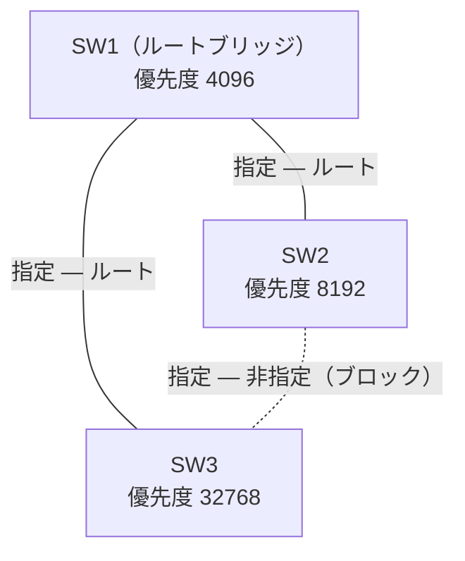
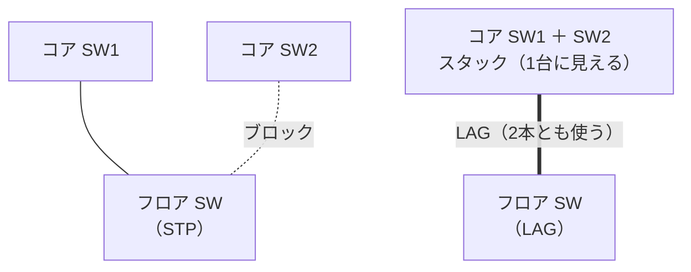

# L2-REDUNDANCY.md
## L2 冗長化 暗記シート

***

## ひとことで

スイッチ間の配線を二重にすると、**輪（ループ）**ができる。イーサネットのフレームには **TTL がない**ので、ループがあるとフレームが**永久に回り続ける**。L2 の冗長化は、「**経路は二重にしつつ、ループは作らない**」ための技術。

| 技術 | 考え方 | 予備の経路 |
| --- | --- | --- |
| **STP / RSTP** | 輪の一部の**ポートをブロック**して、木の形（ツリー）にする | ふだんは**使わない**（障害時に開く） |
| **リンクアグリゲーション** | 複数のリンクを**束ねて1本**に見せる | **全部使う** |
| **スタック** | 複数のスイッチを**1台**に見せる | **全部使う**（リンクアグリゲーションと組み合わせる） |

## ループで起きること

| 現象 | 内容 |
| --- | --- |
| **ブロードキャストストーム** | ブロードキャストフレームが**回り続けて増え**、帯域とスイッチの CPU を使い切る → **ネットワーク全体が通信不能** |
| **MAC アドレステーブルの不安定** | 同じ送信元 MAC アドレスのフレームが**別々のポートから届き**、学習先が次々に書き換わる |
| フレームの重複 | 同じフレームが宛先に複数届く |

- ループは**同じ VLAN（ブロードキャストドメイン）の中全体**に影響する
- 利用者が**持ち込んだハブ**や、**ケーブルの挿し間違い**でも起きる

## STP（スパニングツリープロトコル）

スイッチ同士が **BPDU**（Bridge Protocol Data Unit）を交換して、**ブロックするポートを自動で決める**（IEEE 802.1D）。

| 用語 | 内容 |
| --- | --- |
| **BPDU** | スイッチが **2秒ごと**に送る制御フレーム。宛先はマルチキャスト MAC アドレス（01-80-C2-00-00-00） |
| **ブリッジ ID** | **ブリッジ優先度（2Byte）＋ MAC アドレス（6Byte）**。優先度の初期値は **32768**、4096 刻みで設定する |
| **ルートブリッジ** | ツリーの根になるスイッチ。**ブリッジ ID が最も小さい**スイッチ |
| **パスコスト** | リンクの速度で決まる値。**速いほど小さい**（10Mbps ＝ 100、100Mbps ＝ 19、1Gbps ＝ 4、10Gbps ＝ 2） |
| ルートパスコスト | ルートブリッジまでのパスコストの**合計** |

### ポートの役割の決め方

| 順 | 決めるもの | 選び方 |
| --- | --- | --- |
| 1 | **ルートブリッジ** | **ブリッジ ID が最小**のスイッチ（優先度が同じなら MAC アドレスが小さいほう） |
| 2 | **ルートポート**（RP） | ルートブリッジ以外の**各スイッチに1つ**。**ルートブリッジに最も近い**（ルートパスコストが最小の）ポート |
| 3 | **指定ポート**（DP） | **各リンク（セグメント）に1つ**。そのリンクで、ルートブリッジに最も近い側のポート。**ルートブリッジのポートはすべて指定ポート** |
| 4 | **非指定ポート** | 残ったポート。**ブロッキング**（フレームを転送しない） |

- コストが同じときは、**送信元のブリッジ ID が小さいほう → ポート ID が小さいほう**の順に優先する

- リンクはすべて 1Gbps。線のラベルは「上側のスイッチのポート ― 下側のスイッチのポート」
- SW2 と SW3 の間は、どちらもルートブリッジまでのコストが同じ（4）→ **ブリッジ ID が小さい SW2 側が指定ポート**、SW3 側が**非指定ポート（ブロッキング）**
- SW1 と SW3 の間が切れると、SW3 のブロッキングポートが**開いて**、SW2 経由で通信を続ける

### ポートの状態と収束時間

| 状態 | BPDU の受信 | MAC アドレスの学習 | フレームの転送 | 時間 |
| --- | --- | --- | --- | --- |
| **ブロッキング** | する | しない | しない | 最大 20秒（最大エージ） |
| **リスニング** | する | しない | しない | 15秒（転送遅延） |
| **ラーニング** | する | **する** | しない | 15秒（転送遅延） |
| **フォワーディング** | する | する | **する** | |

- 障害が起きてから通信が戻るまで、**最大 50秒**（20 ＋ 15 ＋ 15）かかる → **STP の最大の弱点**
- リンクがつながった直後のポートも、リスニングとラーニングを通るので、**30秒間は通信できない**
- 構成が変わると、スイッチは **MAC アドレステーブルを早く消して**（保持時間を 300秒 → 15秒に短縮）学習し直す

### RSTP と MSTP

| 規格 | 内容 |
| --- | --- |
| **RSTP**（IEEE 802.1w） | STP を高速にしたもの。**数秒以内**に切り替わる。STP と互換性がある |
| **MSTP**（IEEE 802.1s） | **複数の VLAN を1つのグループ（インスタンス）**にまとめ、**インスタンスごとにツリー**を作る |

**RSTP が速い理由**

- ブロックするポートに、あらかじめ**予備の役割**を決めておく（**代替ポート** ＝ ルートポートの予備、**バックアップポート** ＝ 指定ポートの予備）→ 障害時に**すぐ切り替える**
- タイマを待たず、隣のスイッチと**直接やり取り**（プロポーザルとアグリーメント）して、ポートを開く
- 状態は3つ: **ディスカーディング**（転送も学習もしない）、ラーニング、フォワーディング

**RSTP でも速く切り替わらない場合**（プロポーザルとアグリーメントは、相手と1対1でやり取りできるリンクでしか使えない）

| ポートの種類 | 条件 | 切替え |
| --- | --- | --- |
| **ポイントツーポイント** | スイッチ同士を**全二重**でつないだリンク | **速い**（プロポーザルとアグリーメント） |
| **エッジポート** | PC やサーバをつなぐポート。**BPDU を受け取ると、ふつうのポートに戻る** | **すぐフォワーディング** |
| 共有リンク | **半二重**（ハブの先など） | **遅い**（STP と同じタイマ） |
| **STP の機器とつながるポート** | 相手が古い STP だけに対応 | **遅い**（STP のやり方に合わせる） |

- 「STP と互換性がある」＝ **混ぜて使えるが、その部分は STP と同じ速さ（最大 50秒）になる**

| 障害の種類 | STP | RSTP |
| --- | --- | --- |
| **自分のポートのリンクが切れた** | 最大 50秒 | **すぐ気付いて、すぐ切り替える** |
| 隣のスイッチの異常（リンクは上がったまま） | BPDU が **20秒**届かなかったら | BPDU が **3回（6秒）**届かなかったら |

- 構成が変わると、RSTP は **MAC アドレステーブルをすぐに消して**、学習し直させる

**MSTP の利点**

- VLAN ごとにツリーを分けられるので、**VLAN 10 は左の経路、VLAN 20 は右の経路**のように**負荷分散**できる（STP・RSTP は全 VLAN で1つのツリーなので、ブロックされたリンクは**まったく使われない**）
- VLAN ごとに1つずつツリーを作る方式より、スイッチの**負荷が小さい**

### STP と組み合わせる機能

| 機能 | 設定する場所 | 内容 |
| --- | --- | --- |
| **エッジポート** | **PC やサーバをつなぐポート** | リスニングとラーニングを飛ばして、**すぐフォワーディング**にする。つないで 30秒待つ間に **DHCP がタイムアウトする**のを防ぐ |
| **BPDU ガード** | エッジポート | **BPDU を受信したらポートを閉じる**。利用者が勝手にスイッチをつないで、ループや構成の変化が起きるのを防ぐ |
| **ルートガード** | 下位のスイッチをつなぐポート | **今より優先度の高い BPDU を受信したらブロック**する。ルートブリッジを**奪われる**のを防ぐ |
| 片方向リンクの検知 | スイッチ間のポート | 光ファイバの**片方向だけの断線**で BPDU が届かなくなり、ブロッキングポートが誤って開くのを防ぐ |

### ルートブリッジの設計

- ルートブリッジは**コアスイッチ**にする。**優先度を小さい値に設定**して明示的に決める（初期値のままだと、MAC アドレスが小さい**古い機器**がルートブリッジになることがある）
- 2台目のコアスイッチを**次に小さい優先度**にして、予備のルートブリッジにする
- **VRRP のマスタと同じ機器**にする（別だと通信が遠回りする）

## リンクアグリゲーション

**複数の物理リンクを束ねて、1本の論理リンクとして扱う**（IEEE 802.1AX、以前は 802.3ad）。LAG とも呼ぶ。

| 効果 | 内容 |
| --- | --- |
| **帯域が増える** | 1Gbps × 2本なら、合計で 2Gbps |
| **冗長化** | 1本が切れても、**残りのリンクで通信を続ける**（切替えが速い） |
| **STP でブロックされない** | STP からは**1本のリンク**に見えるので、全部のリンクを使える |

| 方式 | 内容 |
| --- | --- |
| スタティック | 両方のスイッチで**手動で**束ねる。相手の状態を確認しない |
| **LACP** | 制御フレーム（LACPDU）を交換して**自動で**束ねる。**設定の誤りや相手の異常を検知**して、そのリンクを外せる |

- 束ねるリンクは、**速度・全二重・VLAN の設定をそろえる**

### フレームの振り分け

- フレームは、**送信元と宛先の MAC アドレス・IP アドレス・ポート番号**から計算した値（ハッシュ値）で、**どのリンクに流すか**を決める
- **同じ通信（フロー）は、いつも同じリンク**を通る → フレームの**順序が入れ替わらない**
- そのため、**1つの通信の速度は、リンク1本分が上限**（1Gbps × 2本でも、1つの通信は 1Gbps まで）
- 通信の組合せが少ないと、**特定のリンクに偏る**（例: サーバ1台とバックアップ装置1台の間）

## スタック

**複数のスイッチを専用のケーブルでつなぎ、論理的に1台のスイッチ**として動かす。

| 利点 | 内容 |
| --- | --- |
| 管理が楽 | **設定も IP アドレスも1つ**。1台として監視・設定できる |
| **STP に頼らない** | スタックした2台へ**またがるリンクアグリゲーション**を組める → ループができず、**ブロックされるリンクがない** |
| 切替えが速い | 1台が故障しても、リンクアグリゲーションの**残りのリンク**ですぐに続けられる |

- 左: STP の構成。2本のうち**1本はブロック**されて使われない。障害時の切替えに時間がかかる
- 右: スタック ＋ リンクアグリゲーション。**2本とも使え**、切替えも速い

| 注意点 | 内容 |
| --- | --- |
| スタックケーブルの断線 | 2台が**別々に動き出す**（同じ IP アドレス・同じ設定の機器が2台になる）→ スタックの接続を**二重化（リング状）**にする |
| ファームウェアの更新 | **全体の再起動**が必要になり、通信が止まる機種がある |
| 機種の制限 | 同じシリーズの機器同士でないと組めない |

- スタックを使わずに、2台のスイッチへまたがるリンクアグリゲーションを組む機能もある（MC-LAG、マルチシャーシ リンクアグリゲーション）

## STP 以外のループ対策

| 機能 | 内容 |
| --- | --- |
| **ループ検知** | スイッチが**検知用のフレーム**を送り、**自分に戻ってきたら**ループと判断してポートを閉じる。BPDU を通さないハブの先のループも見つけられる |
| **ストームコントロール** | ブロードキャスト（やマルチキャスト）の量が**しきい値を超えたら捨てる**。ループの被害を小さくする |
| BPDU ガード | PC 用のポートに、スイッチをつながせない |

## 試験でよく問われるポイント

### ループと STP

| 論点 | 覚えること |
| --- | --- |
| ループで起きること | **ブロードキャストストーム**が起き、同じ VLAN 全体が通信できなくなる |
| ルートブリッジ | **ブリッジ ID が最小**。優先度を小さくして、コアスイッチに決めておく |
| ポートの役割 | **ルートポートは各スイッチに1つ**、**指定ポートは各リンクに1つ**。残りがブロッキング |
| 切替えの時間 | STP は**最大 50秒**、**RSTP は数秒以内**。ただし RSTP でも、**半二重のリンクや STP の機器が混ざる部分は遅い** |
| エッジポート | **PC をつなぐポート**に設定する。**BPDU ガード**と組み合わせる |
| MSTP | VLAN のグループごとにツリーを作り、**負荷分散**できる |

### リンクアグリゲーション・スタック

| 論点 | 覚えること |
| --- | --- |
| 振り分け | **フロー単位**。**1つの通信の速度は1本分** |
| スタック ＋ リンクアグリゲーション | **STP に頼らず、全リンクを使える** |

### 答えの型

| 問われ方 | 答えの型 |
| --- | --- |
| ループができると VLAN 全体が通信できなくなる理由 | 「ブロードキャストフレームが**回り続けて増え**、帯域とスイッチの処理能力を使い切るから」 |
| ルートブリッジを優先度で明示的に決める理由 | 「意図しないスイッチがルートブリッジになり、**通信の経路が遠回り**になるのを防ぐため」 |
| PC をつなぐポートをエッジポートにする理由 | 「ポートが**すぐに転送を始められる**ようにし、PC の起動時に DHCP などが失敗するのを防ぐため」 |
| PC 用のポートに BPDU ガードを設定する理由 | 「利用者が**スイッチを勝手につなぐ**ことによる、ループや STP の再計算を防ぐため」 |
| STP と比べた RSTP の利点 | 「障害時の**切替え時間が短い**（通信断が数秒以内で済む）」 |
| スタティックと比べた LACP の利点 | 「**対向の設定誤りやリンクの異常を検知**して、そのリンクを自動で外せる」 |
| 2本束ねても1つの通信が1本分より速くならない理由 | 「フロー単位で振り分けるので、**1つの通信は1本のリンクしか使わない**から」 |
| STP と比べた、スタック ＋ リンクアグリゲーションの利点 | 「ループができず、**すべてのリンクを使える**。障害時の切替えも速い」 |
| STP で冗長化すると帯域がむだになる理由 | 「ブロッキングポートのつながるリンクは、**ふだん通信に使われない**から」 |

関連: [vxlan.md](vxlan.md) / [ieee802x.md](ieee802x.md) / [../redundancy/vrrp.md](../redundancy/vrrp.md) / [../routing/reliability.md](../routing/reliability.md)
