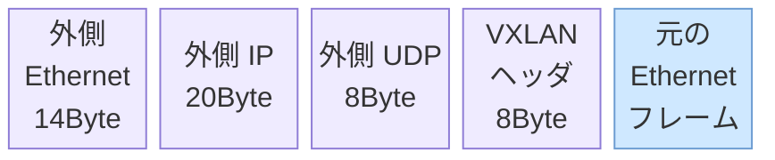
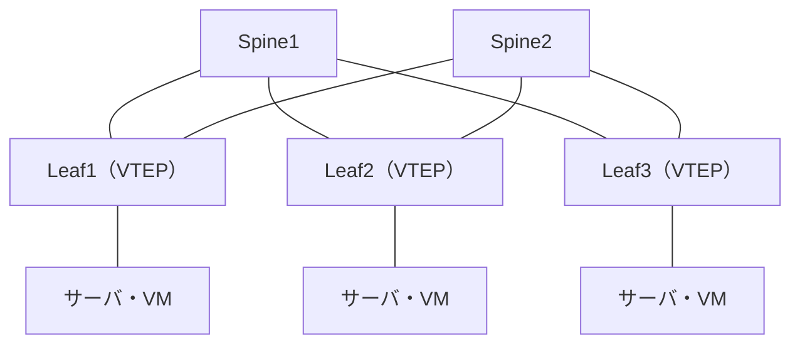

# VXLAN.md
## VXLAN 暗記シート

***

基本のしくみ（VNI・VTEP・Flood & Learn・EVPN の概要）は [vlan-vxlan.md](vlan-vxlan.md) も参照。

## ひとことで

**VXLAN**（RFC 7348）は、**L2 フレームを UDP/IP でカプセル化して、L3 ネットワーク（アンダーレイ）の上に仮想的な L2 ネットワーク（オーバーレイ）を作る**トンネリング技術。

| 用語 | 意味 |
| --- | --- |
| **アンダーレイ** | 土台になる物理的な **L3 ネットワーク**（Leaf-Spine を OSPF・BGP などでつなぐ） |
| **オーバーレイ** | アンダーレイの上に作る**論理的な L2 ネットワーク**（VXLAN のトンネル） |
| **VTEP** | VXLAN トンネルの**入口・出口**。カプセル化と非カプセル化を行う（Leaf スイッチや仮想スイッチ） |
| **VNI** | VXLAN の**ネットワーク識別子**。**24bit**（VLAN ID にあたる） |
| **BUM** | **B**roadcast・**U**nknown Unicast・**M**ulticast。宛先が特定できずフラッディングされる通信 |

## VLAN との比較

| 項目 | VLAN（IEEE 802.1Q） | VXLAN |
| --- | --- | --- |
| 識別子 | VID **12bit** | VNI **24bit** |
| 識別できる数 | **4,094**（0 と 4095 は予約） | **約1,677万**（2^24 = 16,777,216） |
| L2 を延ばせる範囲 | L2 でつながった範囲だけ | **L3 を越えて**どこへでも（拠点・データセンター間も） |
| ループ対策 | **STP** でリンクをブロック（使えないリンクが出る） | アンダーレイは L3 なので **STP 不要**、**ECMP で全リンクを使える** |
| 主な用途 | 企業 LAN のセグメント分割 | **データセンター**、マルチテナント、VM の移動（ライブマイグレーション） |

## カプセル化とヘッダ

- 紫の4つが VXLAN で付け足す部分（14 ＋ 20 ＋ 8 ＋ 8 ＝ **50Byte**）、水色が元のフレーム（宛先 MAC 〜 データ）

| ヘッダ | 中身 | ポイント |
| --- | --- | --- |
| 外側 Ethernet | 次ホップ（アンダーレイのルータ）の MAC | ホップごとに書き換わる |
| **外側 IP** | **送信元 = 自分の VTEP の IP、宛先 = 相手の VTEP の IP** | BUM を Flood & Learn で送るときは宛先が**マルチキャストグループ** |
| **外側 UDP** | **宛先ポート 4789**（IANA 登録） | **送信元ポートは元のフレームのヘッダから計算したハッシュ値** → アンダーレイの **ECMP で負荷分散**される |
| **VXLAN ヘッダ（8Byte）** | Flags（8bit、I フラグ = 1 で VNI 有効）・予約・**VNI（24bit）**・予約 | VNI でどの仮想 L2 かを区別 |
| 元のフレーム | 宛先 MAC・送信元 MAC・タイプ・データ | 元の **802.1Q タグは通常外して**から包む（FCS は含めない） |

- 外側 IP が IPv6 なら **70Byte**、外側に VLAN タグが付くとさらに **+4Byte**
- 外側 UDP のチェックサムは IPv4 では通常 **0**（計算しない）

### MTU の計算（よく出る）

カプセル化で **50Byte 増える**ので、アンダーレイの MTU を大きくしておかないと、元の 1500Byte のパケットが通らない。

| 項目 | Byte |
| --- | --- |
| 元の IP パケット | 1500 |
| ＋ 元の Ethernet ヘッダ | 14 |
| ＋ VXLAN ヘッダ | 8 |
| ＋ 外側 UDP | 8 |
| ＋ 外側 IP | 20 |
| **＝ 外側 IP パケット** | **1550** |

→ アンダーレイの **IP MTU は 1550 以上**が必要

- 実際は余裕を持って **ジャンボフレーム（9000 など）** に設定する
- VTEP は VXLAN パケットを**フラグメントしない**（RFC 7348）→ MTU 不足だと**大きいパケットだけ通らない**（ping は通るのにファイル転送が失敗する、など）
- アンダーレイの MTU を上げられないときは、**VM・サーバ側の MTU を 1450 に下げる**

### 送信元 UDP ポートのハッシュ

- 同じ VTEP 同士の通信は外側の IP アドレスがいつも同じなので、そのままでは ECMP で**1本の経路に偏る**
- 元のフレームの MAC・IP・ポート番号から**送信元 UDP ポートを計算**することで、**フローごとに違う経路**に振り分けられる（エントロピー）

## VTEP の設計ポイント

| ポイント | 理由 |
| --- | --- |
| **VTEP の IP アドレスはループバックインタフェースに付ける** | 物理インタフェースが1つ故障しても**ほかの経路で VTEP に届き続ける**（OSPF のルータIDも同様） |
| ループバックのアドレスを**アンダーレイのルーティングで広告**する | 相手の VTEP まで外側 IP で届くようにするため |
| **VLAN と VNI の対応付け**は VTEP ごとに設定 | VLAN ID は**その Leaf の中だけで意味を持つ**。Leaf A の VLAN 10 と Leaf B の VLAN 20 を同じ VNI 10010 につなぐこともできる |
| 1つの Leaf の中で使える VLAN は 4094 まで | VNI は 1677万でも、**サーバとの接続は VLAN** なので Leaf ごとの上限は残る |

## Leaf-Spine 構成（アンダーレイ）

- **Spine**: Leaf 同士の通信を中継する（VXLAN の中身は見ない）／ **Leaf**: VTEP。サーバ・VM を収容する

| 項目 | 内容 |
| --- | --- |
| 接続 | **すべての Leaf がすべての Spine に接続**（Leaf 同士・Spine 同士はつながない） |
| 経路数 | どの Leaf 間も **Spine の数だけ等コスト経路**がある → **ECMP** で負荷分散・冗長化 |
| ホップ数 | どの Leaf 間も **Leaf → Spine → Leaf** で一定（遅延が読みやすい） |
| 拡張 | サーバが増えたら **Leaf を足す**、帯域が足りなければ **Spine を足す**（スケールアウト） |
| ルーティング | OSPF・IS-IS・eBGP など。VTEP のループバックを広告する |
| Spine の役割 | 外側 IP を見て転送するだけ。**VTEP ではない**（EVPN では BGP の**ルートリフレクタ**を兼ねることが多い） |
| 必要リンク数 | **Leaf 数 × Spine 数** |

データセンターではサーバ間の通信（**東西トラフィック**）が多いため、従来の3階層（コア・ディストリビューション・アクセス）より Leaf-Spine が向いている。

## コントロールプレーン（宛先 VTEP の学び方）

VXLAN 自体はデータを運ぶ**データプレーン**。「どの MAC アドレスがどの VTEP の先にいるか」を知る方法が別に必要。

| 項目 | **Flood & Learn**（マルチキャスト） | **EVPN**（MP-BGP） |
| --- | --- | --- |
| MAC と VTEP の対応の学習 | **データプレーンで学習**（届いたパケットの元の送信元 MAC と外側の送信元 IP を覚える） | **BGP で広告し合う**（コントロールプレーン） |
| BUM の転送 | **VNI ごとのマルチキャストグループ**へ送る | マルチキャスト、または **Ingress Replication**（必要な VTEP にユニキャストで複製） |
| アンダーレイの要件 | **IP マルチキャスト（PIM）が必要** | マルチキャスト不要にできる |
| 初回通信 | 宛先が分からないので**フラッディング** | 事前に広告済みなので**フラッディングが少ない** |
| ARP | ブロードキャストが全 VTEP に届く | **ARP 抑制**（VTEP が代わりに応答） |
| 規模 | 小規模向け | **大規模向け**（現在の主流） |

- **Ingress Replication**（ヘッドエンドレプリケーション）: BUM を受けた VTEP が、**同じ VNI を持つ VTEP の数だけユニキャストでコピー**して送る。マルチキャスト不要だが、VTEP が多いと送信量が増える

## EVPN の要点

| 項目 | 内容 |
| --- | --- |
| 使うプロトコル | **MP-BGP**（BGP のマルチプロトコル拡張、L2VPN/EVPN アドレスファミリ） |
| 構成 | 各 Leaf（VTEP）が **iBGP で Spine（ルートリフレクタ）とピア**を張る → **フルメッシュ不要** |
| RD（Route Distinguisher） | 同じ MAC・プレフィックスでもテナント別に**区別して扱う**ための値 |
| RT（Route Target） | どの VNI・VRF に**取り込むか（import / export）**を決める値 |
| **ARP 抑制** | Type 2 で覚えた MAC・IP の対応を使い、**VTEP がローカルで ARP に応答** → BUM を減らす |
| MAC モビリティ | VM が別の Leaf に移ると、新しい Leaf がシーケンス番号を上げて広告し直す |

### EVPN のルートタイプ

| Type | 名前 | 用途 |
| --- | --- | --- |
| 1 | Ethernet Auto-Discovery | **マルチホーミング**（ESI）。障害時の一括切替え、複数 Leaf への負荷分散 |
| **2** | **MAC/IP Advertisement** | **ホストの MAC（と IP）を広告**。MAC 学習と ARP 抑制の元になる |
| **3** | **Inclusive Multicast Ethernet Tag** | **VNI ごとに参加している VTEP を広告** → BUM の送り先（Ingress Replication の送り先リスト） |
| 4 | Ethernet Segment | 同じ ESI を持つ Leaf の発見、**DF（BUM を代表で転送する Leaf）の選出** |
| 5 | IP Prefix | **IP プレフィックス**（サブネット・外部経路）を広告。L3 の通信に使う |

### マルチホーミングと ESI

- サーバを **2台の Leaf に LAG で接続**して冗長化する
- 2台の Leaf でその LAG に**同じ ESI（Ethernet Segment Identifier、10Byte）**を設定 → サーバからは**1台のスイッチと LAG を組んでいる**ように見える
- **DF（Designated Forwarder）**を選び、BUM を**どちらか1台だけ**がサーバへ送る（二重に届かないように）
- 似た方式: スタック接続や MLAG（2台を論理的に1台に見せ、**同じ VTEP アドレス（エニーキャスト）**を共有する）

## VXLAN 間のルーティング

| 用語 | 内容 |
| --- | --- |
| **L2VNI** | 1つの L2 セグメント（ブロードキャストドメイン）を表す VNI |
| **L3VNI** | テナント（**VRF**）ごとのルーティング用の VNI |
| **エニーキャストゲートウェイ** | **すべての Leaf に同じデフォルトゲートウェイの IP・MAC**を設定 → 最寄りの Leaf で即ルーティング。**VM が移動してもゲートウェイ設定を変えなくてよい** |
| 非対称 IRB | 送信側の Leaf だけでルーティング。**全 Leaf に全 VNI の設定が必要** |
| 対称 IRB | 送信側・受信側の両方の Leaf でルーティングし、間は **L3VNI** で運ぶ。大規模向け |

## マルチテナント

- テナントごとに **VNI（と VRF）を分ける** → **IP アドレスが重複していても混ざらない**
- 例）顧客 A は VNI 10010、顧客 B は VNI 20010。どちらも 10.0.0.0/24 を使える

## ほかのオーバーレイ技術

| 技術 | カプセル化 | 識別子 |
| --- | --- | --- |
| **VXLAN** | **UDP 4789** | VNI 24bit |
| NVGRE | GRE | VSID 24bit |
| Geneve | UDP 6081（可変長のオプションを持てる） | VNI 24bit |

## セキュリティ・運用

| 論点 | ポイント |
| --- | --- |
| 暗号化 | **VXLAN には暗号化・認証の機能がない** → 拠点間などで必要なら **IPsec や MACsec** と組み合わせる |
| なりすまし | VXLAN の UDP 4789 は、信頼できる VTEP からだけ受け付けるよう **ACL で制限** |
| ブロードキャストドメインの拡大 | L2 を広く延ばすと **BUM が広範囲に流れる** → EVPN の ARP 抑制で減らす |
| 障害の切り分け | オーバーレイ（VNI・MAC 学習）とアンダーレイ（経路・MTU）を**分けて確認**する |
| 可視化 | 外側ヘッダだけでは中身の通信が分からない。監視機器が VXLAN を解釈できるか確認 |

## 計算・暗記の早見表

| 項目 | 値 |
| --- | --- |
| VNI のビット数 / 数 | **24bit / 16,777,216（約1,677万）** |
| VLAN ID のビット数 / 使える数 | 12bit / 4,094 |
| VXLAN ヘッダ | **8Byte** |
| 増えるサイズ（外側 IPv4） | **50Byte**（14 ＋ 20 ＋ 8 ＋ 8） |
| アンダーレイに必要な IP MTU | **1550Byte 以上**（元が 1500 のとき） |
| UDP ポート | **4789** |
| Leaf-Spine のリンク数 | **Leaf 数 × Spine 数** |
| Leaf 間の等コスト経路数 | **Spine の数** |

## 試験でよく問われるポイント

- **VNI は 24bit、約1,677万**（VLAN の 12bit・4,094 と比べる）
- **UDP 4789**。**送信元ポートはハッシュ値**で ECMP の負荷分散に使われる
- **50Byte 増える** → **アンダーレイの MTU 不足**で大きいパケットだけ通らない
- **VTEP の IP はループバック**に付ける（物理 IF の障害に強い）
- **Leaf-Spine ＋ ECMP**、STP が要らない、Spine は VTEP ではない
- **Flood & Learn はマルチキャスト（PIM）が必要**、**EVPN は MP-BGP**でフラッディングを減らす
- EVPN の **Type 2（MAC/IP）・Type 3（BUM の送り先）**、**ARP 抑制**
- **ESI**: 2台の Leaf への LAG に付ける共通の識別子。BUM は DF だけが送る
- **iBGP のフルメッシュを避けるため Spine をルートリフレクタ**にする
- **エニーキャストゲートウェイ**で VM が移動してもゲートウェイが変わらない
- テナントごとに VNI を分ければ **IP アドレスが重複してもよい**

関連: [vlan-vxlan.md](vlan-vxlan.md) / [lag-stp.md](lag-stp.md) / [../routing/bgp.md](../routing/bgp.md) / [../routing/reliability.md](../routing/reliability.md) / [../routing/multicast.md](../routing/multicast.md)
