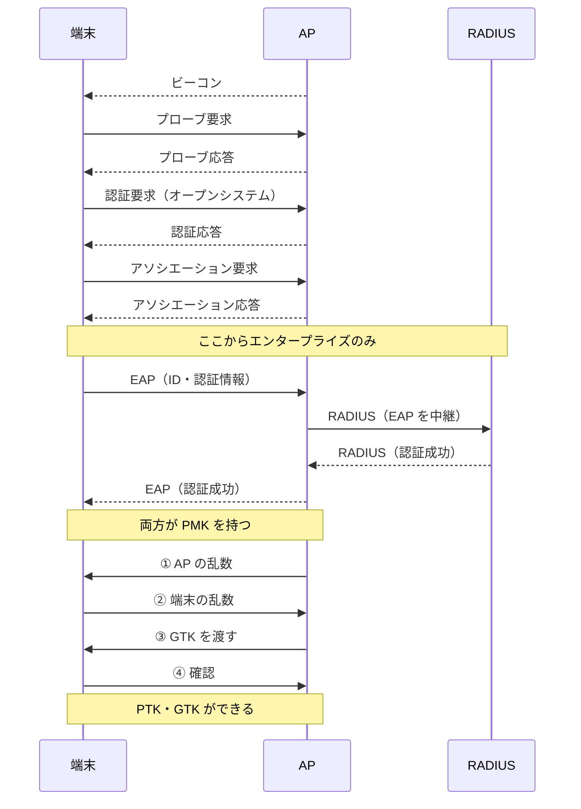

# WIFI-CHEATSHEET.md
## 無線LAN 暗記シート

***

## 規格

| 規格 | 名称 | 周波数帯 | 最大速度 | 主な技術 |
| --- | --- | --- | --- | --- |
| 802.11b | ― | 2.4GHz | 11Mbps | DSSS |
| 802.11a | ― | **5GHz** | 54Mbps | OFDM |
| 802.11g | ― | 2.4GHz | 54Mbps | OFDM |
| **802.11n** | **Wi-Fi 4** | **2.4GHz / 5GHz** | 600Mbps | **MIMO**（4ストリーム）、**チャネルボンディング（40MHz）**、フレームアグリゲーション |
| **802.11ac** | **Wi-Fi 5** | **5GHz のみ** | 6.9Gbps | 80/160MHz 幅、**256QAM**、8ストリーム、**MU-MIMO（下り）** |
| **802.11ax** | **Wi-Fi 6 / 6E** | 2.4GHz / 5GHz（6E は **6GHz** も） | 9.6Gbps | **OFDMA**、MU-MIMO（上り・下り）、**1024QAM**、BSS カラーリング、TWT |
| 802.11be | Wi-Fi 7 | 2.4GHz / 5GHz / 6GHz | 約46Gbps | 320MHz 幅、4096QAM、**MLO**（複数の周波数帯を同時に使う） |

- **2.4GHz 帯を使う**: 802.11b/g/n/ax、**Bluetooth**、電子レンジ → **干渉しやすい**
- **802.11ac は 5GHz 帯だけ**（2.4GHz の端末は 11n 以前で接続する）
- 無線は**半二重**で制御のオーバーヘッドも大きいので、**実効速度はリンク速度の半分程度以下**。しかも **AP につながる端末で帯域を分け合う**

| 用語 | 意味 |
| --- | --- |
| **BSS** | **1台の AP** とそこにつながる端末の無線ネットワーク。識別子は **BSSID**（AP の MAC アドレスが使われることが多い） |
| **ESS** | **複数の BSS をまとめた**無線ネットワーク。識別子は **ESSID（SSID）**。複数の AP に**同じ SSID** を設定して作る → 同じ ESS の中を移るのが**ローミング** |
| ビーコン | AP が定期的に出す信号。**AP の存在と SSID** を端末に知らせる |

## 周波数帯とチャネル

| 周波数帯 | 特徴 |
| --- | --- |
| **2.4GHz** | 遠くまで届き障害物に強い。**チャネルが少なく干渉が多い**（電子レンジ・Bluetooth） |
| **5GHz** | **チャネルが多く干渉が少ない**、高速。障害物に弱い。**W53・W56 は DFS が必要** |
| 6GHz | さらに干渉が少ない（Wi-Fi 6E 以降の端末だけが使える）。障害物にもっと弱い |

### 2.4GHz 帯

- 1〜13ch（5MHz 間隔）。**隣のチャネルと周波数が重なる**
- **重ならない組合せは 1・6・11**（日本で 20MHz 幅なら 1・5・9・13 の4つ）
- 隣り合う AP は**重ならないチャネル**にする

### 5GHz 帯（日本）

| グループ | チャネル | 屋外 | DFS | ポイント |
| --- | --- | --- | --- | --- |
| **W52** | 36・40・44・48 | 原則屋内のみ | **不要** | **レーダーの影響を受けない** → IP 電話など通信断を避けたい用途 |
| **W53** | 52・56・60・64 | **屋内のみ** | **必要** | |
| **W56** | 100〜144 | **使える** | **必要** | チャネル数が多い |

### DFS（Dynamic Frequency Selection）

- W53・W56 は**気象レーダーなどと同じ周波数**を使う
- AP は**使い始める前に1分間レーダーを監視**し、**運用中にレーダーを検知したら別のチャネルへ移る**（移った先でも1分監視）
- → **通信が途切れる** / 検知したチャネルは**30分間使えない**
- 対策: 通信断が困る用途は **W52 を使う**、DFS の影響を受けにくい設計にする

### チャネルボンディング

- **20MHz のチャネルを束ねて 40・80・160MHz 幅**にし、速度を上げる
- 束ねるほど**使えるチャネル数が減り、AP 同士が干渉しやすい** → AP が多い環境では 20/40MHz に抑える
- 2.4GHz 帯では 40MHz でもチャネルが足りないので**使わないのが一般的**

## 高速化の技術

| 技術 | 内容 |
| --- | --- |
| **MIMO** | **複数のアンテナ**で別々のデータを同時に送る（**空間ストリーム**）。ストリーム数に比例して速くなる |
| **MU-MIMO** | **複数の端末と同時に**別々のストリームで通信する（11ac は下りのみ、11ax は上りも） |
| **OFDM** | データを**直交する複数のサブキャリア**に分けて並行に送る |
| **OFDMA** | サブキャリアを**複数の端末で分け合う**（11ax）→ 小さなパケットの端末が多い環境で効率が良い |
| **チャネルボンディング** | チャネル幅を広げる |
| **QAM**（多値変調） | 1回で送るビット数を増やす（256QAM = 8bit、1024QAM = 10bit）。電波が強い近距離でだけ使える |
| フレームアグリゲーション | 複数のフレームを**まとめて送り**、制御のオーバーヘッドを減らす |
| ビームフォーミング | 端末の方向に電波を集中させる |
| BSS カラーリング（11ax） | 隣の BSS の電波を色で見分け、**同じチャネルでも送信を控えすぎない** |
| TWT（11ax） | 端末の起きる時刻を決めて**省電力**にする（IoT 向け） |

**802.11ac の速度を決める要素**: **チャネル幅（80MHz など）** と **アンテナ本数（ストリーム数）**、変調方式

### OFDM と OFDMA の違い

どちらもチャネルを細かいサブキャリアに分けて送る。違いは**同時に何台の端末へ送るか**。

| 項目 | OFDM（11a/g/n/ac） | OFDMA（11ax） |
| --- | --- | --- |
| サブキャリア | ある瞬間は**全部を1台の端末が使う** | **RU**（サブキャリアのまとまり）に分け、**複数の端末で同時に使う** |
| 複数端末への送り方 | **時間**で分ける（1台ずつ順番） | **周波数と時間**で分ける（同時に複数台） |
| 小さなパケットが多いとき | 小さなデータでも**チャネル全体を占有** → 待ちが増え効率が悪い | **少ない RU で済み**、残りをほかの端末が使う → **遅延が減り効率が上がる** |
| 向く環境 | 端末が少なく大きなデータを送る | **端末が多い**（オフィス、駅、IoT） |

例え: OFDM はトラックを**1台ずつ貸し切り**で走らせる。OFDMA は**1台の荷台を分けて**何人分もの荷物を一緒に運ぶ。

| 技術 | 複数の端末を何で分けるか |
| --- | --- |
| **OFDMA** | **周波数**（サブキャリア） |
| **MU-MIMO** | **空間**（アンテナ・ビーム） |

11ax はこの2つを組み合わせて使える。

## アクセス制御（CSMA/CA）

| 項目 | 内容 |
| --- | --- |
| **CSMA/CA** | 送信前に電波が空いているか確認し、**ランダムな待ち時間（バックオフ）を置いてから送る** → **衝突を避ける**。無線は送信中に**ほかの電波を受信できず**、有線の CSMA/CD のように衝突を検出できないので、**検出ではなく回避**する |
| **ACK** | 受信側が **ACK を返して届いたことを知らせる**。ACK が来なければ再送 |
| **隠れ端末問題** | **端末同士は互いの電波が届かない**が、AP には両方届く → 同時に送って AP で衝突する |
| **RTS / CTS** | 送信前に RTS（送信要求）を送り、AP が CTS（許可）を全員に返す → **ほかの端末は待つ**。隠れ端末問題の対策 |

## 接続の流れ

| 段階 | 内容 |
| --- | --- |
| 1. スキャン | AP が定期送信する**ビーコン**を受信（パッシブ）、または**プローブ要求・応答**（アクティブ） |
| 2. 認証 | **オープンシステム認証**（形式的なもの） |
| 3. アソシエーション | アソシエーション要求・応答で **AP に接続を確立** |
| 4. 802.1X 認証 | （エンタープライズのみ）**EAP** で利用者を認証し、**PMK** を作る |
| 5. 4ウェイハンドシェイク | **PMK** から通信用の暗号鍵（**PTK・GTK**）を作る |

- **PMK**: 暗号鍵のもと。パーソナルでは**パスフレーズと SSID** から、エンタープライズでは **802.1X 認証の結果**から作る
- **4ウェイハンドシェイク**: ①② で AP と端末が**乱数を交換**し、それぞれが **PMK と2つの乱数から同じ PTK を計算**する（PTK そのものは送らない）。③ で AP が **GTK を暗号化して渡し**、④ で端末が受け取りを確認する
- **PTK**: 端末ごとのユニキャスト用の鍵 / **GTK**: ブロードキャスト・マルチキャスト用の共通の鍵

### PTK と GTK を使い分ける理由

| | PTK | GTK |
| --- | --- | --- |
| 用途 | ユニキャスト（1対1） | ブロードキャスト・マルチキャスト（1対全員） |
| 鍵を持つのは | **その端末と AP だけ** | **同じ AP につながる全端末と AP** |
| 作り方 | **端末ごとに別**（4ウェイハンドシェイクで、PMK・双方の乱数・双方の MAC アドレスから生成） | AP が作り、全端末に配る |
| 理由 | ほかの端末は同じ電波を受信できるので、**端末ごとに鍵を変えて盗聴されないようにする** | **1回の送信で全員に届ける**ため、全端末が復号できる共通の鍵が必要 |

- 同じ PMK でも、端末が違えば**別の PTK** になる
- **WPA2 パーソナル（PSK）の弱点**: 全員が同じパスフレーズ（PMK のもと）を知っているので、**ほかの端末の4ウェイハンドシェイクを盗聴できれば、その端末の PTK を計算できる**
- **WPA3（SAE）**: PMK が端末ごとに別になるので、盗聴されてもほかの端末の PTK は計算できない（= **端末ごとの個別暗号化**）

**試験での答えの型**
- PTK と GTK を使い分ける理由 → **ユニキャストは端末ごとの鍵でほかの端末に盗聴されないようにし、ブロードキャスト・マルチキャストは1回の送信で全端末に届けるため共通の鍵を使う**
- PTK の作り方 → **PMK から、4ウェイハンドシェイクで端末ごとに作る**

## セキュリティ

### 暗号化方式

| 方式 | 暗号化 | 状態 |
| --- | --- | --- |
| WEP | RC4 | **使用禁止**（短時間で解読される） |
| WPA | **TKIP**（RC4 ベース） | 非推奨 |
| **WPA2** | **AES（CCMP）** | 広く使われている（4ウェイハンドシェイクに **KRACK** の脆弱性） |
| **WPA3** | AES（CCMP / GCMP） | **推奨**。PMF 必須 |

| モード | 認証 | 向き |
| --- | --- | --- |
| **パーソナル**（PSK / SAE） | **全員で同じパスフレーズ** | 家庭・小規模 |
| **エンタープライズ** | **IEEE 802.1X**（RADIUS サーバで**利用者ごと**に認証）、鍵は**動的に生成** | 企業 |

### WPA3 の改良点

| 改良 | 内容 |
| --- | --- |
| **SAE** | PSK に代わる鍵交換。**オフラインの辞書攻撃に強い**（通信を盗聴してもパスフレーズを総当たりできない）。過去の通信も解読されにくい（前方秘匿性） |
| **PMF**（802.11w）必須 | 管理フレームを保護 → **偽の切断（deauth）フレーム**による攻撃を防ぐ |
| 192bit セキュリティ（エンタープライズ） | より強い暗号の組合せ |
| OWE（Enhanced Open） | パスワードなしの公衆無線 LAN でも**通信を暗号化** |

### PMF（Protected Management Frames）

**PMF**（IEEE 802.11w）は、**管理フレームを暗号化・改ざん検知して、偽造を防ぐ**しくみ。**WPA2 では任意、WPA3 では必須**。

| フレームの種類 | 例 | PMF がないとき |
| --- | --- | --- |
| データフレーム | 実際の通信 | WPA2 で**保護される** |
| 制御フレーム | ACK、RTS / CTS | 保護されない |
| **管理フレーム** | ビーコン、プローブ、認証、アソシエーション、**切断**（Deauthentication・Disassociation） | **暗号化も改ざん検知もされない** → 中身を読めるうえ、**誰でも偽造できる**（送信元を確かめられない） |

- 攻撃者が **AP の MAC アドレスを名乗って切断のフレーム**を送ると、端末はそれを信じて切断される（**切断攻撃**、Deauth 攻撃）

| 切断攻撃の狙い | 内容 |
| --- | --- |
| 通信の妨害（DoS） | 切断のフレームを送り続けて、つながらないようにする |
| **パスフレーズの解読** | つなぎ直すときの**4ウェイハンドシェイクを盗聴**し、パスフレーズを総当たりで試す（WPA2 パーソナル） |
| **偽の AP へ誘導** | 本物から切断させ、同じ SSID の偽の AP（イービルツイン）につながせる |

- PMF では、接続した後の管理フレームに**4ウェイハンドシェイクで作った鍵**で保護を付ける → 端末は、**正しい鍵の付いていない切断のフレームを無視する**
- 守れるのは**接続した後**の管理フレームだけ。**ビーコンやプローブ要求・応答は守れない**（鍵ができる前に送るため）

### IEEE 802.1X と EAP

| 役割 | 機器 |
| --- | --- |
| **サプリカント** | 端末（PC・スマートフォン） |
| **オーセンティケータ** | **AP や WLC**（**RADIUS クライアント**として認証サーバに問い合わせる） |
| **認証サーバ** | **RADIUS サーバ**（UDP 1812 / アカウンティング 1813） |

| EAP の方式 | 端末の認証 | サーバの認証 | ポイント |
| --- | --- | --- | --- |
| **EAP-TLS** | **クライアント証明書** | サーバ証明書 | **最も安全**。端末ごとに証明書の配布が必要 |
| **PEAP** | **ID・パスワード**（TLS トンネルの中で） | サーバ証明書 | クライアント証明書が不要 |
| EAP-TTLS | ID・パスワードなど | サーバ証明書 | PEAP と似た方式 |
| EAP-MD5 | パスワード | **なし** | 相互認証できず鍵も作れない → **無線では使わない** |

- RADIUS から **VLAN を指定**して、**利用者ごとに接続する VLAN を変える**こともできる（ダイナミック VLAN）

### そのほかの対策と注意点

| 対策 | 内容 | 注意 |
| --- | --- | --- |
| **ステルス SSID** | ビーコンで SSID を知らせない | **SSID は暗号化されず**、端末のプローブ要求などから分かる → **単独では対策にならない** |
| **ANY 接続拒否** | **SSID を空にしたプローブ要求**（「どの SSID でもいい」という問合せ）に**応答しない** | ステルス SSID と組み合わせて使う。SSID を入れたプローブ要求は平文なので、**盗聴すれば SSID は分かる** → これも**単独では対策にならない** |
| **MAC アドレスフィルタ** | 登録した端末だけ接続 | MAC アドレスは**盗聴して偽装できる** |
| **プライバシセパレータ** | **同じ AP につながる端末同士の通信を禁止** | 公衆無線 LAN・ゲスト用で使う |
| **SSID ごとの VLAN** | 社員用・ゲスト用など、**SSID ごとに別の VLAN へ**つなぐ | ゲストは社内に入れない |
| 不正 AP の検知 | WLC や WIPS で、許可していない AP・なりすまし AP を見つける | |

## ローミング（ハンドオーバ）

| 項目 | 内容 |
| --- | --- |
| ローミング | 端末が移動して**接続する AP を切り替える**こと。**切り替えを決めるのは端末** |
| 条件 | 同じ **SSID**・同じ**認証方式** |
| IP アドレス | 同じ **VLAN（サブネット）**なら変わらない → AP 間で同じ VLAN にするか、WLC がトンネルで吸収する |
| 遅延の原因 | 802.1X の**再認証**に時間がかかる → IP 電話などが途切れる |
| 高速化 | **PMK キャッシュ**、**802.11r**（高速ローミング FT）、802.11k（近くの AP の情報）、802.11v（AP から移動を促す） |
| 設計 | 隣の AP とセルを**少し重ねる**（重ならないと通信が切れる） |

## WLC（無線 LAN コントローラ）

| 機能 | 内容 |
| --- | --- |
| **集中管理** | **多数の AP の設定・ファームウェアを一括**で配る |
| 電波の自動調整 | AP の**チャネルと送信出力を自動で調整**し、干渉を減らす |
| 監視 | AP の**死活監視**、端末の接続状況 |
| 認証 | 利用者の認証（RADIUS との連携）。ローミング時の認証を速くする |
| 不正 AP の検知 | 許可していない AP を見つける |
| 通信の流れ | AP と WLC の間は **CAPWAP** のトンネル。通信を **WLC に集める方式**と **AP から直接 LAN に流す方式**（ローカルスイッチング）がある |

- WLC が故障すると全 AP に影響 → **WLC も冗長化**する。クラウドで管理する方式もある

## 設計のポイント

| 論点 | ポイント |
| --- | --- |
| **サイトサーベイ** | 導入前に**電波の届く範囲・干渉・壁などの透過**を測って、AP の配置とチャネルを決める（導入後にも測定する） |
| チャネル設計 | **隣り合う AP は重ならないチャネル**。5GHz 帯を優先して使う（**バンドステアリング**で 5GHz 対応の端末を誘導） |
| AP の台数 | **1台の AP につながる端末数**と必要な帯域から決める（会議室など人が集まる場所は多めに） |
| 送信出力 | 強すぎると隣の AP と干渉する。セルを小さくして AP を増やすと全体の容量が増える |
| **DFS** | 通信断が困るなら **W52** |
| **PoE** | 11ax の AP は消費電力が大きく **PoE+（802.3at）以上**が必要なことが多い |
| 上位の回線 | 11ax の AP は 1Gbps を超えることがあり、**マルチギガ（2.5GBASE-T など）**のスイッチを使う |
| トライバンド | 2.4GHz と 5GHz 2系統（W52/W53 と W56）を同時に使う AP。端末を分散できる |

## IoT 向けの無線

| 規格 | 特徴 |
| --- | --- |
| **Bluetooth / BLE** | 2.4GHz、近距離。BLE は低消費電力 |
| **ZigBee** | **IEEE 802.15.4** を使う低消費電力の無線。センサネットワーク向け、メッシュ |
| **Wi-SUN** | **920MHz 帯**、マルチホップで長距離。スマートメーター |
| **LPWA** | 低消費電力・広域。**LoRaWAN・Sigfox**（免許不要）、**LTE-M・NB-IoT**（携帯電話網） |
| ローカル 5G | 土地・建物の所有者が**免許を取って**自営の 5G 網を作る |

920MHz 帯は免許不要の **ISM バンド**のひとつで、2.4GHz 帯より干渉が少なく遠くまで届く。

## 試験でよく問われるポイント

### 電波・規格

| 論点 | 覚えること |
| --- | --- |
| 規格と周波数帯 | **802.11n は 2.4/5GHz**、**802.11ac は 5GHz のみ**、**802.11ax は OFDMA** |
| 2.4GHz 帯 | **Bluetooth・電子レンジと干渉**する。重ならないチャネルは **1・6・11** |
| DFS | **W53・W56 で必要**。レーダーを検知すると**チャネルが変わり、通信が途切れる** → 避けたいなら **W52** |
| チャネルボンディング | 速くなるが、**使えるチャネルが減る** |
| サイトサーベイ | 設置の前に、**電波の状況を調べる** |

### アクセス制御

| 論点 | 覚えること |
| --- | --- |
| CSMA/CA | 衝突を**検出できない**ので、**避ける**。届いたことは **ACK** で確かめる |
| 隠れ端末問題 | **RTS / CTS** で対策する |

### セキュリティ

| 論点 | 覚えること |
| --- | --- |
| WPA2 | **AES（CCMP）** |
| WPA3 | **SAE**（辞書攻撃に強い）＋ **PMF 必須**（偽の切断フレームを防ぐ） |
| 802.1X の役割 | 端末 ＝ **サプリカント**、AP ＝ **オーセンティケータ兼 RADIUS クライアント**、RADIUS サーバ |
| EAP の方式 | **EAP-TLS はクライアント証明書**、**PEAP は ID・パスワード**（サーバ証明書は両方で必要） |
| 単独では不十分な対策 | **ステルス SSID**、**MAC アドレスフィルタ** |
| 有効な対策 | **プライバシセパレータ**、**SSID ごとの VLAN** |

### 運用・移動

| 論点 | 覚えること |
| --- | --- |
| WLC | 集中管理、**チャネルと出力の自動調整**、死活監視、認証 |
| ローミング | 802.1X の**再認証に時間がかかる** → **PMK キャッシュ**、**802.11r** |

### 答えの型

| 問われ方 | 答えの型 |
| --- | --- |
| CSMA/CD ではなく CSMA/CA を使う理由 | 「無線は送信中に**ほかの電波を受信できず**、衝突を**検出できない**ので、**衝突を避ける**ため」 |
| RTS / CTS で防ぐ問題 | 「**隠れ端末**どうしの送信が、**AP で衝突する**のを防ぐため」 |
| 2.4GHz 帯で 1・6・11 チャネルを使う理由 | 「**チャネルが重ならず**、隣の AP と**干渉しない**から」 |
| W53・W56 で通信が途切れることがある理由 | 「**DFS** によって、**レーダーを検知**すると**チャネルを変更**するから」 |
| 不正接続対策として、ステルス SSID だけでは不十分な理由 | 「端末の**プローブ要求**などから、SSID は**盗聴で分かる**から」 |
| 不正接続対策として、MAC アドレスフィルタだけでは不十分な理由 | 「MAC アドレスは**盗聴して偽装**できるから」 |
| WPA2（PSK）と比べた WPA3（SAE）の利点 | 「通信を盗聴されても、**パスフレーズをオフラインで総当たりされない**」 |
| WPA3 で必須の PMF の目的 | 「**管理フレームを保護**し、**なりすました切断フレーム**による攻撃を防ぐ」 |
| ゲスト用の無線 LAN でプライバシセパレータを使う目的 | 「同じ AP に接続した**端末同士の通信を禁止**し、利用者間の攻撃を防ぐ」 |
| 802.1X 環境のローミングで通信が途切れる理由と対策 | 「AP を切り替えるたびに **802.1X 認証をやり直す**から」→「**PMK キャッシュ**や **802.11r** で認証を省く」 |
| パーソナル方式と比べたエンタープライズ方式の利点 | 「**利用者ごとに認証**でき、**特定の利用者だけを接続させなくする**などの管理ができる」 |

関連: [ieee802x.md](ieee802x.md) / [poe.md](poe.md) / [vxlan.md](vxlan.md) / [ethernet-types.md](ethernet-types.md)
