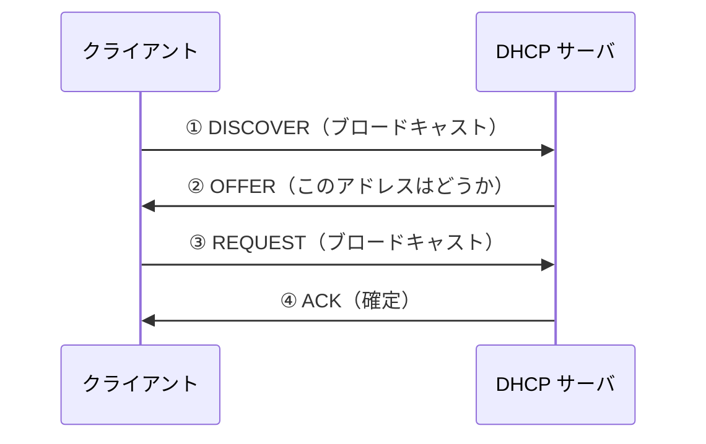

# DHCP-NAT.md
## DHCP・NAT 暗記シート

***

## DHCP ひとことで

**DHCP**（Dynamic Host Configuration Protocol）は、端末に **IP アドレスなどの設定を自動で配る**プロトコル。**UDP** を使い、サーバが **67番**、クライアントが **68番**。

| 配るもの | 内容 |
| --- | --- |
| **IP アドレス**とサブネットマスク | 配る範囲（プール、スコープ）から1つ貸し出す |
| **デフォルトゲートウェイ** | |
| **DNS サーバ**のアドレス | |
| **リース期間** | そのアドレスを使ってよい時間 |
| そのほか | ドメイン名、NTP サーバなど（オプション） |

## 4つのメッセージ

| 順 | メッセージ | 向き | 内容 |
| --- | --- | --- | --- |
| 1 | **DISCOVER** | クライアント → サーバ | 「DHCP サーバはいるか」。**ブロードキャスト**（送信元 0.0.0.0、宛先 255.255.255.255） |
| 2 | **OFFER** | サーバ → クライアント | 「このアドレスを使ってよい」という提案 |
| 3 | **REQUEST** | クライアント → サーバ | 「**そのアドレスを使いたい**」。**ブロードキャスト** |
| 4 | **ACK** | サーバ → クライアント | 確定。ここから使える |

- **DISCOVER がブロードキャストの理由**: クライアントはまだ**自分の IP アドレスも、サーバのアドレスも知らない**から
- **REQUEST もブロードキャストの理由**: DHCP サーバが複数あるとき、**選ばなかったサーバにも「別のサーバを選んだ」と知らせる**ため（選ばれなかったサーバは、提案したアドレスを戻す）
- 受け取ったアドレスは、使う前に **ARP で重複がないか確かめる**（重複していたら DECLINE を送って断る）

| そのほかのメッセージ | 内容 |
| --- | --- |
| NAK | サーバが要求を断る |
| RELEASE | クライアントがアドレスを返す |

### リース期間と更新

| 時点 | 動作 |
| --- | --- |
| リース期間の **50%** | アドレスを貸したサーバへ、**ユニキャスト**で REQUEST を送って延長する |
| リース期間の **87.5%** | 延長できていなければ、**ブロードキャスト**で REQUEST を送る（ほかのサーバでもよい） |
| 期限切れ | アドレスを手放し、DISCOVER からやり直す |

- リース期間を**短く**する場面: 来客用の無線 LAN など**端末の入れ替わりが多い**ネットワーク（使い終わったアドレスが早く戻り、**枯渇を防げる**）
- リース期間を**長く**する場面: 端末が固定されているネットワーク（更新の通信が減る）
- DHCP サーバにつながらないとき、Windows の端末は **169.254.0.0/16**（APIPA）のアドレスを自分で付ける → **このアドレスになっていたら、DHCP の取得に失敗している**

## DHCP リレーエージェント

DISCOVER は**ブロードキャストなので、ルータを越えられない**。DHCP サーバが別のセグメントにあるときは、ルータ（L3SW）の**リレーエージェント**が中継する。

1. L3SW が、受け取ったブロードキャストを **DHCP サーバ宛てのユニキャスト**に変えて転送する
2. このとき、**受け取ったインタフェースの IP アドレス**（giaddr）をメッセージに書き込む
3. DHCP サーバは、giaddr を見て「**どのサブネットの端末か**」を判断し、**そのサブネット用の範囲**からアドレスを選ぶ
4. 応答は giaddr 宛てに返り、L3SW がクライアントへ届ける

- L3SW には、**VLAN（インタフェース）ごとに** DHCP サーバのアドレスを設定する
- DHCP サーバには、**サブネットごとの配布範囲**を用意する
- 途中の FW で **UDP 67番・68番**を許可する

## DHCP の冗長化と固定割当て

| 項目 | 内容 |
| --- | --- |
| 範囲の分割 | 2台のサーバで、**重ならない範囲**を受け持つ（重なると、同じアドレスを別の端末に配ってしまう） |
| フェールオーバー | 2台で**貸出しの情報を同期**し、片方が止まっても続ける |
| 固定割当て（予約） | **MAC アドレスごとに、決まった IP アドレス**を配る（プリンタやサーバ向け） |

## DHCP スヌーピング

**不正な DHCP サーバ**（利用者が持ち込んだルータなど）が、**偽のデフォルトゲートウェイや DNS サーバ**を配ると、通信できなくなったり、**通信を盗み見られたり**する。L2SW の **DHCP スヌーピング**で防ぐ。

| ポートの種類 | つなぐもの | 動作 |
| --- | --- | --- |
| **信頼するポート**（trusted） | 正規の DHCP サーバ、上位のスイッチ | DHCP の全メッセージを通す |
| **信頼しないポート**（untrusted） | PC などの端末 | **サーバが送るメッセージ（OFFER・ACK）を捨てる** |

- L2SW は DHCP のやり取りをのぞき見て、**「MAC アドレス・IP アドレス・ポート・VLAN」の対応表（バインディングテーブル）**を作る
- この表を使う機能:

| 機能 | 内容 |
| --- | --- |
| **ダイナミック ARP インスペクション**（DAI） | 表と合わない ARP を捨てる → **ARP スプーフィング**を防ぐ |
| **IP ソースガード** | 表と合わない送信元 IP アドレスのパケットを捨てる → **固定で IP アドレスを設定した端末**や、送信元を偽った通信を止める |

## NAT の種類

| 種類 | 変換 | 用途 |
| --- | --- | --- |
| **静的 NAT** | 内部の IP アドレスと外部の IP アドレスを **1対1 で固定** | 内部のサーバを外部に公開する |
| 動的 NAT | 用意した外部アドレスの中から、空いているものを割り当てる（1対1） | |
| **NAPT**（IP マスカレード） | **IP アドレスとポート番号**を変換し、**1つのグローバル IP アドレスを多数の端末で共有** | 社内の PC からインターネットへ |
| **宛先 NAT**（ポートフォワーディング） | 外部から届いた通信の**宛先**（とポート番号）を、内部のサーバに変換 | 公開サーバを内部アドレスで運用する |

### NAPT のしくみ

- 線のラベルは、パケットの**送信元の IP アドレスとポート番号**。ルータを通ると書き換わる

| 変換前（内部） | 変換後（外部） | 宛先 |
| --- | --- | --- |
| 192.168.1.10 : 50001 | 203.0.113.1 : 40001 | 198.51.100.5 : 443 |
| 192.168.1.11 : 50001 | 203.0.113.1 : 40002 | 198.51.100.5 : 443 |

- ルータは、出ていく通信の**送信元 IP アドレスとポート番号を書き換え**、対応を**変換テーブル**に記録する
- 戻りの通信は、**宛先のポート番号を変換テーブルで引いて**、元の PC へ戻す
- 変換テーブルの行は、通信が終わるか**一定時間通信がない**と消える

### NAPT の制約

| 制約 | 理由 | 対策 |
| --- | --- | --- |
| **外部から通信を始められない** | 変換テーブルは、**内部から通信したとき**に作られる | 静的 NAT、ポートフォワーディング |
| **ポート番号のないプロトコルが通らない** | ESP などは変換できない | **NAT トラバーサル**（UDP で包む） |
| **データの中に IP アドレスを書くプロトコル** | FTP、SIP などは、**中身のアドレスが変換されない** | ルータの補助機能（ALG）、FTP はパッシブモード |
| **ポート番号が足りなくなる** | 1つのグローバル IP アドレスで使えるポートは**約 6万個**。SaaS は **1台の PC が多数のセッション**を張る | **グローバル IP アドレスを増やす**、ローカルブレイクアウトで分散する |
| **誰の通信か分からない** | 外部からは全員が同じ IP アドレスに見える | **変換ログ**と時刻で突き合わせる |

### ヘアピン NAT

**内部の PC が、内部にある公開サーバへ「グローバル IP アドレス」でアクセスする**と、通信できないことがある。

| 順 | 起きること |
| --- | --- |
| 1 | PC（192.168.1.10）が、公開サーバのグローバル IP アドレス（203.0.113.10）宛てに送る |
| 2 | ルータが宛先を、サーバの内部アドレス（192.168.1.20）に変換して届ける |
| 3 | サーバは、送信元が**同じセグメントの PC** なので、**ルータを通さず直接**応答する（送信元 192.168.1.20） |
| 4 | PC は 203.0.113.10 からの応答を待っているので、**192.168.1.20 からの応答を捨てる** |

| 対策 | 内容 |
| --- | --- |
| **ヘアピン NAT**（NAT ループバック） | ルータが**送信元もルータのアドレスに変換**して、戻りを必ずルータに通す |
| **内部向けの DNS** | 内部の PC には、公開サーバの**内部アドレスを答える**（内部向けと外部向けで DNS の応答を分ける） |

## 試験でよく問われるポイント

### DHCP

| 論点 | 覚えること |
| --- | --- |
| メッセージの順序 | **DISCOVER → OFFER → REQUEST → ACK**。UDP 67番（サーバ）・68番（クライアント） |
| ブロードキャスト | **DISCOVER と REQUEST** |
| リレーエージェント | セグメントが違うときに使う。サーバは **giaddr** で配布範囲を決める |
| リースの更新 | **50% でユニキャスト**、**87.5% でブロードキャスト** |
| DHCP スヌーピング | **不正な DHCP サーバ**を防ぎ、その表で **ARP スプーフィング**も防ぐ |
| 169.254.x.x | DHCP で**アドレスを取れなかった**印 |

### NAT

| 論点 | 覚えること |
| --- | --- |
| NAPT | **ポート番号で端末を区別**する。**外部からは通信を始められない** |
| ポート番号の枯渇 | SaaS の利用で**セッション数が増える**と起きる |

### 答えの型

| 問われ方 | 答えの型 |
| --- | --- |
| リレーエージェントが必要な理由 | 「DHCP の**ブロードキャストはルータを越えない**ので、別セグメントのサーバへ届かないから」 |
| サーバが配布範囲を決める方法 | 「リレーエージェントが書き込んだ **giaddr（受信したインタフェースの IP アドレス）**から、サブネットを判断する」 |
| REQUEST をブロードキャストで送る理由 | 「**選ばなかった DHCP サーバにも**、ほかのサーバを選んだことを知らせるため」 |
| リース期間を短くする理由 | 「使われなくなったアドレスを早く回収し、**アドレスの枯渇を防ぐ**ため」 |
| DHCP スヌーピングの目的 | 「**不正な DHCP サーバ**が配る偽の設定を、端末が受け取らないようにする」 |
| 固定 IP アドレスの端末を通信させない方法 | 「DHCP スヌーピングの表にない送信元の通信を、**IP ソースガードで捨てる**」 |
| NAPT で外部から接続できない理由 | 「**変換テーブルに対応する行がなく**、どの端末へ転送すればよいか分からないから」 |
| NAPT でセッションが張れなくなる理由 | 「1つのグローバル IP アドレスで使える**ポート番号を使い切った**から」 |
| その対策 | 「NAPT に使う**グローバル IP アドレスを増やす**」 |

関連: [dhcp.md](dhcp.md) / [dns.md](dns.md) / [../security/security.md](../security/security.md)（NAT と FW） / [../wan-vpn/ipsec.md](../wan-vpn/ipsec.md)（NAT トラバーサル） / [../ip-address/ipv6.md](../ip-address/ipv6.md)（SLAAC・DHCPv6）
