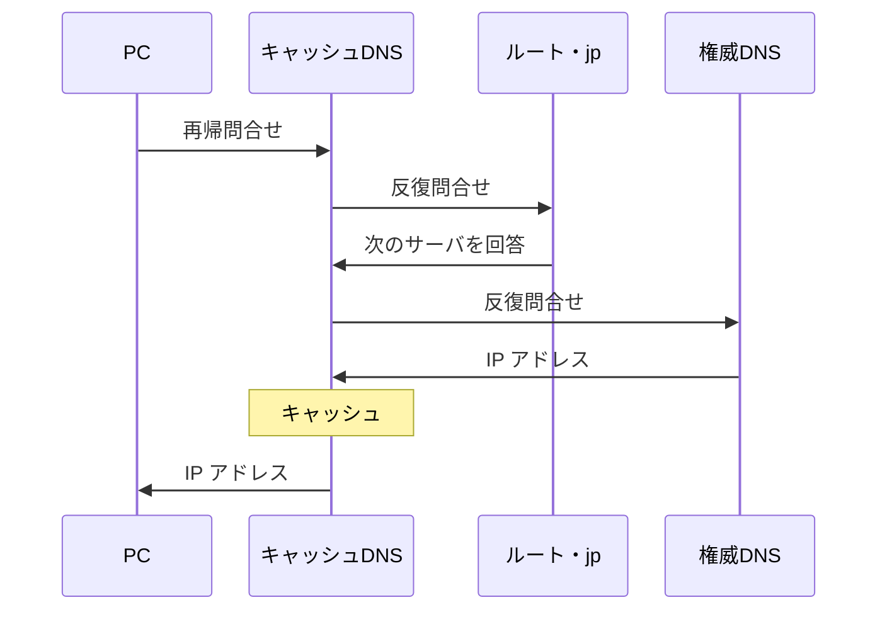

# DNS.md
## DNS 暗記シート

***

## ひとことで

**DNS** は、**ドメイン名と IP アドレスを対応付ける**仕組み。世界中の DNS サーバが**階層構造**で分担して管理している。

| 項目 | 内容 |
| --- | --- |
| ポート | **UDP 53**（通常の問合せ）、**TCP 53**（応答が大きいとき・ゾーン転送） |
| 構造 | ルート → TLD（jp・com など）→ 各組織のドメイン、の**階層** |
| 分担 | 上位は下位のサーバの場所だけを知っていて、詳しい情報は**下位に任せる（権限委譲）** |

## 登場するサーバ

| 名前 | 役割 |
| --- | --- |
| **スタブリゾルバ** | PC・サーバの中にある問合せ機能。キャッシュ DNS サーバに「調べて」と頼むだけ |
| **キャッシュ DNS サーバ**（フルリゾルバ） | 利用者の代わりに、**権威 DNS サーバを順にたどって調べる**。結果を **TTL の間キャッシュ**する |
| **権威 DNS サーバ**（コンテンツサーバ） | **自分が管理するドメイン（ゾーン）の情報**を答える。ほかのドメインのことは調べない |
| フォワーダ | 自分では調べず、**別のキャッシュ DNS サーバに問合せを転送**する DNS サーバ（社内 DNS → ISP の DNS など） |

## 名前解決の流れ

PC が `www.example.jp` の IP アドレスを調べる例。

1. PC がキャッシュ DNS サーバに「`www.example.jp` の IP アドレスは？」と頼む
2. キャッシュ DNS サーバが上位の権威 DNS サーバに聞くと、「**下位のこのサーバに聞いて**」と次の問合せ先を教えられる
3. `example.jp` の権威 DNS サーバに聞くと、IP アドレス（例: 192.0.2.10）が返る
4. キャッシュ DNS サーバは結果を **TTL の間キャッシュ**し、PC に返す

- 実際は**ルート → jp → example.jp** と1段ずつたどる（図では上位をまとめている）
- キャッシュに答えがあれば、権威 DNS サーバには問い合わせずにすぐ返す

| 問合せの種類 | 誰から誰へ | 内容 |
| --- | --- | --- |
| **再帰問合せ** | PC → キャッシュ DNS | 「**最終的な答え**を返して」と頼む |
| **反復問合せ** | キャッシュ DNS → 権威 DNS | 答えか、**次に聞くべきサーバ**を教えてもらう。これを繰り返す |

- 端末側の優先順: **hosts ファイル** → DNS（hosts に書くと DNS より先に使われる）

## 主なレコード

| レコード | 内容 | ポイント |
| --- | --- | --- |
| **A** | ホスト名 → **IPv4 アドレス** | 1つの名前に複数登録できる（ラウンドロビン） |
| **AAAA** | ホスト名 → **IPv6 アドレス** | |
| **CNAME** | ホスト名の**別名** → 正式なホスト名 | 相手（CDN・クラウド）が IP を変えても**自分の設定を変えなくてよい**。同じ名前にほかのレコードは置けない |
| **MX** | ドメイン → **メールサーバ**のホスト名 | **優先度の値が小さい方**が優先 |
| **NS** | ドメイン → **権威 DNS サーバ**のホスト名 | **権限委譲**に使う |
| **SOA** | ゾーンの管理情報 | **シリアル番号**（更新のたびに増やす）、更新間隔、ネガティブキャッシュの TTL |
| **PTR** | IP アドレス → ホスト名（**逆引き**） | in-addr.arpa / ip6.arpa |
| **TXT** | 任意の文字列 | **SPF・DKIM・DMARC** の情報を載せる |
| **SRV** | サービス → **サーバのホスト名とポート番号** | SIP・Active Directory など |

## TTL とキャッシュ

| TTL | 利点 | 欠点 |
| --- | --- | --- |
| **短い** | レコードを変更したとき、**古いキャッシュが早く消える** | 問合せが増え、権威 DNS サーバの負荷が上がる |
| **長い** | 問合せが減る | 変更が**反映されるまで時間がかかる** |

- **サーバの移行・切替えの前**: あらかじめ **TTL を短く**しておく → 切替え後、古い IP アドレスのキャッシュが残る時間を短くできる
- TTL を短くしても、**変更前の TTL でキャッシュされた分**はその時間が切れるまで残る → **事前に**短くしておく必要がある
- 「存在しない」という応答もキャッシュされる（**ネガティブキャッシュ**）

## ゾーンと権限委譲

| 用語 | 内容 |
| --- | --- |
| **ゾーン** | 1つの権威 DNS サーバが管理する範囲 |
| **権限委譲** | サブドメインの管理を別の DNS サーバに任せる。親のゾーンに**子の NS レコード**（とそのアドレス = グルーレコード）を書く |
| **プライマリ / セカンダリ** | ゾーンの原本を持つサーバ / コピーを持つサーバ。**冗長化**のため両方を NS に登録する |
| **ゾーン転送** | プライマリからセカンダリへゾーンの情報をコピーする（**TCP 53**） |
| **DNS NOTIFY** | プライマリが**更新したことをセカンダリに知らせ**、すぐゾーン転送させる |
| **シリアル番号** | セカンダリは SOA のシリアル番号が**増えていたら**転送を受ける（増やし忘れると更新されない） |

## DNS を使った負荷分散・冗長化

| 方式 | しくみ | 注意点 |
| --- | --- | --- |
| **DNS ラウンドロビン** | 1つの名前に**複数の A レコード**を登録し、順番を変えて返す | **サーバの故障を検知しない**（故障したサーバの IP も返す）。キャッシュがあるので**均等にならない** |
| **GSLB**（広域負荷分散） | サーバの**死活や負荷を監視**し、**DNS の応答を変えて**複数拠点に振り分ける | TTL を短くしておく。拠点障害時の切替え（災害対策）に使う |
| **LB と組み合わせ** | DNS には LB の**仮想 IP アドレス**を登録する | サーバの増減は LB の中で吸収できる |
| **CNAME で CDN へ** | 自社の名前を CDN 事業者のホスト名の別名にする | CDN 側が利用者に近いサーバの IP を返す |

## 構成の定番

| 構成 | 内容・理由 |
| --- | --- |
| **権威 DNS とキャッシュ DNS を分ける** | 外部に公開する権威 DNS で**再帰問合せを受け付けない** → **DNS リフレクタ攻撃の踏み台**や**キャッシュポイズニング**を防ぐ |
| **キャッシュ DNS は内部からだけ使わせる** | 外部から誰でも使える状態（**オープンリゾルバ**）にしない |
| **内部用と外部用の DNS を分ける** | 社内向けには内部のアドレスを、外部向けには公開用のアドレスだけを答える（内部の構成を外に見せない） |
| **フォワーダ** | 社内の DNS は外部を自分で調べず、DMZ や ISP のキャッシュ DNS に転送する → FW で許可する通信を絞れる |
| **プライマリを隠す** | 外部にはセカンダリだけを公開し、原本を持つプライマリを守る |

## 応答が大きいとき（EDNS0 と TCP）

- 従来の DNS は **UDP で 512Byte まで**
- **EDNS0**: UDP で 512Byte を超える応答を扱えるようにする拡張（DNSSEC・AAAA・TXT で応答が大きくなるため）
- 収まらない場合は応答に **TC ビット**が立ち、**TCP 53 で問い合わせ直す**
- → FW で **TCP 53 や大きな UDP の DNS 応答を遮断していると、名前解決に失敗する**ことがある

## セキュリティ

| 攻撃・技術 | 内容 | 対策 |
| --- | --- | --- |
| **DNS キャッシュポイズニング** | キャッシュ DNS サーバに**偽の応答**を先に送り込み、偽の IP アドレスをキャッシュさせる → 利用者を偽サイトへ誘導 | **送信元ポート番号と ID をランダムにする**、**DNSSEC**、外部からの再帰問合せを受けない |
| **DNS リフレクタ攻撃**（DNS amp） | **送信元を標的の IP に偽装**した問合せをオープンリゾルバに送り、**大きな応答を標的に集中**させる（DRDoS） | オープンリゾルバにしない、権威とキャッシュの分離、送信元を偽装したパケットを通さない |
| **ゾーン転送の悪用** | 誰でもゾーン転送できると、**内部のホスト一覧を読み出される** | ゾーン転送を**セカンダリの IP アドレスだけに許可** |
| **DNS を使った C&C 通信** | マルウェアが DNS の問合せに情報を載せて外部と通信（DNS トンネリング）、ドメイン名を次々に自動生成（**DGA**） | 端末から外部の DNS へ直接問い合わせさせない、DNS のログを監視 |
| **DNSSEC** | 応答に**デジタル署名**を付け、**正しいサーバからの応答で、改ざんされていない**ことを検証する | 暗号化はしない（盗聴は防げない）。応答が大きくなる |
| **DoT / DoH** | 問合せを **TLS（TCP 853）/ HTTPS（TCP 443）** で暗号化し、盗聴・改ざんを防ぐ | 社内の DNS による制御・監視を通らなくなることがある |

メールの送信ドメイン認証（SPF・DKIM・DMARC）は [mail-security.md](mail-security.md) を参照。

## 午後でよく問われるポイント

| 問われ方 | 答えの型 |
| --- | --- |
| TTL を短くする理由 | 切替え後に、**古い IP アドレスのキャッシュが残る時間を短くする**ため |
| DNS ラウンドロビンの問題点 | **サーバの故障を検知できず**、故障したサーバの IP アドレスも応答してしまう |
| 権威 DNS とキャッシュ DNS を分ける理由 | 外部からの**再帰問合せを受けない**ようにし、**リフレクタ攻撃の踏み台**やキャッシュポイズニングを防ぐため |
| ゾーン転送を制限する理由 | **ゾーンの情報（内部のホスト名や IP アドレス）を第三者に読み出されない**ようにするため |
| CNAME を使う利点 | 相手側が IP アドレスを変更しても、**自社の DNS の設定を変えなくてよい** |
| セカンダリが更新されない原因 | SOA の**シリアル番号を増やしていない** |
| DNS の応答が届かない原因 | 応答が 512Byte を超え、**TCP 53 での再問合せが FW で遮断**されている |
| キャッシュポイズニングの対策 | 問合せの**送信元ポート番号をランダムにする**、DNSSEC で応答を検証する |
| DNS 切替えで拠点を切り替える（GSLB・災害対策） | **DNS の応答を切替え先の IP アドレスに変える**。TTL の時間だけ切替えが遅れる |

関連: [mail-security.md](mail-security.md) / [dhcp.md](dhcp.md) / [../ip-address/ipv6.md](../ip-address/ipv6.md) / [../redundancy/load-balancer.md](../redundancy/load-balancer.md)
