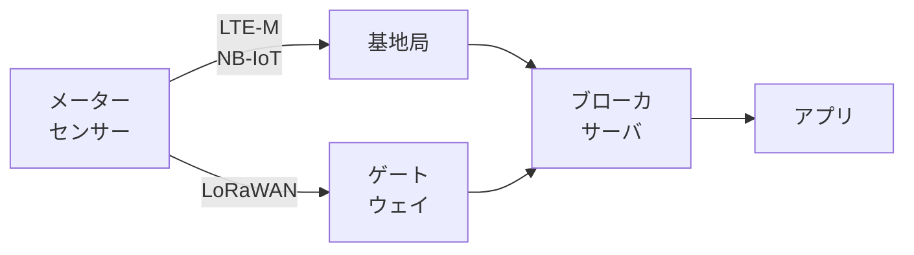
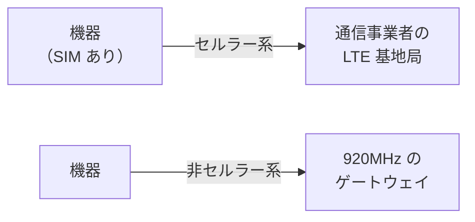
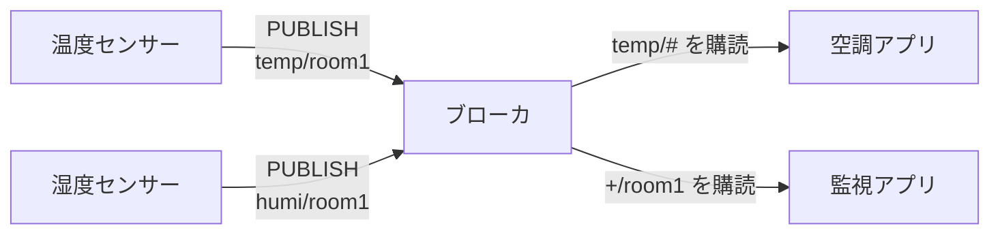
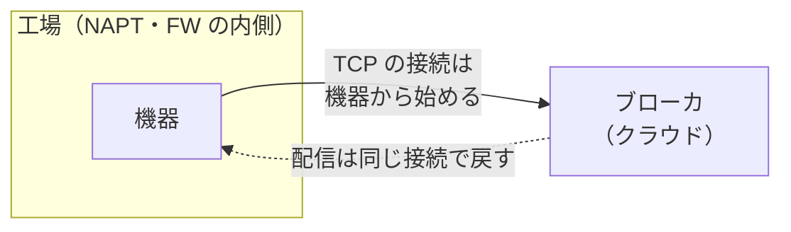
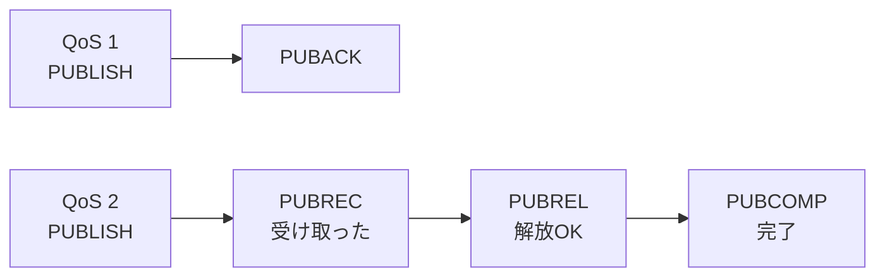
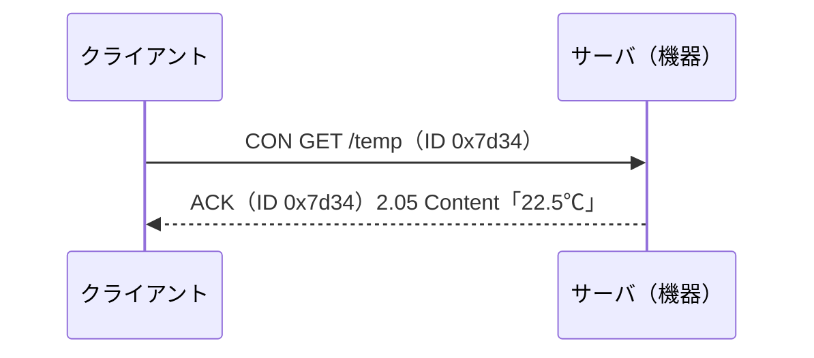
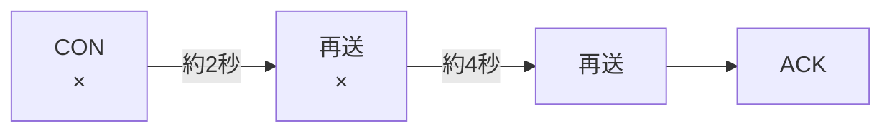
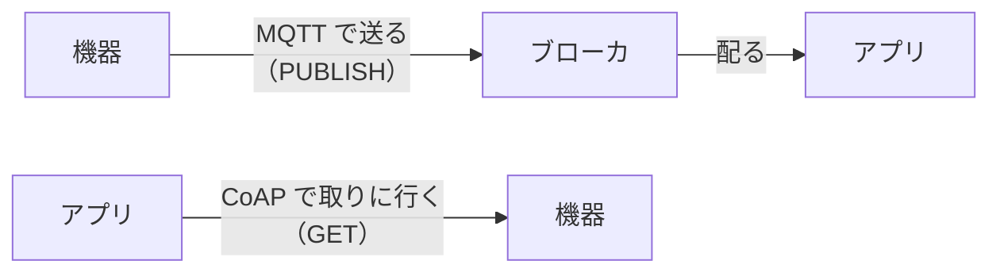

# IOT.md
## IoT 暗記シート

***

## ひとことで

IoT では、**電池で長く動く小さな機器**が、**少ないデータを、遠くまで、たまに**送る。そのため、無線は **LPWA**（省電力・広い範囲）、通信のプロトコルは **MQTT** や **CoAP**（軽いプロトコル）を使う。

| 層 | 主な技術 |
| --- | --- |
| 無線（つなぎ方） | **LPWA**（LTE-M、NB-IoT、LoRaWAN、Sigfox）、Wi-Fi、Bluetooth Low Energy、Zigbee |
| アプリケーション（やり取りの形） | **MQTT**（TCP、Publish/Subscribe）、**CoAP**（UDP、REST） |

### 全体像：データがどう流れるか

| 区間 | 使う技術 | ポイント |
| --- | --- | --- |
| 機器 → 基地局 | **LPWA**（無線） | 電池で何年も動かすので、**少しだけ・たまに**送る |
| 基地局 → クラウド | インターネットや閉域網 | ふつうの IP 通信 |
| 機器 ⇔ クラウドのやり取り | **MQTT** または **CoAP** | HTTP より**軽い**プロトコル |

- 基地局は通信事業者のもの（LTE-M・NB-IoT）、ゲートウェイは自分で置くもの（LoRaWAN）。ブローカ・サーバはクラウドに置く
- IoT の問題は、「**どの無線でつなぐか**」と「**どのプロトコルでやり取りするか**」の2段に分けて考える

## LPWA（Low Power Wide Area）

**低消費電力**で、**数 km〜十数 km** 届く無線。速度は遅い（数十 kbps〜数百 kbps 程度）が、メーターやセンサーには十分。

- セルラー系は**携帯電話の網を借りる**、非セルラー系は**自分で（または専門の事業者が）無線の網を作る**

| 分類 | 方式 | 周波数 | 特徴 |
| --- | --- | --- | --- |
| **セルラー系** | **LTE-M**、**NB-IoT** | 通信事業者の**免許が必要な帯域**（LTE と同じ） | **3GPP** の仕様。通信事業者の LTE 網を使う → 全国で使える。**SIM** カードが必要。品質が安定 |
| **非セルラー系** | **LoRaWAN**、**Sigfox** | **920MHz 帯**（免許が要らない **ISM バンド**） | 免許なしで使える。LoRaWAN は**自分で基地局（ゲートウェイ）を置いて**網を作れる |

| セルラー系の比較 | LTE-M | NB-IoT |
| --- | --- | --- |
| 速度 | **速め**（1Mbps 程度） | **遅い** |
| 移動（ハンドオーバ） | **できる** → 車や人が持つ機器 | 向かない → **固定のメーター**など |

**920MHz 帯の特徴**（2.4GHz 帯と比べて）

- 使っている機器が少ないので、**電波干渉の影響が少ない**
- 周波数が低いので、**遠くまで届き、障害物の裏にも回り込みやすい**
- 免許は要らないが、1回に電波を出せる時間などに**ルールがある**

**セルラー系の機器に設定するもの**

| 設定 | 内容 |
| --- | --- |
| **SIM** カード | 通信事業者が**契約者を識別する情報**を記録している |
| **APN** | LTE 網から**どのネットワークへ接続するか**の指定 |

## MQTT

**Publish/Subscribe**（出版・購読）型のメッセージ交換。**ブローカ**（試験では「サーバ」「交換サーバ」とも呼ぶ）が中継する。

| ワイルドカード（購読するときだけ使える） | 意味 | 図の例 |
| --- | --- | --- |
| **#** | それより下を**すべて** | temp/# → temp/room1、temp/room2 … |
| **+** | **1階層だけ**、何でもよい | +/room1 → temp/room1、humi/room1 |

- メールは「**相手を指定して**送る」。MQTT は「**話題（トピック）を指定して**送り、その話題を購読している人に届く」

| 項目 | 内容 |
| --- | --- |
| トランスポート | **TCP**（**1883番**、TLS を使うなら **8883番**） |
| **トピック** | メッセージの宛先の名前。「/」で区切る階層（例: temp/room1）。購読するときは **+**（1階層）や **#**（それ以下すべて）の**ワイルドカード**が使える |
| 送り手と受け手 | **互いを知らなくてよい**。送り手はトピックに送るだけ、受け手はトピックを購読するだけ |
| 接続の向き | **機器からブローカへ**つなぐ（TCP の接続を始めるのは機器側）→ 機器が NAPT や FW の内側にあっても、**外から接続を受けなくてよい** |

### 接続の向き

- 機器は、**自分からブローカへ TCP で接続**し、その接続を張ったままにする（PINGREQ で生存確認）
- ブローカからのメッセージも、**同じ接続を通って**機器に届く
- → **外から工場へ接続を始める必要がない**ので、FW で外からの通信を開けなくて済み、NAPT の内側でも動く

### パケットの種類

| パケット | 向き | 用途 |
| --- | --- | --- |
| **CONNECT** / **CONNACK** | クライアント → サーバ / その応答 | **接続**の要求と確認応答 |
| **PUBLISH** | 双方向 | **メッセージの送信**（QoS レベル、トピック名、パケット ID、メッセージ） |
| PUBACK | | QoS 1 の受信の確認 |
| **PUBREC** / **PUBREL** / **PUBCOMP** | | QoS 2 の4段階のやり取り（受信の通知 / リリースの通知 / 送信終了の通知） |
| **SUBSCRIBE** / **SUBACK** | クライアント → サーバ / その応答 | **購読**の要求と確認応答 |
| UNSUBSCRIBE / UNSUBACK | | 購読の取りやめ |
| PINGREQ / PINGRESP | | 接続の生存確認（キープアライブ） |
| DISCONNECT | | 切断 |

### QoS（届け方の保証）

| QoS | 保証 | やり取り |
| --- | --- | --- |
| **0** | **最大1回**（届かないことがある） | PUBLISH だけ |
| **1** | **最低1回**（重複することがある） | PUBLISH → **PUBACK** |
| **2** | **ちょうど1回**（重複も欠落もない） | PUBLISH → **PUBREC** → **PUBREL** → **PUBCOMP** |

- PUBLISH・PUBREL は**送り手から**、PUBACK・PUBREC・PUBCOMP は**受け手（ブローカ）から**送る
- **QoS 1 で重複する理由**: PUBACK が来なければ再送する。**PUBACK だけが消える**と、同じメッセージを2回送ってしまう
- **QoS 2 で重複しない理由**: 「受け取った（PUBREC）」→「もう再送しないので記録を消してよい（PUBREL）」→「消した（PUBCOMP）」の**2往復**で、重複を防ぐ
- QoS が高いほど**確実だが、やり取りが増える**（電池・通信量を使う）。例: 温度の定期送信は QoS 0、課金や制御の命令は QoS 1・2
- QoS 1・2 では、どのメッセージへの応答かを**パケット ID** で対応させる

| そのほかの機能 | 内容 |
| --- | --- |
| リテイン（保持） | ブローカが**最後のメッセージを保持**し、後から購読したクライアントにもすぐ送る |
| ウィル（遺言） | 機器が**異常切断**したら、あらかじめ預けておいたメッセージをブローカが配る → 機器の故障を知らせられる |

## CoAP（Constrained Application Protocol）

**資源の少ない機器向けの、軽い HTTP** のようなプロトコル。**RESTful**（GET・POST などでリソースを操作する）。

| 項目 | 内容 |
| --- | --- |
| トランスポート | **UDP**（**5683番**。DTLS で暗号化するなら 5684番） |
| 形 | **クライアント・サーバ型**（HTTP と同じ）。リソースを URI で指定する |
| 特徴 | ヘッダが小さい（固定部分は 4 バイト）。UDP なので、**届いたかの確認や再送は CoAP 自身が行う** |

### メッセージの種類

| 種類 | 内容 |
| --- | --- |
| **CON**（Confirmable） | **確認が必要**なメッセージ。受け手は **ACK** を返す。ACK が来なければ再送する |
| **NON**（Non-confirmable） | 確認が**不要**なメッセージ（センサー値の定期送信など） |
| **ACK** | CON を受け取ったことの確認。**応答（データ）を ACK に載せて返せる**（ピギーバック） |
| RST | 処理できないメッセージへの返事 |

- HTTP と同じく、**GET でリソース（/temp）を取りに行く**
- 応答のデータ（2.05 Content）を **ACK に載せて一度に返す**（ピギーバック）→ 往復が1回で済む
- ACK の**メッセージ ID** が CON と同じなので、どの要求への返事か分かる

| しくみ | 内容 |
| --- | --- |
| **メッセージ ID** | CON と ACK の対応付けと、**重複したメッセージの検出**に使う（UDP では、**順番が入れ替わったり、重複したり、消えたり**するため） |
| トークン | リクエストとレスポンスの対応付けに使う |
| **非同期**通信 | ACK を待たずに、続けて CON を送れる |
| 再送 | ACK が来なければ再送する。待ち時間は**指数バックオフ**（再送するたびに倍に延ばす） |
| Observe | リソースを**購読**し、値が変わったら通知してもらう |

### 再送と指数バックオフ

- × は失われたことを表す。3つの CON は、どれも**同じメッセージ ID**（例: 0x01）。矢印のラベルは、次に再送するまでの待ち時間（約2秒 → 約4秒と**倍**になる）
- UDP は届いたか分からないので、**CoAP 自身が再送**する
- 待ち時間を**再送のたびに倍に延ばす**（**指数バックオフ**）→ 混雑しているときに、再送で網をさらに混ませない
- 再送しても**メッセージ ID は同じ** → サーバに2回届いても**重複**と分かり、二重に処理しない

### メソッドコードとレスポンスコード

| メソッドコード | メソッド | 内容 |
| --- | --- | --- |
| **0.01** | **GET** | リソースを取得する |
| **0.02** | **POST** | リソースを作成する |
| 0.03 | PUT | リソースを更新する |
| **0.04** | **DELETE** | リソースを削除する |

| レスポンスコード | 状態 | 内容 |
| --- | --- | --- |
| **2.01** | **Created** | 作成された |
| **2.02** | **Deleted** | 削除された |
| 2.04 | Changed | 変更された |
| **2.05** | **Content** | 取得できた（中身を返す） |
| 4.04 | Not Found | リソースがない |

- コードの形は「**クラス.詳細**」。2 は成功、4 はクライアントの誤り、5 はサーバの誤り（HTTP の 201・404・500 と同じ考え方）

## MQTT・CoAP・HTTP の比較

- MQTT は機器が**送り、ブローカが配る**。CoAP はアプリが機器に**取りに行く・命令する**

| 項目 | **MQTT** | **CoAP** | HTTP |
| --- | --- | --- | --- |
| トランスポート | **TCP** | **UDP** | TCP |
| やり取りの形 | **Publish/Subscribe**（ブローカ経由） | **クライアント・サーバ**（REST） | クライアント・サーバ（REST） |
| 届いたかの確認 | **QoS 0・1・2** | **CON と ACK** | TCP に任せる |
| 向いている使い方 | 多数の機器から集める、**多数へ配る** | 機器の値を**取りに行く**・操作する | 一般の Web |
| ヘッダ | 小さい（最小 2 バイト） | 小さい（4 バイト） | 大きい（文字列） |

## 計算の型（通信料）

例）1台が **1時間ごと**に **100 バイト**送る。通信費は **1,000 バイト当たり1円**、基本料金は月額 **300円**。30日の月の1台当たりの料金

| 手順 | 計算 |
| --- | --- |
| 1か月の送信回数 | 24回 × 30日 ＝ **720回** |
| 1か月の通信量 | 720回 × 100 バイト ＝ **72,000 バイト** |
| 通信費 | 72,000 ÷ 1,000 × 1円 ＝ **72円** |
| 合計 | 72円 ＋ 300円 ＝ **372円** |

## 試験でよく問われるポイント

### 無線

| 論点 | 覚えること |
| --- | --- |
| LPWA の分類 | **セルラー系 ＝ LTE-M・NB-IoT**（3GPP、免許帯域、SIM）、**非セルラー系 ＝ LoRaWAN・Sigfox**（920MHz の ISM バンド） |
| 920MHz 帯 | **ISM バンド**。2.4GHz 帯より**電波干渉が少なく**、遠くまで届く |
| LTE-M と NB-IoT | LTE-M は**移動できて速め**、NB-IoT は**固定の機器向け** |

### プロトコル

| 論点 | 覚えること |
| --- | --- |
| MQTT | **TCP 1883**、**Publish/Subscribe**、ブローカ、トピック。機器から**外向きに接続** |
| MQTT の QoS | 0 最大1回、1 最低1回（PUBACK）、2 ちょうど1回（PUBREC → PUBREL → PUBCOMP） |
| CoAP | **UDP 5683**、**RESTful**、CON・NON・ACK、**メッセージ ID** で重複を検出、**指数バックオフ**で再送 |
| CoAP のコード | 0.01 GET、0.02 POST、0.04 DELETE ／ 2.01 Created、2.02 Deleted、2.05 Content |

### 答えの型

| 問われ方 | 答えの型 |
| --- | --- |
| LPWA を使う理由 | 「**消費電力が小さく**、電池で長期間動かせ、**広い範囲**をカバーできるから」 |
| 920MHz 帯を使う利点 | 「2.4GHz 帯より**電波干渉の影響が少なく**、遠くまで届く」 |
| MQTT で機器から接続する利点 | 「機器が **NAPT や FW の内側**にあっても、外部から接続を受け付けずに通信できる」 |
| Publish/Subscribe の利点 | 「送り手と受け手が**互いを知らなくてよく**、受け手を増やしても送り手を変えなくてよい」 |
| CoAP がメッセージ ID を使う理由 | 「UDP では**重複や順序の入れ替わり**が起きるので、**重複を検出**し、ACK と対応付けるため」 |
| QoS 2 の利点と欠点 | 「重複も欠落もなく**ちょうど1回**届く」が「**やり取りが4回**に増え、通信量と電力を使う」 |

関連: [../lan/wifi-cheatsheet.md](../lan/wifi-cheatsheet.md)（IoT 向けの無線） / [http.md](http.md) / [tcp-qos.md](tcp-qos.md) / [udp.md](udp.md)
