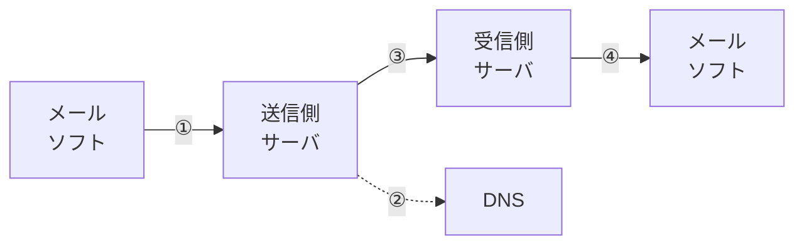
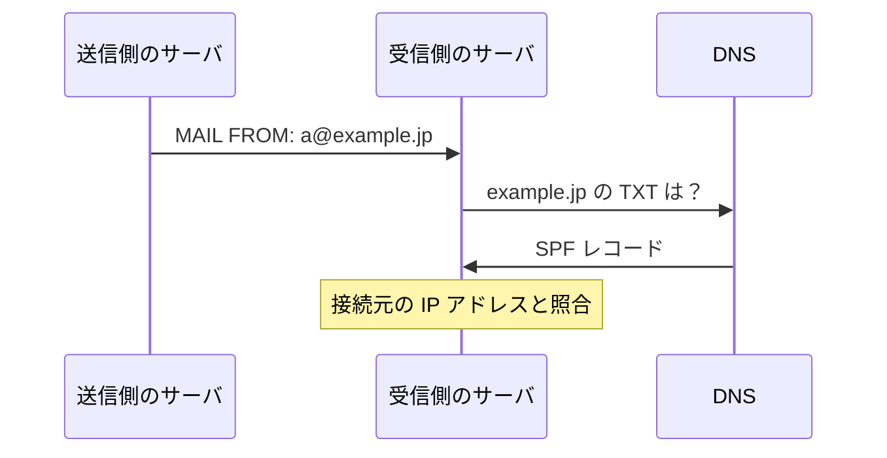

# MAIL.md
## メール 暗記シート

***

## ひとことで

メールは、**送信側のメールサーバが DNS の MX レコードで相手のメールサーバを調べ、SMTP で届ける**しくみ。SMTP には**送信者を確かめる機能がない**ので、**成りすましを見破るしくみ（SPF・DKIM・DMARC）**を後から足している。

| 順 | 内容 | プロトコル |
| --- | --- | --- |
| ① | 送信者のメールソフトが、自分のメールサーバへ送る | **SMTP**（587番） |
| ② | 送信側のメールサーバが、宛先ドメインの **MX レコード**を DNS に問い合わせる | DNS |
| ③ | 送信側のメールサーバが、受信側のメールサーバへ転送する | **SMTP**（25番） |
| ④ | 受信者のメールソフトが、メールサーバから受け取る | **POP3** または **IMAP** |

| 用語 | 意味 |
| --- | --- |
| MUA | メールソフト（利用者が使う） |
| **MTA** | メールを**転送**するサーバ（メールサーバ） |
| MDA | 届いたメールを、利用者のメールボックスに入れる機能 |

## プロトコルとポート番号

| プロトコル | ポート | 用途 |
| --- | --- | --- |
| **SMTP** | **TCP 25番** | **メールサーバ同士**の転送 |
| **サブミッション** | **TCP 587番** | **メールソフトからメールサーバへの送信**。**SMTP-AUTH**（利用者の認証）を必須にする |
| SMTPS | TCP 465番 | 最初から TLS で暗号化した送信 |
| **POP3** | TCP 110番（POP3S は 995番） | メールを**端末に取り込む**（サーバからは消すのが基本） |
| **IMAP** | TCP 143番（IMAPS は 993番） | メールを**サーバに置いたまま**読む（複数の端末で同じ状態を見られる） |

- **STARTTLS**: 平文で始めた SMTP の通信を、途中から **TLS に切り替える**命令（25番・587番で使う）

## DNS とメール

| レコード | 役割 |
| --- | --- |
| **MX** | そのドメイン宛てのメールを受け取る**メールサーバの名前**。**優先度（プリファレンス）の値が小さいほうを優先**する |
| A / AAAA | MX に書かれたメールサーバ名の IP アドレス |
| **TXT** | **SPF・DKIM・DMARC** の情報を載せる |
| PTR | IP アドレスからの逆引き。受信側が確認に使うことがある |

例）`example.jp. IN MX 10 mx1.example.jp.` と `example.jp. IN MX 20 mx2.example.jp.` → ふだんは **mx1**（値が小さい）へ届け、つながらなければ mx2 へ届ける

- 値が**同じ**なら、負荷分散になる
- メールサーバを移行するときは、**MX レコードを書き換える**。事前に **TTL を短く**しておく

## エンベロープとヘッダ

SMTP では、**配送に使う情報（エンベロープ）**と、**メールの中に書かれた情報（ヘッダ）**は**別物**。封筒の宛名と、便せんに書いた宛名の関係。

| 情報 | SMTP のコマンド・場所 | 役割 |
| --- | --- | --- |
| **エンベロープ From** | **MAIL FROM** コマンド | 配送に使う送信者。**届かなかったときのエラーメールの返送先**。受信側で Return-Path ヘッダに記録される。**SPF が検査する** |
| **エンベロープ To** | **RCPT TO** コマンド | **実際の配送先**。BCC の宛先はここにだけ入る |
| **ヘッダ From** | メールの中の From: ヘッダ | **メールソフトに表示される**差出人。**自由に書けるので、簡単に偽れる** |
| ヘッダ To | メールの中の To: ヘッダ | 表示される宛先 |

- **Received ヘッダ**: 経由したメールサーバが**1つずつ上に追加**する → **下から上へ**読むと、通った順が分かる
- フィッシングメールは、**ヘッダ From を偽って**有名な組織に見せかける

## 迷惑メールを送らせない対策

| 対策 | 内容 |
| --- | --- |
| **第三者中継の禁止** | メールサーバは、「**自分のドメイン宛て**」か「**認証した利用者・社内から**」のメールだけを受け付ける。誰のメールでも中継する状態（オープンリレー）は、迷惑メールの踏み台にされる |
| **OP25B**（Outbound Port 25 Blocking） | ISP が、利用者の**動的 IP アドレスから外部の 25番ポート宛て**の通信を止める。マルウェアに感染した PC が**直接メールを送る**のを防ぐ |
| **SMTP-AUTH** | 送信するときに、**利用者 ID とパスワードで認証**する |

- OP25B があるので、利用者は **587番（サブミッション）＋ SMTP-AUTH** で、自分のメールサーバへ送る

## 送信ドメイン認証

**受信側**が、「このメールは、**本当にそのドメインから送られたか**」を **DNS を使って**確かめるしくみ。

| 方式 | 確かめるもの | しくみ | 弱点 |
| --- | --- | --- | --- |
| **SPF** | **送信元の IP アドレス** | **エンベロープ From のドメイン**の TXT レコード（SPF レコード）を引き、**接続してきたサーバの IP アドレス**が載っているか見る | **転送されると失敗**する（転送したサーバの IP アドレスは載っていない） |
| **DKIM** | **電子署名** | 送信側が**秘密鍵で署名**してヘッダに付ける。受信側は DNS から**公開鍵**を取って検証する | メーリングリストなどで**本文や件名が書き換わると失敗**する |
| **DMARC** | SPF・DKIM の結果と、**ヘッダ From との一致** | 失敗したメールの**扱いを送信側のドメインが宣言**する。結果の**レポート**も受け取れる | SPF か DKIM の設定が前提 |

### SPF

例）`example.jp. IN TXT "v=spf1 ip4:192.0.2.0/24 include:_spf.example.com -all"`

| 書き方 | 意味 |
| --- | --- |
| `v=spf1` | SPF のバージョン |
| `ip4:192.0.2.0/24` | この範囲の IP アドレスからの送信を**認める** |
| `a` / `mx` | このドメインの A レコード・MX レコードのサーバを認める |
| `include:ドメイン名` | **ほかのドメインの SPF レコードも含める**（外部のメール配信サービスを使うとき） |
| **`-all`** | 上に当てはまらないものは**認めない**（fail） |
| `~all` | 当てはまらないものは**疑わしい**（softfail）。受け取りはする |

- **外部のサービスから自社ドメインのメールを送る**ときは、そのサービスの送信サーバを **SPF レコードに追加**する（`include`）。追加しないと、受信側で SPF が失敗する
- SPF が見るのは**エンベロープ From**。**ヘッダ From が偽られていても、SPF は合格する**ことがある

### DKIM

1. 送信側のメールサーバが、ヘッダと本文から作ったハッシュ値に**秘密鍵で署名**し、**DKIM-Signature ヘッダ**として付ける
2. 受信側は、DKIM-Signature ヘッダの **d=（ドメイン）**と **s=（セレクタ）**を見て、DNS で `セレクタ._domainkey.ドメイン` の TXT レコードを引く
3. そこにある**公開鍵**で署名を検証する → **改ざんされていないこと**と、**そのドメインが署名したこと**が分かる

例）`sel1._domainkey.example.jp. IN TXT "v=DKIM1; k=rsa; p=（公開鍵）"`

- **セレクタ**は鍵の名前。鍵を入れ替えるときや、送信サーバごとに鍵を分けるときに使う
- 署名はメール自体に付いているので、**転送されても検証できる**（SPF との違い）

### DMARC

例）`_dmarc.example.jp. IN TXT "v=DMARC1; p=quarantine; rua=mailto:report@example.jp"`

| 項目 | 意味 |
| --- | --- |
| `p=none` | 何もしない（**監視だけ**。導入の最初に使う） |
| `p=quarantine` | **隔離**する（迷惑メールフォルダに入れる） |
| `p=reject` | **受信を拒否**する |
| `rua=` | 認証結果の**集計レポートの送り先** |

**DMARC の合格条件**: 次のどちらかを満たすこと

- **SPF に合格**し、かつ**エンベロープ From のドメインがヘッダ From のドメインと一致**する
- **DKIM に合格**し、かつ**署名のドメイン（d=）がヘッダ From のドメインと一致**する

→ SPF・DKIM だけでは見ていなかった**ヘッダ From（利用者に見える差出人）の偽装**を見破れる

- レコードは、すべて**送信側のドメインの DNS に登録**する。**検査するのは受信側**のメールサーバ
- 検査の結果は、受信側が **Authentication-Results ヘッダ**に記録する

## 暗号化

| 方式 | 守る範囲 | ポイント |
| --- | --- | --- |
| **STARTTLS**（SMTP over TLS） | **サーバ間の通信経路** | 相手が対応していなければ**平文で送られる**。メールサーバの中では平文 |
| POP3S・IMAPS | メールソフトとサーバの間 | |
| **S/MIME** | **送信者から受信者まで**（エンドツーエンド） | **証明書**を使い、**暗号化と電子署名**を行う。途中のサーバでも読めない。受信者の公開鍵（証明書）が必要 |

## 受信側の対策と構成

| 対策 | 内容 |
| --- | --- |
| メールゲートウェイ | 迷惑メールの判定、**マルウェアの検査**、添付ファイルの隔離（サンドボックスで動かして調べる） |
| ブラックリスト（DNSBL） | 迷惑メールの送信元として知られる IP アドレスを、DNS で照会する |
| グレイリスティング | 初めての相手からのメールを**一時的に拒否**し、**再送してきたら受け取る**（迷惑メールの送信プログラムは再送しないことが多い） |

**社内にメールサーバを置く構成**

- **DMZ に中継用のメールサーバ**、内部に利用者のメールボックスを持つメールサーバを置く
- FW で許可する通信: インターネット ⇔ DMZ の中継サーバ（25番）、DMZ の中継サーバ ⇔ 内部のメールサーバ（25番）
- **内部の PC からインターネットへの 25番は禁止**する（感染した PC が直接送るのを防ぐ）
- 外部へ出るメールは、必ず**中継サーバを通す** → SPF に登録する IP アドレスが1つで済み、検査やログも1か所になる

## 試験でよく問われるポイント

- メールサーバ間は **SMTP（25番）**、メールソフトからの送信は **587番 ＋ SMTP-AUTH**
- **MX レコードは値が小さいほうが優先**
- **エンベロープ From とヘッダ From は別物**。ヘッダ From は簡単に偽れる
- **OP25B**: 動的 IP アドレスから外部の 25番宛てを止める
- **SPF は IP アドレス、DKIM は電子署名、DMARC は扱いの宣言とヘッダ From の照合**
- SPF は**転送に弱い**。DKIM は転送されても検証できる
- 外部の配信サービスを使うときは、**SPF レコードに追加**する
- DNS に登録するのは**送信側**、検査するのは**受信側**
- **S/MIME** は送信者から受信者まで暗号化する。STARTTLS は経路だけ

### 答えの型

| 問われ方 | 答えの型 |
| --- | --- |
| SPF で確認する内容 | 「**送信元の IP アドレス**が、エンベロープ From のドメインの SPF レコードに登録されているか」 |
| 外部サービス利用時に SPF で必要な対応 | 「外部サービスの**送信サーバの情報を、自社ドメインの SPF レコードに追加**する」 |
| 転送メールで SPF が失敗する理由 | 「**転送したサーバの IP アドレス**が、元のドメインの SPF レコードに登録されていないから」 |
| DKIM で分かること | 「メールが**改ざんされていない**ことと、**署名したドメイン**が正しいこと」 |
| DMARC が必要な理由 | 「SPF と DKIM だけでは、**ヘッダ From の偽装**を検知できないから」 |
| DMARC を p=none から始める理由 | 「正規のメールが拒否されないか、**レポートで影響を確認してから**厳しくするため」 |
| OP25B の目的 | 「感染した PC などが、ISP のメールサーバを通さずに**直接迷惑メールを送る**のを防ぐ」 |
| 内部から外部への 25番を FW で止める理由 | 「マルウェアに感染した PC が、**メールサーバを経由せずに送信する**のを防ぐため」 |
| 移行前に TTL を短くする理由 | 「MX レコードの変更が、**キャッシュに残らず早く反映される**ようにするため」 |

関連: [email-header.md](email-header.md) / [mail-security.md](mail-security.md) / [dns.md](dns.md) / [well-known-ports.md](well-known-ports.md) / [../security/auth-pki.md](../security/auth-pki.md)
