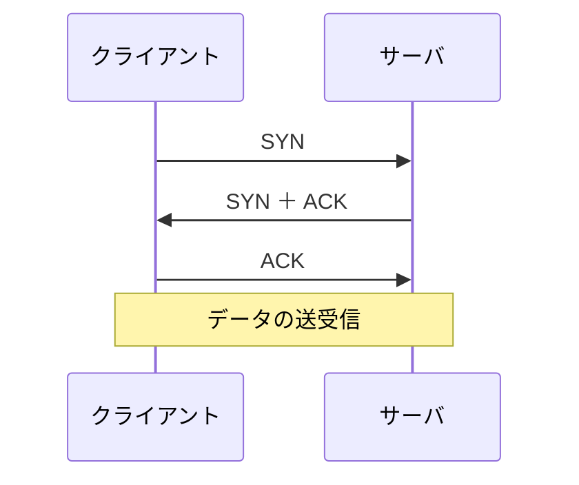

# TCP-QOS.md
## TCP・QoS 暗記シート

***

## TCP ひとことで

**TCP** は、**届いたかを確かめながら送る**（信頼性のある）プロトコル。届かなければ**再送**し、順番も直す。その分、**確認の待ち時間**があり、回線の遅延やパケットロスの影響を受けやすい。

| 項目 | **TCP** | UDP |
| --- | --- | --- |
| 接続 | **コネクションを張る**（3ウェイハンドシェイク） | 張らない |
| 信頼性 | **確認応答・再送・順序制御**がある | ない（必要ならアプリケーションで行う） |
| 速度の調整 | **フロー制御・輻輳制御**がある | ない |
| ヘッダ | **20Byte**（オプションなし） | **8Byte** |
| 向く用途 | Web、メール、ファイル転送 | DNS、DHCP、NTP、SNMP、音声・映像（RTP）、QUIC |

- **音声や映像に UDP を使う理由**: 遅れて届いたデータは使えないので、**再送を待つより、欠けたまま先へ進むほうがよい**から

## コネクションの確立と切断

| フラグ | 意味 |
| --- | --- |
| **SYN** | 接続を始めたい |
| **ACK** | 受け取った（確認応答） |
| **FIN** | 送るデータは終わり（**正常な切断**） |
| **RST** | **強制的な切断**（閉じているポートへの接続、異常時など） |

- 確立は **3ウェイハンドシェイク**（SYN → SYN ＋ ACK → ACK）。このとき、互いの**最初のシーケンス番号**と **MSS**、ウィンドウサイズなどを伝え合う
- 切断は、**両方向それぞれ**で FIN と ACK を交換する（4回のやり取り）
- **閉じているポート**に SYN を送ると **RST** が返る。**FW が捨てている**ときは**何も返らない**（タイムアウトする）→ 切り分けの手がかりになる

## シーケンス番号と確認応答

- **シーケンス番号**: 送るデータの**先頭が、全体の何バイト目か**を示す
- **確認応答番号**: 「**次はこの番号から送ってほしい**」という値（＝ 受け取った最後のバイトの次）
- **SYN と FIN は、データがなくてもシーケンス番号を1つ使う** → SYN への確認応答番号は「**SYN のシーケンス番号 ＋ 1**」（例: SYN の番号が 5000 なら、確認応答番号は 5001）
- 受信側は、シーケンス番号を見て**順番を並べ直し**、重複を捨てる

## MSS と MTU

| 用語 | 意味 | イーサネットでの値 |
| --- | --- | --- |
| **MTU** | 1つの **IP パケット**の最大サイズ（IP ヘッダを含む） | 1,500Byte |
| **MSS** | 1つの **TCP セグメントに入るデータ**の最大サイズ（ヘッダを含まない） | **1,460Byte**（1,500 − IP ヘッダ 20 − TCP ヘッダ 20） |

- MSS は、**SYN のときに互いに伝え**、**小さいほう**を使う
- トンネル（IPsec、PPPoE など）でヘッダが増えると、MTU を超えて**分割（フラグメント）**が起きる → 途中の機器で **MSS を小さく書き換える**
- PPPoE の MTU は **1,492Byte**（PPPoE 6Byte ＋ PPP 2Byte の分小さい）→ MSS は 1,452Byte

## 再送制御

| 方式 | きっかけ | 内容 |
| --- | --- | --- |
| **タイムアウトによる再送** | 一定時間（RTO）待っても **ACK が来ない** | 同じデータを送り直す。待ち時間が長い |
| **高速再送** | **同じ確認応答番号の ACK（重複 ACK）が3回**続けて届いた | タイムアウトを待たずに、**欠けたセグメントをすぐ再送**する |
| SACK（選択的確認応答） | | 「ここからここまでは届いている」と伝え、**欠けた部分だけ**を再送させる |

- 重複 ACK が出る理由: 途中の1つが欠けると、受信側は後続を受け取るたびに「**欠けた番号から送ってほしい**」と同じ ACK を返すから

## フロー制御と輻輳制御

| 制御 | 誰の都合か | 使う値 | 内容 |
| --- | --- | --- | --- |
| **フロー制御** | **受信側** | **ウィンドウサイズ**（受信側が通知する） | 受信バッファの**空きの分だけ**送らせる。空きがなくなるとウィンドウサイズ 0 を通知し、送信を止めさせる |
| **輻輳制御** | **ネットワーク** | **輻輳ウィンドウ**（送信側が自分で決める） | 混雑を見ながら、送る量を増減する |

- 送信側が一度に送れる量 ＝ **ウィンドウサイズと輻輳ウィンドウの小さいほう**
- **スライディングウィンドウ**: ACK を1つずつ待たず、**ウィンドウの分はまとめて送る**。ACK が届くたびに、送れる範囲を先へずらす

### 輻輳制御の動き

| 段階 | 動き |
| --- | --- |
| **スロースタート** | 小さい値から始め、ACK が届くたびに**倍々に**増やす |
| **輻輳回避** | しきい値を超えたら、**少しずつ**増やす |
| パケットロスを検知 | **混雑したと判断**して、輻輳ウィンドウを**小さくする**（高速再送なら半分、タイムアウトなら最小から） |

- TCP は、**パケットロスを「混雑の印」とみなして送る量を絞る** → **ロスの多い回線（無線など）では、帯域が空いていても遅くなる**

### 遅延とスループット

TCP は、**ウィンドウの分を送ったら ACK を待つ**。往復の時間（RTT）が長いと、待つ時間が増える。

**スループットの上限 ≒ ウィンドウサイズ ÷ 往復の遅延時間（RTT）**

例）ウィンドウサイズ 65,535Byte、RTT 100ms → 65,535 × 8 ÷ 0.1 ≒ **約 5.2Mbps**（回線が 1Gbps でも、これ以上は出ない）

| 対策 | 内容 |
| --- | --- |
| **ウィンドウスケール** | オプションで、ウィンドウサイズを **65,535Byte より大きく**する |
| 複数のコネクションを使う | 並列に転送する |
| **WAN 高速化装置** | 拠点の両側に置き、**代理で ACK を返す**、データを**圧縮・キャッシュ**する、などで遅延の影響を減らす |

## TCP と FW

- ステートフルな FW は、**通信の状態（セッション）を覚えて**、戻りの通信を通す
- **一定時間通信がないセッションは、FW が消す** → 長時間つなぎっぱなしで通信の間があくアプリケーションは、**突然切れる**
- 対策: **キープアライブ**を FW のタイムアウトより短い間隔で送る。または FW のタイムアウトを延ばす
- 行きと戻りで**別の FW を通る**（非対称ルーティング）と、戻り側の FW には状態がないので**捨てられる**

## QoS ひとことで

**QoS** は、回線が混んだときに、**大事な通信を先に・確実に通す**しくみ。IP は基本が**ベストエフォート**（早い者勝ち）なので、何もしないと音声も大容量のファイル転送も同じ扱いになる。

| 品質の指標 | 意味 | 影響 |
| --- | --- | --- |
| **遅延** | 届くまでの時間 | 会話がかみ合わない（音声は片方向 **150ms 以下**が目安） |
| **ジッタ**（揺らぎ） | 遅延の**ばらつき** | 音が途切れる・乱れる → 受信側の**ジッタバッファ**でためて吸収する |
| **パケットロス** | 届かない割合 | 音が欠ける（音声は再送しない） |

## QoS の処理の流れ

| 処理 | 内容 |
| --- | --- |
| **分類**（クラシファイ） | IP アドレス、ポート番号、VLAN などで、通信を**種類（クラス）に分ける** |
| **マーキング** | 分けた結果を、**フレームやパケットのヘッダに印として書き込む** |
| **キューイング** | クラスごとの**待ち行列（キュー）**に入れる |
| **スケジューリング** | **どのキューから先に送り出すか**を決める |

- 分類とマーキングは**ネットワークの入口**で1回行い、途中の機器は**印だけを見て**処理する

## マーキング

| 印 | 場所 | ビット数 | 範囲 |
| --- | --- | --- | --- |
| **CoS** | **IEEE 802.1Q の VLAN タグ**の中（レイヤ2） | **3bit** | 0〜7 |
| IP プレシデンス | IP ヘッダの ToS フィールドの上位 | 3bit | 0〜7 |
| **DSCP** | IP ヘッダの **ToS（DS）フィールド**の上位（レイヤ3） | **6bit** | 0〜63 |

- **CoS は VLAN タグの中**にあるので、**タグのないフレームには付けられない**。ルータを越えると**消える** → 拠点間で引き継ぐには **DSCP** を使う（CoS と DSCP を対応付けて書き換える）
- DSCP の代表的な値: **EF（46）** ＝ 最優先（音声）、AF ＝ クラス分けした優先、**0** ＝ ベストエフォート
- PC が自分で高い優先度の印を付けてくることがある → **入口のスイッチで印を付け直す**（信頼する範囲を決める）

## 優先制御と帯域制御

| 制御 | 内容 |
| --- | --- |
| **優先制御** | 優先度の高いキューを**先に**送る |
| **帯域制御** | クラスごとに**使える帯域を割り当てる**（保証する、または上限を決める） |

| キューの方式 | 内容 | 弱点 |
| --- | --- | --- |
| FIFO | 届いた順に送る | 優先の区別がない |
| **PQ**（優先キューイング） | **優先度の高いキューが空になるまで**、低いキューを送らない | 低い優先度の通信が**まったく送られなくなる**ことがある |
| **WRR / WFQ**（重み付き） | キューごとの**重みの割合**で順に送る | 音声の遅延を保証しにくい |
| **LLQ** | **音声だけ最優先（PQ）**にし、残りを重み付きで分ける | |

- キューがあふれると、後から来たパケットは捨てられる（**テールドロップ**）。多くの TCP が**同時に速度を落とし、同時に上げる**ことを繰り返し、回線を使い切れなくなる → あふれる前に**少しずつランダムに捨てる**（RED・WRED）

### シェーピングとポリシング

| 方式 | 超えた分の扱い | 特徴 | 使う場所 |
| --- | --- | --- | --- |
| **シェーピング** | **バッファにためて、遅らせて送る** | 捨てない（その分、**遅延が増える**） | **送信側**（出口） |
| **ポリシング** | **捨てる**（または優先度を下げる） | 遅延は増えない。TCP は再送になる | **受信側**（入口） |

- **契約帯域が物理的な速度より小さい**回線（例: 1Gbps の回線で契約は 100Mbps）では、**送信側のルータで 100Mbps にシェーピング**する → 通信事業者の側で超過分が**捨てられるのを防ぐ**
- シェーピングしてから、その帯域の中で優先制御を行う

### IntServ と DiffServ

| 方式 | 内容 | 特徴 |
| --- | --- | --- |
| IntServ | 通信ごとに、経路上の全ルータで**帯域を予約**する（RSVP） | 品質を保証できるが、**通信の数が増えると破綻**する |
| **DiffServ** | **DSCP の印**を見て、**各ルータがクラスごとに**処理する | 予約しないので**大規模でも動く**。現在の主流 |

- QoS が効くのは、**自分で管理しているネットワークの中だけ**。インターネットでは印を無視される

## 試験でよく問われるポイント

### TCP

| 論点 | 覚えること |
| --- | --- |
| MSS | **MTU − 40**。トンネルを通すときは MSS を小さくする |
| 高速再送 | **重複 ACK 3回**で再送する |
| フロー制御と輻輳制御 | **フロー制御は受信側の都合**、**輻輳制御はネットワークの都合** |
| 遅延とスループット | **遅延が大きいと下がる**（ACK 待ち）。上限 ≒ ウィンドウサイズ ÷ RTT |
| 無通信での切断 | FW の**無通信タイムアウト**で切れる → **キープアライブ** |

### QoS

| 論点 | 覚えること |
| --- | --- |
| マーキング | **CoS は VLAN タグの 3bit**、**DSCP は IP ヘッダの 6bit** |
| シェーピングとポリシング | **シェーピングはためて遅らせる**、**ポリシングは捨てる** |
| 音声 | **UDP（RTP）**。遅延・ジッタ・ロスに弱いので**最優先**にする |

### 答えの型

| 問われ方 | 答えの型 |
| --- | --- |
| 遅延の大きい回線で転送が遅い理由 | 「**ACK を待つ時間が長く**なり、一定時間に送れるデータ量が減るから」 |
| ロスの多い回線で TCP が遅くなる理由 | 「ロスを**輻輳と判断して、送信量を絞る**から」 |
| IP 電話の音声に UDP を使う理由 | 「**再送による遅延**が、音声の品質を下げるから」 |
| FW 経由の TCP が無通信で切断される理由 | 「FW が、**一定時間通信のないセッションの情報を削除**するから」 |
| 入口のスイッチで QoS の値を付け直す理由 | 「端末が**勝手に高い優先度を付けた**通信を、優先させないため」 |
| 拠点間で CoS ではなく DSCP を使う理由 | 「**CoS は VLAN タグの中**にあり、ルータを越えると失われるから」 |
| 契約帯域が物理速度より小さい回線でシェーピングする理由 | 「**契約帯域を超えた分が、通信事業者の網で捨てられる**のを防ぐため」 |
| QoS で PQ を使うときの問題点 | 「優先度の高い通信が続くと、**低い優先度の通信が送られなくなる**」 |
| QoS で音声を最優先にする理由 | 「音声は**遅延と揺らぎに弱く**、遅れて届いたパケットは使えないから」 |

関連: [tcp.md](tcp.md) / [udp.md](udp.md) / [voip.md](voip.md) / [../operation/qos.md](../operation/qos.md) / [../operation/calculation.md](../operation/calculation.md) / [../wan-vpn/ipsec.md](../wan-vpn/ipsec.md)（MSS の調整）
