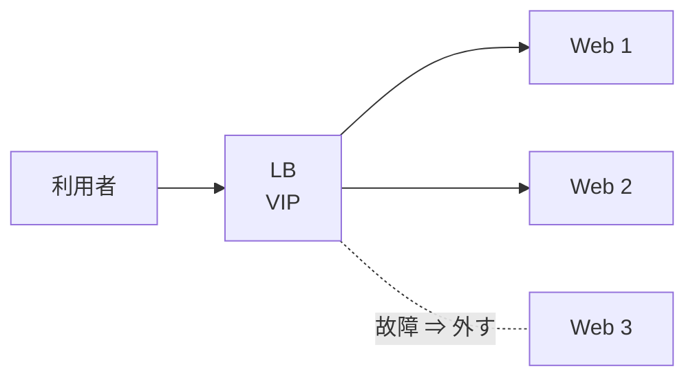
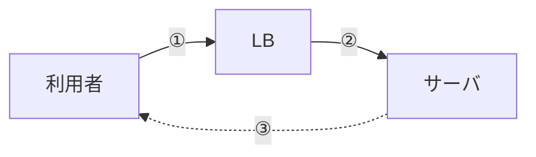
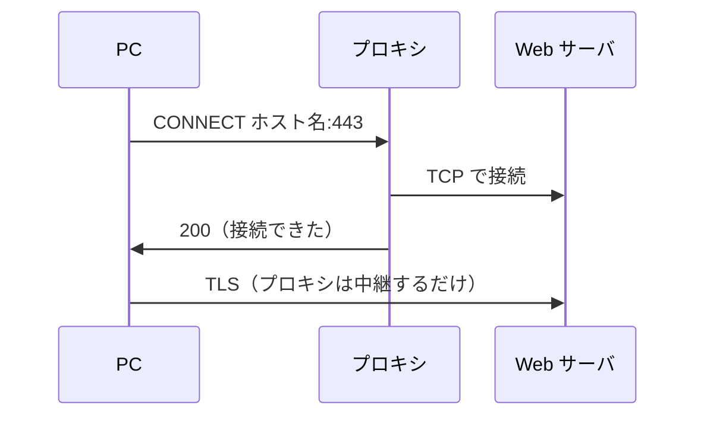

# LB-PROXY.md
## 負荷分散・プロキシ 暗記シート

***

## ひとことで

**負荷分散装置（LB）**は、**仮想 IP アドレス（VIP）**で利用者からの通信を受け、**複数のサーバへ振り分ける**装置。処理能力を増やすことと、サーバが故障しても続けられることが目的。

| 基本機能 | 内容 |
| --- | --- |
| **負荷分散** | 決めた方式で、サーバへ通信を振り分ける |
| **ヘルスチェック**（死活監視） | サーバが正常かを定期的に確かめ、**異常なサーバを振り分け先から外す** |
| **セッション維持**（パーシステンス） | 同じ利用者の通信を、**同じサーバへ送り続ける** |

- DNS には **VIP を登録**する。利用者からは1台のサーバに見える

## 振り分け方式

| 方式 | 内容 | 向いている場面 |
| --- | --- | --- |
| **ラウンドロビン** | **順番に**振り分ける | サーバの性能が同じ |
| 重み付きラウンドロビン | サーバごとの**重みに応じた割合**で振り分ける | サーバの性能に差がある |
| **最小コネクション数** | **今の接続数が最も少ない**サーバへ | 通信の長さがばらばら |
| 最速応答 | 応答が最も速いサーバへ | |
| 送信元 IP アドレスのハッシュ | 送信元 IP アドレスから計算して決める | 同じ利用者を同じサーバへ送りたい |

## セッション維持

**なぜ必要か**: ログインの状態や買い物かごの中身（**セッション情報**）を**サーバ1台の中だけ**で持っていると、途中で別のサーバに振り分けられたときに**情報が引き継がれない**（ログインし直しになる）。

| 方式 | しくみ | 弱点 |
| --- | --- | --- |
| **送信元 IP アドレス** | 同じ送信元 IP アドレスを同じサーバへ（レイヤ3） | **プロキシや NAPT を通る**と多数の利用者が同じ IP アドレスになり、**1台に偏る**。途中で IP アドレスが変わると切れる |
| **Cookie** | LB が**サーバの識別情報を Cookie に入れて**返す。以後は Cookie を見て同じサーバへ（レイヤ7） | **HTTPS では中身が見えない** → **LB で TLS を終端**する必要がある |
| TLS のセッション ID | セッション ID が同じなら同じサーバへ | セッション ID が作り直されると切れる |

- 別の解決方法: セッション情報を**サーバ間で共有**する（共有のデータベースやキャッシュに置く）→ どのサーバに振り分けられてもよくなる

## ヘルスチェック

| 階層 | 方法 | 分かること |
| --- | --- | --- |
| レイヤ3 | **ping**（ICMP） | サーバ（OS）が動いているか |
| レイヤ4 | **TCP のポートへ接続** | サービスのプロセスがポートを開いているか |
| **レイヤ7** | **HTTP のリクエストを送り、応答コードや内容を確認** | **アプリケーションが正しく応答するか** |

- ping やポートの確認だけでは、「**プロセスは動いているが、アプリケーションが異常**」（データベースにつながらない、など）を見つけられない → **レイヤ7 のヘルスチェック**を使う
- **間隔**と「**何回続けて失敗したら外すか**」を決める。短くすると検知は速いが、**サーバと LB の負荷が増え**、一時的な遅れでも外してしまう
- 保守のときは、そのサーバへの**新しい振り分けだけを止め**、処理中の通信が終わるのを待ってから停止する

## レイヤ4 とレイヤ7

| 種類 | 見るもの | できること |
| --- | --- | --- |
| **L4 LB** | IP アドレス、ポート番号 | 高速。中身は見ない |
| **L7 LB** | **URL、Host ヘッダ、Cookie** など HTTP の中身 | URL ごとに別のサーバ群へ振り分ける、Cookie でセッション維持、ヘッダの追加 |

### TLS の終端

**サーバ証明書と秘密鍵を LB に置き**、LB が復号する。

| 利点 | 内容 |
| --- | --- |
| HTTP の中身が見える | **Cookie や URL** を使った振り分けができる |
| サーバの負荷が減る | 暗号処理を LB が受け持つ |
| 証明書の管理が1か所 | サーバごとに証明書を入れなくてよい |

- **LB とサーバの間は平文**になる（必要なら、LB からサーバへ TLS を張り直す）

## 送信元 IP アドレスの扱い

LB が**送信元 IP アドレスを自分のアドレスに変換**（送信元 NAT）すると、サーバからは**すべての通信が LB から来た**ように見える。

- 困ること: サーバの**アクセスログに利用者の IP アドレスが残らない**。IP アドレスによる制限もできない
- 対策: LB が、HTTP ヘッダの **X-Forwarded-For** に**元の送信元 IP アドレスを入れて**サーバへ渡す。サーバはこのヘッダの値をログに記録する
- X-Forwarded-For は **HTTP のヘッダ**なので、HTTPS のままでは追加できない（**TLS を終端**している必要がある）

## 構成

| 構成 | 内容 | 戻りの通信 |
| --- | --- | --- |
| **インライン**（ツーアーム） | LB が利用者とサーバの**間に入る**。サーバのデフォルトゲートウェイは LB | 必ず LB を通る |
| **ワンアーム** | LB を L3SW に**横付け**する。LB を通す必要のない通信は LB を通らない | **送信元 NAT** で、サーバから見た相手を LB にして戻りを LB に通す |
| **DSR** | 行きだけ LB を通り、**戻りはサーバから直接**返す | **LB を通らない** |

- **戻りの通信が LB を通らない**と、利用者は VIP 宛てに送ったのに**サーバの実 IP アドレスから応答が届き**、通信が成り立たない → 戻りを LB に通す（DSR は例外）

### DSR（Direct Server Return）

- ① 利用者が **VIP 宛て**に送る → ② LB が**宛先 MAC アドレスだけ**を書き換えてサーバへ → ③ サーバが、**送信元を VIP にして直接**利用者へ返す

| 項目 | 内容 |
| --- | --- |
| しくみ | LB は**宛先 MAC アドレスだけ**をサーバのものに書き換える（**宛先 IP アドレスは VIP のまま**） |
| サーバ側の設定 | **ループバックインタフェースに VIP を設定**する（VIP 宛てのパケットを受け取るため）。**VIP への ARP には応答しない**設定にする |
| 利点 | 応答が LB を通らないので、**LB がボトルネックにならない**（動画配信など、**応答のデータ量が大きい**場合に有効） |
| 制約 | LB とサーバを**同じセグメント**に置く。LB は応答を見ないので、**Cookie によるセッション維持や TLS の終端はできない** |

## LB の冗長化

- LB 自体が単一障害点にならないよう、**2台（アクティブとスタンバイ）**にする
- VIP は **VRRP と同じしくみ**で引き継ぐ
- **セッション維持の情報や接続の状態を2台で同期**する → 切り替わっても、利用者の通信が続く

## GSLB（広域負荷分散）

**DNS の応答を使って、複数の拠点（データセンター）へ振り分ける**。

- GSLB の装置が**権威 DNS サーバ**として動き、**各拠点の状態（ヘルスチェックの結果・負荷）を見て**、返す IP アドレスを変える
- 用途: **災害対策**（拠点が止まったら別の拠点の IP アドレスを返す）、拠点間の負荷分散
- **TTL を短く**しておく（キャッシュが残っている間は、古い拠点へアクセスしてしまう）
- 判断の材料になるのは**キャッシュ DNS サーバの IP アドレス**で、利用者本人のものではない

## プロキシ

**利用者とサーバの間に入り、通信を代理する**サーバ。

| 種類 | 置く場所 | 主な機能 |
| --- | --- | --- |
| **フォワードプロキシ** | 社内の PC とインターネットの間（**PC の代理**） | **URL フィルタリング**、利用者の認証、**アクセスログ**の記録、マルウェアの検査、キャッシュ |
| **リバースプロキシ** | インターネットと社内の Web サーバの間（**サーバの代理**） | 負荷分散、**TLS の終端**、キャッシュ、WAF、認証（シングルサインオン）、サーバを外部から隠す |
| 透過型プロキシ | 通信の経路上 | PC の設定なしで、通信を横取りして代理する |

### フォワードプロキシの要点

- **名前解決はプロキシが行う** → PC は外部の名前を解決しなくてよい
- **FW で「プロキシ以外からインターネットへの HTTP・HTTPS」を禁止**する → マルウェアが直接外部と通信するのを防ぎ、すべての通信を**プロキシのログに残せる**
- プロキシの認証が必要なら、プロキシは **407**（Proxy Authentication Required）を返す
- プロキシを通ると、Web サーバから見た送信元は**プロキシの IP アドレス**になる（元の IP アドレスは X-Forwarded-For で伝える）
- **PAC ファイル**: 宛先に応じて「このプロキシを使う」「直接接続する」を決めるスクリプト。PC に配って、**特定の SaaS だけ直接接続**させる、といった使い分けができる

### HTTPS とプロキシ（CONNECT メソッド）

- PC は、プロキシに **CONNECT メソッド**で「このホストの 443番へつないでほしい」と頼む
- プロキシは TCP の接続を**中継するだけ**。TLS は **PC と Web サーバの間**で張られるので、**プロキシには中身が見えない**
- そのため、URL フィルタリングに使えるのは **CONNECT で指定されたホスト名まで**（パスは見えない）。マルウェアの検査もできない

| 中身を検査したいとき | 内容 |
| --- | --- |
| **TLS の復号**（HTTPS の検査） | プロキシが **PC との TLS** と **Web サーバとの TLS** を**別々に張る**。プロキシは、接続先のサーバ証明書を**その場で作って** PC に見せる |
| 必要な準備 | プロキシが証明書の発行に使う**ルート証明書を、PC に信頼済みとして入れておく**（入れないと、PC で証明書の警告が出る） |

## CDN

**コンテンツを各地のキャッシュサーバに置き、利用者に近いサーバから配信する**サービス。

- 元のサーバ（**オリジンサーバ**）の**負荷が減り**、応答が速くなる。大量のアクセスや DDoS 攻撃にも強い
- 利用者を CDN へ向けるには、DNS で**ホスト名を CDN の名前の別名（CNAME）にする**
- キャッシュできるのは**静的なコンテンツ**（画像など）。利用者ごとに変わる内容はキャッシュさせない
- オリジンサーバへの**直接のアクセスは、CDN からだけに制限**する（直接攻撃されるのを防ぐ）

## 試験でよく問われるポイント

### 負荷分散装置

| 論点 | 覚えること |
| --- | --- |
| 基本機能 | **負荷分散**、**ヘルスチェック**、**セッション維持** |
| セッション維持 | 送信元 IP アドレスでは、**プロキシや NAPT を通ると偏る** → **Cookie** を使う |
| TLS の終端 | Cookie や X-Forwarded-For を使うには、**LB で TLS を終端**する |
| ヘルスチェック | **レイヤ7** で、アプリケーションの異常まで見つける |
| X-Forwarded-For | **元の送信元 IP アドレス**をサーバに伝える |
| DSR | 戻りが **LB を通らない**。サーバの**ループバックに VIP** を設定する |
| GSLB | **DNS** で拠点を振り分ける。**TTL を短く**する |

### プロキシ

| 論点 | 覚えること |
| --- | --- |
| HTTPS の中継 | **CONNECT** で中継されるので、**プロキシには中身が見えない** |
| HTTPS の検査 | **ルート証明書を PC に入れて**、プロキシで復号する |
| FW の設定 | **プロキシ以外からの外向き通信を禁止**する |

### 答えの型

| 問われ方 | 答えの型 |
| --- | --- |
| LB でセッション維持が必要な理由 | 「セッション情報を**サーバごとに持っている**ので、別のサーバに振り分けられると処理を続けられないから」 |
| 送信元 IP アドレスでのセッション維持が偏る理由 | 「プロキシ経由の通信は**送信元 IP アドレスが同じ**になり、特定のサーバに偏るから」 |
| Cookie でセッション維持するために LB で TLS を終端する理由 | 「**暗号化されたままでは Cookie や URL を見られない**から」 |
| LB のヘルスチェックをレイヤ7で行う理由 | 「ポートは開いているが**アプリケーションが応答しない**障害を検知するため」 |
| LB で X-Forwarded-For を使う理由 | 「LB が送信元を変換するので、**サーバで利用者の IP アドレスを知る**ため」 |
| LB を DSR 構成にする利点 | 「**応答が LB を通らない**ので、LB の処理能力や帯域がボトルネックにならない」 |
| DSR でループバックに VIP を設定する理由 | 「**宛先 IP アドレスが VIP のまま**届くパケットを、サーバが受け取れるようにするため」 |
| GSLB で TTL を短くする理由 | 「障害時に、**DNS のキャッシュが早く切れて**、別の拠点へ切り替わるようにするため」 |
| プロキシで HTTPS の中身を検査できない理由 | 「CONNECT で中継するだけで、**PC とサーバの間で暗号化**されているから」 |
| プロキシで HTTPS を検査するための PC 側の準備 | 「**プロキシのルート証明書を PC に信頼済みとして登録**する」 |
| プロキシ以外の外向き通信を FW で止める理由 | 「マルウェアなどが**プロキシを通らずに外部と通信する**のを防ぐため」 |

関連: [load-balancer.md](load-balancer.md) / [vrrp.md](vrrp.md) / [../protocol/http.md](../protocol/http.md) / [../protocol/dns.md](../protocol/dns.md) / [../security/auth-pki.md](../security/auth-pki.md)
