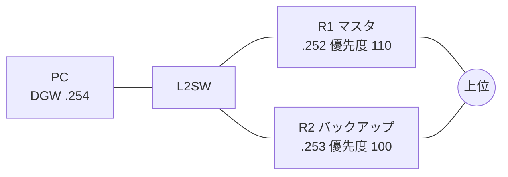
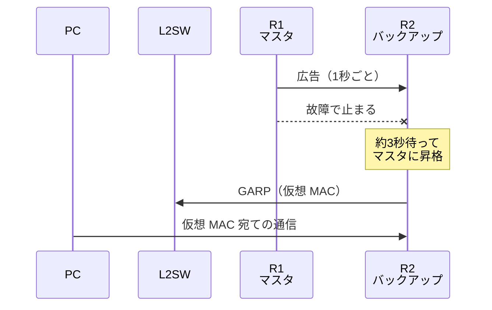
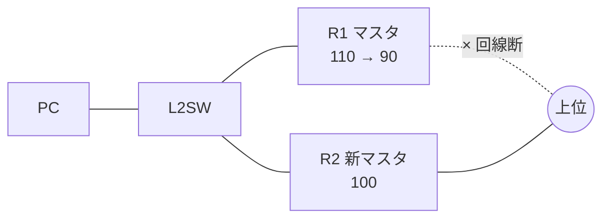

# VRRP.md
## VRRP 暗記シート

***

## ひとことで

**VRRP**（Virtual Router Redundancy Protocol）は、**デフォルトゲートウェイを冗長化**するプロトコル。複数のルータ（L3SW）で**仮想 IP アドレスと仮想 MAC アドレスを共有**し、1台の**仮想ルータ**に見せる。

- PC のデフォルトゲートウェイには**仮想 IP アドレス**を設定する
- ふだんは**マスタ**が仮想 IP アドレス宛ての通信を処理し、マスタが故障したら**バックアップ**が引き継ぐ
- 切り替わっても仮想 IP アドレスと仮想 MAC アドレスは変わらないので、**PC の設定も ARP テーブルも変えなくてよい**

- R1（実 IP アドレス 192.168.1.252）と R2（192.168.1.253）が、**仮想 IP アドレス 192.168.1.254** を共有する（VRID 1 なら仮想 MAC アドレスは 00-00-5E-00-01-01）
- PC のデフォルトゲートウェイ（DGW）は、仮想 IP アドレスの 192.168.1.254

## 用語

| 用語 | 内容 |
| --- | --- |
| **仮想ルータ** | 複数のルータをまとめた、論理的な1台のルータ |
| **VRID**（Virtual Router ID） | VRRP のグループを示す ID（1〜255）。**同じ VRID のルータ同士**でマスタとバックアップを選出する |
| **仮想 IP アドレス** | 仮想ルータの IP アドレス。PC のデフォルトゲートウェイに設定する |
| **仮想 MAC アドレス** | **00-00-5E-00-01-XX**（XX ＝ VRID）。VRID から自動で決まる |
| **マスタ**（Master） | 仮想 IP アドレスを受け持ち、**ARP に応答し、パケットを転送する**ルータ |
| **バックアップ**（Backup） | 待機しているルータ。マスタからの広告を監視する |
| **優先度**（Priority） | マスタの選出に使う値（1〜254、**初期値 100**）。**大きいほど優先** |
| **VRRP アドバタイズメント** | **マスタが定期的に送る広告**。宛先は**マルチキャストアドレス 224.0.0.18**、初期値は **1秒間隔** |
| **プリエンプト**（Preempt） | 優先度の高いルータが、**今のマスタから役割を奪う**動作 |

- VRRP は IP の上で直接動く（**IPプロトコル番号 112番**。TCP・UDP ではない）
- アドバタイズメントは **TTL 255** で送られ、**ルータを越えない**（同じセグメントの中だけ）

### VRRP アドバタイズメントの中身

| フィールド | 内容 |
| --- | --- |
| Version | VRRP のバージョン（IPv4 では基本は 2。**VRRPv3 は IPv6 にも対応**） |
| **VRID** | VRRP のグループ |
| **Priority** | 送信したルータの優先度 |
| Advertise Interval | アドバタイズメントの送信間隔 |

## マスタの選出

1. **Priorityが最も大きいルーター**がマスタになる
2. 優先度が同じ場合は、**実 IP アドレスが最も大きいルーター**がマスタになる

| 優先度の値 | 意味 |
| --- | --- |
| 1〜254 | 設定できる範囲（初期値 100） |
| **255** | **仮想 IP アドレスと同じ実 IP アドレスを持つルータ**（IP アドレスオーナ）。必ずマスタになる |
| **0** | マスタが「**マスタをやめる**」と知らせるときの値（停止するときに送る → バックアップがすぐに引き継ぐ） |

- STP のルートブリッジは「値が**小さい**ほうが優先」。VRRP は「**大きい**ほうが優先」。混同しない

## 切替え（フェールオーバー）のしくみ

1. バックアップは、マスタからのアドバタイズメントを監視している
2. **アドバタイズメントが一定時間届かない**と、マスタが故障したと判断する
3. バックアップが**マスタに昇格**し、アドバタイズメントを送り始める
4. 新しいマスタは **GARP（Gratuitous ARP）**を送る。送信元 MAC アドレスは**仮想 MAC アドレス**
5. **L2SW の MAC アドレステーブルが書き換わり**、仮想 MAC アドレス宛てのフレームが新しいマスタのポートへ届くようになる

| 項目 | 内容 |
| --- | --- |
| 故障と判断するまでの時間 | **アドバタイズメント間隔 × 3 ＋ スキュー時間**（初期値では**約3秒**） |
| スキュー時間 | (256 − 優先度) ÷ 256 秒。**優先度が高いバックアップほど早く**マスタになる |
| PC 側で変わるもの | **何も変わらない**（デフォルトゲートウェイも ARP テーブルもそのまま） |
| L2SW 側で変わるもの | **MAC アドレステーブル**（仮想 MAC アドレスの学習先のポート） |

- マスタが ARP 要求に答えるときは、**実 MAC アドレスではなく仮想 MAC アドレス**で答える。だから切り替わっても **PC の ARP テーブルを更新しなくて済む**

## プリエンプト

- **有効**（VRRP の初期値）: 優先度の高いルータが復旧すると、**自動でマスタに戻る**（切戻し）
- **無効**: 復旧しても、今のマスタが動いている限り**交代しない**。切戻しは手動で行う

| 設定 | 利点 | 欠点 |
| --- | --- | --- |
| 有効 | **自動で元の構成に戻る**。トラッキングと組み合わせて使える | 切戻しのたびに**短い通信断**が起きる。回線が不安定だと切替えを**繰り返す** |
| 無効 | **切戻しの時刻を管理者が決められる**（業務時間外に行える） | 手作業が必要。元に戻すまで、想定と違う経路のまま |

## トラッキング（上位側の障害への対応）

VRRP のアドバタイズメントは **LAN 側**で送られる。そのため、**マスタの WAN 側（上位側）の回線が切れても、LAN 側は正常なのでマスタのまま**になる。PC はマスタへ送り続けるが、**その先へ届かない**。

- **対策**: 上位側のインタフェースや経路を監視し、**障害を検知したら自分の優先度を下げる**（**トラッキング**）
- 例）R1 は 110、R2 は 100。R1 が上位側の回線断を検知して優先度を 20 下げ、**90** にする → R2（100）のほうが高くなり、**R2 がマスタになる**
- **下げた後の値が、バックアップの優先度より小さくなる**ように設定する
- バックアップ側で**プリエンプトを有効**にしておく（無効だと、優先度が逆転しても交代しない）

| 監視する対象 | 内容 |
| --- | --- |
| インタフェース | 上位側のポートがリンクダウンしたら優先度を下げる |
| 経路・到達性 | ping の応答や経路の有無を監視する（**リンクは上がっているが、その先で切れている**障害に対応できる） |

## 負荷分散

VRRP はふだん**マスタしか転送しない**ので、バックアップの機器と回線は使われない。両方を使うには、**グループを2つ作って互い違いにマスタにする**。

| グループ | 仮想 IP アドレス | R1 | R2 | 使う PC |
| --- | --- | --- | --- | --- |
| VRID 1 | 192.168.1.254 | **マスタ** | バックアップ | 半分の PC（または VLAN 10） |
| VRID 2 | 192.168.1.253 | バックアップ | **マスタ** | 残りの PC（または VLAN 20） |

- 同じセグメントで分ける場合は、**PC ごとにデフォルトゲートウェイの設定を変える**必要がある（DHCP で配り分ける）
- **VLAN ごと**にマスタを分けるほうが管理しやすい

## 設計の注意点

| 論点 | ポイント |
| --- | --- |
| **STP との組合せ** | VLAN ごとに、**ルートブリッジと VRRP のマスタを同じ機器にする**。別々だと、通信がブロッキングポートを避けて**遠回り**する |
| **両方がマスタになる** | ルータ間の L2 の経路が切れると、アドバタイズメントが届かず**両方がマスタ**になる → ルータ間の接続を**冗長化**する（リンクアグリゲーション、複数の経路） |
| 戻りの通信 | VRRP が決めるのは **PC からの行きの経路だけ**。戻りの経路は上位側のルーティングで決まる → 行きと戻りで違う機器を通ることがある |
| **FW の冗長化** | FW では、**内側と外側の両方**でマスタを同じ機器にそろえる。通信の状態（セッション情報）は VRRP では引き継がれないので、**別の機能で同期**する |
| フィルタの設定 | 機器間で **224.0.0.18 宛て（プロトコル番号 112）**の通信を止めない |

### HSRP との違い

| 項目 | **VRRP** | HSRP |
| --- | --- | --- |
| 規格 | **標準**（RFC） | シスコ独自 |
| 役割の名前 | マスタ / バックアップ | アクティブ / スタンバイ |
| 宛先 | 224.0.0.18（プロトコル番号 112） | 224.0.0.2（UDP 1985番） |
| 仮想 MAC アドレス | 00-00-5E-00-01-XX | 00-00-0C-07-AC-XX |
| 仮想 IP アドレス | **実 IP アドレスと同じでもよい** | 実 IP アドレスとは別にする |
| プリエンプトの初期値 | **有効** | 無効 |

## 試験でよく問われるポイント

### 基本

| 論点 | 覚えること |
| --- | --- |
| PC の設定 | **デフォルトゲートウェイには仮想 IP アドレス**を設定する |
| マスタの選出 | **優先度が最も大きい**ルータ。同じなら実 IP アドレスが大きいほう |
| アドバタイズメント | **マスタが 224.0.0.18 宛てに送る**。届かなくなったら、バックアップが昇格する |

### 切替え

| 論点 | 覚えること |
| --- | --- |
| 切替えのとき | **GARP で L2SW の MAC アドレステーブルを更新**する。PC の設定・ARP テーブルは変わらない |
| 上位側の障害 | **切り替わらない** → **トラッキングで優先度を下げる** |
| プリエンプト | 有効なら**自動で切り戻る**。無効なら手動 |

### 設計

| 論点 | 覚えること |
| --- | --- |
| 負荷分散 | **グループを2つ作る** |
| STP との組合せ | **STP のルートブリッジと VRRP のマスタを同じ機器に**する |

### 答えの型

| 問われ方 | 答えの型 |
| --- | --- |
| ゲートウェイを VRRP で冗長化する利点 | 「ルータが故障しても、PC の**デフォルトゲートウェイの設定を変えずに**通信を続けられる」 |
| バックアップがマスタの故障を知る方法 | 「マスタからの **VRRP アドバタイズメントを一定時間受信しない**ことで検知する」 |
| 新しいマスタが GARP を送る理由 | 「L2SW の **MAC アドレステーブルを更新**させ、仮想 MAC アドレス宛てのフレームを新しいマスタへ届けるため」 |
| 切替え後も PC の ARP テーブルを更新しなくてよい理由 | 「切り替わっても、**仮想 IP アドレスと仮想 MAC アドレスが変わらない**から」 |
| マスタの WAN 側の障害で切り替わらない理由 | 「**LAN 側ではアドバタイズメントが届き続ける**ので、バックアップがマスタの異常を検知できないから」 |
| マスタの WAN 側の障害で切り替えるための対策 | 「WAN 側のインタフェースを監視し、障害時に**優先度をバックアップより小さい値に下げる**」 |
| プリエンプトを無効にする理由 | 「復旧時の自動切戻しによる**通信断を避け**、切戻しの時刻を管理者が決めるため」 |
| 2台ともマスタになる原因 | 「ルータ間の経路が切れ、**アドバタイズメントが届かなくなった**から」 |

関連: [load-balancer.md](load-balancer.md) / [../lan/lag-stp.md](../lan/lag-stp.md) / [../routing/multicast.md](../routing/multicast.md)（224.0.0.18） / [../routing/reliability.md](../routing/reliability.md)
