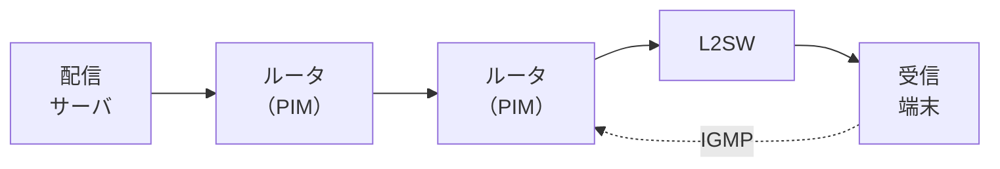
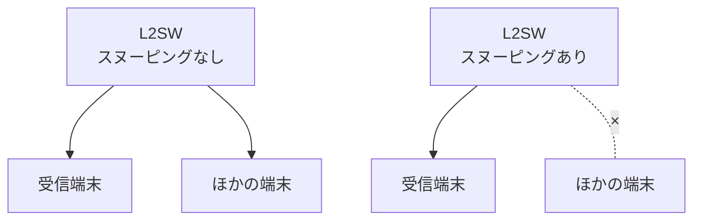

# MULTICAST.md
## マルチキャスト 暗記シート

***

## ひとことで

**マルチキャスト**は、**特定のグループに参加している端末だけ**に、同じデータを**1回の送信で**届ける通信。映像配信や、ルーティングプロトコルのやり取り（OSPF・VRRP など）に使う。

| 通信 | 宛先 | 特徴 |
| --- | --- | --- |
| ユニキャスト | 1台 | 受信者が増えると、**送信者と回線の負荷が受信者の数だけ増える** |
| ブロードキャスト | 同じセグメントの全員 | **関係のない端末にも届く**。ルータを越えない |
| **マルチキャスト** | **グループに参加した端末** | 送信は1回。**必要な端末にだけ届く**。ルータを越えられる |

- マルチキャストは **UDP** で送る（1対多なので、TCP のコネクションは作れない）→ **再送はされない**
- マルチキャストアドレスは**宛先にだけ**使う。**送信元は必ずユニキャストアドレス**

### 3つのしくみ

| しくみ | 働く場所 | 役割 |
| --- | --- | --- |
| **IGMP** | **受信端末とルータの間** | 端末が「このグループを受信したい」とルータに伝える |
| **PIM** | **ルータとルータの間** | 配信サーバから受信端末のいるルータまでの**配信経路（ディストリビューションツリー）**を作る |
| **IGMP スヌーピング** | **L2SW** | 受信端末のいる**ポートにだけ**フレームを流す |

## マルチキャストIPアドレス

**224.0.0.0 〜 239.255.255.255**（クラス D、**224.0.0.0/4**）。1つのアドレスが1つの**グループ**を表す。

| 範囲 | アドレス | 用途 |
| --- | --- | --- |
| リンクローカル | 224.0.0.0 〜 224.0.0.255 | **同一セグメント上**で使用されるアドレス（**リンクローカルアドレス**）。**TTL 1 で送られ、ルータを越えない** |
| グローバル | 224.0.1.0 〜 238.255.255.255 | **インターネット上で予約**されたアドレス（このうち 232.0.0.0/8 は SSM 用） |
| プライベート | 239.0.0.0 〜 239.255.255.255 | 組織内などの**プライベート空間で使用**されるアドレス。企業内の映像配信に使用されるケースが多い |

### 代表的な予約済みリンクローカルアドレス

| アドレス | 宛先 / 用途 |
| --- | --- |
| **224.0.0.1** | **全ホスト宛**（同じセグメントの全端末） |
| **224.0.0.2** | **全ルータ宛** |
| 224.0.0.5 | 全 OSPF ルータ宛 |
| 224.0.0.6 | 全 OSPF DR/BDR ルータ宛 |
| 224.0.0.9 | RIPv2 |
| 224.0.0.13 | **全 PIM ルータ宛**。PIM ルータどうしの Hello、Join / Prune の宛先（Register は RP へユニキャストで送る） |
| 224.0.0.18 | VRRP 用に予約 |
| 224.0.0.22 | IGMP 用に予約（IGMPv3 の参加通知） |

## マルチキャストMACアドレス

マルチキャスト IP アドレスから、**計算で** MAC アドレスを作る（ARP は使わない）。

- 先頭の 24bit は『**01-00-5E**』で固定し、**25ビット目は常に0で固定**
- 残りの 23bit に、マルチキャスト IP アドレスの**下位23bit**をそのままコピーする（水色の x の部分）

**マッピングの例**

| IPアドレス | 2進（第2〜第4オクテット） | MACアドレス |
| --- | --- | --- |
| 224.100.1.1 | **0**1100100 . 00000001 . 00000001 | 01-00-5E-**64**-01-01 |
| 224.228.1.1 | **1**1100100 . 00000001 . 00000001 | 01-00-5E-**64**-01-01 |

- IP アドレスの先頭 4bit（1110）は全グループ共通。残り 28bit のうち、MAC アドレスに入るのは 23bit → **5bit が捨てられる**
- そのため、**32個（2 の 5乗）の IP アドレスが同じ MAC アドレス**になる（**完全に1:1のマッピングとならない**）
- 同じ MAC アドレスのフレームは届いてしまうので、受信端末は **IP アドレス**を見て、自分が参加しているグループか**識別**する

**計算の手順**（例: 239.130.5.9）

| 手順 | 内容 |
| --- | --- |
| 1 | 第1オクテット（239）は捨てる |
| 2 | 第2オクテット（130）が **128 以上なら 128 を引く** → 2（16進で 02） |
| 3 | 第3・第4オクテットを 16進にする → 05、09 |
| 4 | 01-00-5E の後ろに並べる → **01-00-5E-02-05-09** |

## IGMP

**IGMP**（Internet Group Management Protocol）は、**マルチキャストグループへの参加と脱退を管理**するプロトコル。受信端末が**上位のルータに参加・脱退を伝える**ことで、ルータは配信が必要なグループを判断できる。

- IP の上で直接動く（**IPプロトコル番号 2番**）。**TTL 1** で送られ、ルータを越えない
- ルータはすべての受信端末を把握する必要はなく、**セグメントに1台でも受信端末がいる**と分かればよい

### メッセージ

| メッセージ | 送る側 | 宛先 | 内容 |
| --- | --- | --- | --- |
| **Membership Report**（Join） | 受信端末 | 参加するグループのアドレス（IGMPv3 は 224.0.0.22） | 「このグループを**受信したい**」 |
| **Membership Query**（General Query） | ルータ | **224.0.0.1**（全端末） | 「受信している端末は**まだいるか**」と**定期的に**確認 |
| **Leave Group** | 受信端末 | **224.0.0.2**（全ルータ） | 「このグループから**抜ける**」（IGMPv2 から） |
| **Specific Membership Query**（Group-Specific Query） | ルータ | 抜けると言われたグループのアドレス | 「そのグループに**ほかの受信端末は残っているか**」（IGMPv2 から） |

### バージョンの違い

| 動作 | IGMPv1 | IGMPv2 | IGMPv3 |
| --- | --- | --- | --- |
| 参加 | Membership Report を送る | 同左 | 同左。さらに**配信元の IP アドレスを指定できる（ソースフィルタ機能）** |
| 維持 | ルータが **224.0.0.1** 宛てに Membership Query を定期的に送り、受信端末が Report で応答する | 同左 | 同左 |
| 脱退 | **何も送らない**。Query に応答がなくなって初めて配信が止まる（**止まるまでに時間がかかる**） | **Leave Group** を送る → ルータが Specific Membership Query で残りを確認 → いなければ**すぐに配信を止める** | 同左 |

- IGMPv2 で**明示的な脱退**ができるようになり、**不要な配信を早く止められる**ようになった
- IGMPv3 で**ソースフィルタ**（配信元の指定）ができるようになった → **PIM-SSM** に必要
- 同じセグメントにルータが複数あるときは、**IP アドレスが最も小さいルータ**が Query を送る役（**クエリア**）になる

## IGMP スヌーピング

L2SW は、マルチキャストのフレームを**ブロードキャストと同じように全ポートへ流す**（宛先 MAC アドレスを学習できないため）。受信しない端末にも届き、**帯域と端末の処理能力をむだに使う**。

- 図の左がスヌーピングなし（**受信しない端末にも届く**）、右がスヌーピングあり（**受信端末にだけ届く**）
- **IGMP スヌーピング**: L2SW が端末とルータの間の **IGMP メッセージをのぞき見て**、「どのポートの先に、どのグループの受信端末がいるか」を覚える
- マルチキャストのフレームを、**受信端末のいるポートとルータのつながるポートにだけ**転送する

| 注意点 | 内容 |
| --- | --- |
| **クエリアが必要** | Query を送るルータがいないと、端末が Report を送り続けず、L2SW が**受信端末を忘れて配信が止まる** |
| ルータのない VLAN | 同じ VLAN の中だけで配信するときは、**L2SW の IGMP クエリア機能**を有効にする |
| IPv6 の場合 | IGMP の代わりに **MLD** を使うので、**MLD スヌーピング** |

## PIM

**PIM**（Protocol Independent Multicast）は、**マルチキャスト用のルーティングプロトコル**。配信サーバから受信端末までの経路（**ディストリビューションツリー**）を作り、**受信が不要なルータにはマルチキャストを転送しない**ようにする。

- 「Protocol Independent」＝ **ユニキャストのルーティングプロトコルの種類に依存しない**（OSPF でも BGP でも、できあがったルーティングテーブルを使う）
- PIM ルータ同士は **224.0.0.13** 宛ての Hello で隣のルータを見つける（IPプロトコル番号 103番）

### RPF チェック（ループの防止）

- ルータは、マルチキャストのパケットが「**送信元へ向かうときに使うインタフェース**」から届いたかを確かめる（**RPF**: Reverse Path Forwarding）
- **違うインタフェースから届いたパケットは捨てる** → パケットがぐるぐる回る**ループを防ぐ**
- 「送信元へ向かうインタフェース」は、**ユニキャストのルーティングテーブル**で決める

### PIM の Mode

| モード | 経路の決定方法 | 向いている環境 |
| --- | --- | --- |
| **PIM-DM**（Dense Mode / デンスモード） | **Flood & Prune** 方式。まず全ルータへ流し（Flood）、**受信端末のいないルータが「不要」と伝えて（Prune）**止めてもらう | 企業内の LAN など、受信端末が**密集**している環境 |
| **PIM-SM**（Sparse Mode / スパースモード） | **RP（Rendezvous Point）**と **join** を用いる。受信端末のいるルータが RP へ向けて join を送り、**必要な経路にだけ**流す | WAN など、受信端末が**分散**している環境 |
| **PIM-SSM**（Source-Specific Multicast） | **配信元の IP アドレスを指定**して join を送る。RP は不要 | 配信元が決まっている映像配信など |

### PIM-SM の動き

1. **送信側**: 配信サーバにつながるルータが、マルチキャストのパケットを **Register** メッセージ（ユニキャスト）に包んで **RP** へ送る
2. **受信側**: 受信端末から IGMP で参加を受けたルータが、**RP へ向けて join** を送る。途中のルータが配信経路を覚える
3. **RP で両者が出会い**、RP を経由して配信が始まる（**RP ツリー**、共有ツリー）
4. その後、受信側のルータが**配信元へ直接 join** を送り、RP を通らない**最短経路**に切り替える（**SPT**: 最短パスツリー）

- **RP** は、送信側と受信側が**待ち合わせる場所**になるルータ。全ルータに RP のアドレスを設定する（または自動で配る）
- RP が止まると新しい配信を始められない → **RP を冗長化**する

### PIM-DM / PIM-SM と PIM-SSM の違い

- PIM-DM と PIM-SM は、**配信元を指定せず**（グループだけで）ツリーを作る
- **PIM-SSM** は**配信元の IP アドレスを指定**してツリーを作る → **信頼できる配信元からだけ**受信できる
- PIM-SSM を使うには、**IGMPv3 のソースフィルタ機能が必要**

| 特徴 | PIM-DM | PIM-SM | **PIM-SSM** |
| --- | --- | --- | --- |
| 配信元の指定 | 無 | 無 | **有** |
| ツリーの作り方 | Flood & Prune | RP と join | 配信元へ直接 join |
| RP | 不要 | **必要** | 不要 |
| 向いている環境 | 受信端末が**密集**（LAN） | 受信端末が**分散**（WAN） | 配信元が決まっている配信 |
| 不要なトラフィック | **多い**（最初に全体へ流す） | 少ない | **最も少ない** |

## ほかの技術との関係

| 技術 | 関係 |
| --- | --- |
| **OSPF・VRRP・RIPv2** | 隣の機器とのやり取りにリンクローカルのマルチキャスト（224.0.0.x）を使う |
| **IPsec** | **マルチキャストを通せない** → **GRE over IPsec** で包んで通す |
| **VXLAN** | BUM フレームを届ける方法の1つとして、アンダーレイのマルチキャストを使う |
| **無線 LAN** | マルチキャストは**低い伝送速度**で送られ、再送もされない → 映像配信ではユニキャストに変換する機能を使うことがある |
| **IPv6** | ブロードキャストがなく、**マルチキャストで代用**する（ff02::1 ＝ 全ノード、ff02::2 ＝ 全ルータ）。IGMP に当たるのは **MLD**。MAC アドレスは 33-33 で始まる |

## 試験でよく問われるポイント

- マルチキャストは**送信1回で、参加した端末だけ**に届く。**UDP** を使う
- **224.0.0.0/24 はルータを越えない**。組織内の配信には **239.0.0.0/8**
- MAC アドレスは **01-00-5E ＋ IP アドレスの下位23bit**。**32個の IP アドレスが同じ MAC アドレス**になる
- **IGMP は端末とルータの間、PIM はルータとルータの間**
- **IGMPv2 は Leave Group**（すぐ止められる）、**IGMPv3 はソースフィルタ**（PIM-SSM に必要）
- **IGMP スヌーピング**で、L2SW が受信端末のいるポートにだけ流す
- **PIM-DM は Flood & Prune、PIM-SM は RP と join**
- **RPF チェック**でループを防ぐ

### 答えの型

| 問われ方 | 答えの型 |
| --- | --- |
| マルチキャストで配信する利点 | 「受信端末が増えても、**配信サーバと回線の負荷が増えない**」 |
| IGMP スヌーピングを使う理由 | 「受信端末のいないポートへの**不要なフレームの転送を止め**、帯域と端末の負荷を減らすため」 |
| IGMP スヌーピングのしくみ | 「**IGMP メッセージを監視**して、受信端末のつながるポートを学習する」 |
| IGMPv2 で改善された点 | 「**Leave Group** で脱退を伝えられ、**不要な配信を早く止められる**」 |
| PIM-SM が WAN に向く理由 | 「**join を送ったルータにだけ**配信するので、不要なトラフィックが流れない」 |
| PIM-DM が WAN に向かない理由 | 「最初に**全ルータへ流す**ので、帯域の小さい回線にも不要なトラフィックが流れる」 |
| RPF チェックの目的 | 「送信元への経路と違うインタフェースから届いたパケットを捨て、**ループを防ぐ**」 |
| 受信端末が IP アドレスも確認する理由 | 「**複数の IP アドレスが同じ MAC アドレス**に対応し、別のグループのフレームも届くから」 |

関連: [ospf.md](ospf.md)（224.0.0.5/6、GRE over IPsec） / [../redundancy/vrrp.md](../redundancy/vrrp.md)（224.0.0.18） / [../lan/vxlan.md](../lan/vxlan.md)（BUM フレーム） / [../ip-address/ipv6.md](../ip-address/ipv6.md)（MLD）
