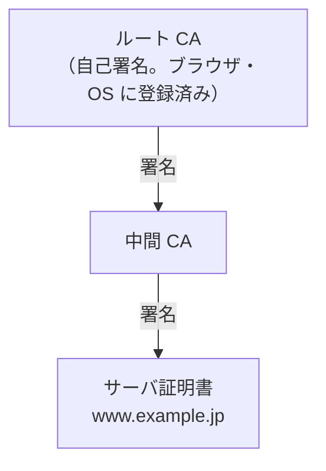
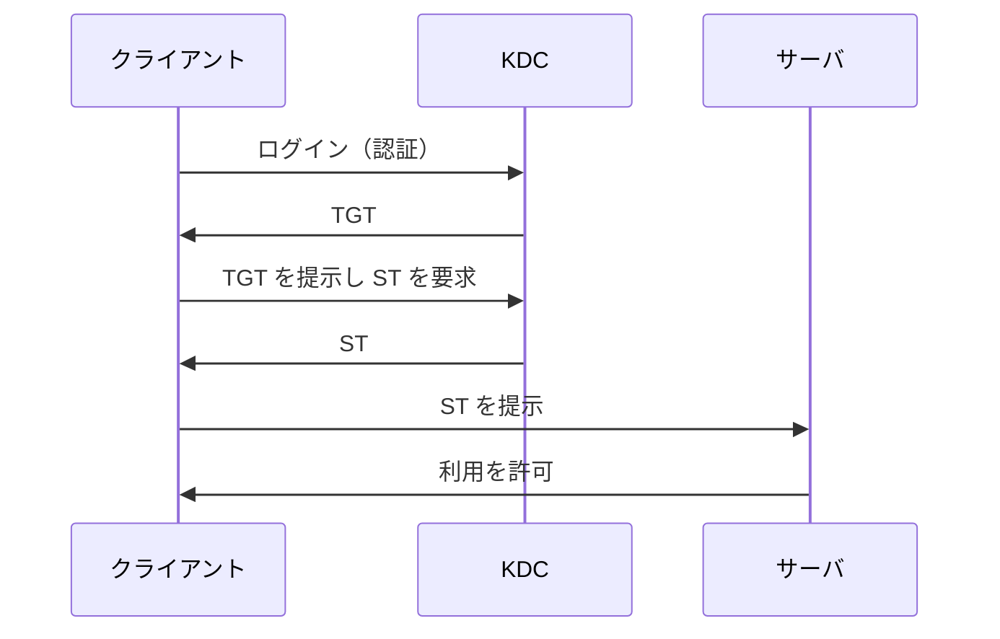
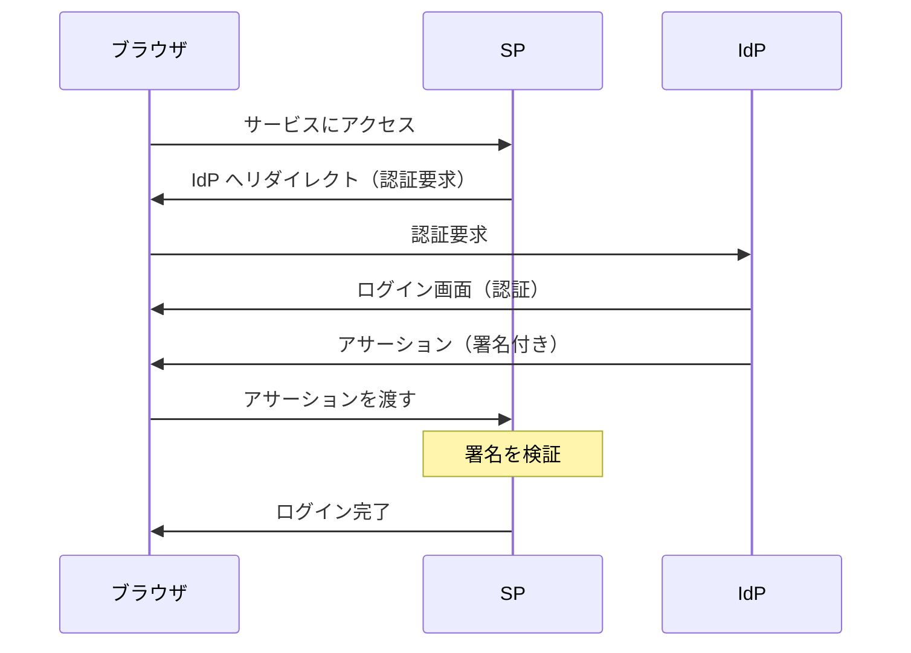

# AUTH-PKI.md
## 認証・PKI 暗記シート

***

TLS のハンドシェイクの詳細は [../protocol/tls.md](../protocol/tls.md)、無線 LAN の 802.1X・EAP は [../lan/wifi-cheatsheet.md](../lan/wifi-cheatsheet.md) も参照。

## 暗号技術の使い分け

| 技術 | しくみ | 守れるもの | 例 |
| --- | --- | --- | --- |
| **共通鍵暗号** | 暗号化と復号に**同じ鍵**を使う。**速い** | 機密性 | AES |
| **公開鍵暗号** | **公開鍵**で暗号化し、**秘密鍵**で復号する。**遅い** | 機密性、鍵の受け渡し | RSA、楕円曲線 |
| **ハッシュ関数** | データから固定長の値を作る。元に戻せない | 完全性（改ざん検知） | SHA-256 |
| **メッセージ認証符号（MAC）** | **共有鍵＋データ**から作る値 | 完全性、送信者の確認（相手も同じ鍵を持つ） | HMAC |
| **デジタル署名** | ハッシュ値を**送信者の秘密鍵**で署名し、**公開鍵**で検証する | 完全性、本人確認、**否認防止** | RSA 署名、ECDSA |

- **ハイブリッド暗号**: 公開鍵暗号（や鍵交換）で**共通鍵を安全に共有**し、データは**共通鍵で暗号化**する（TLS・IPsec）
- n 人が互いに通信するときの鍵の数: 共通鍵は **n(n−1)/2 個**、公開鍵は **2n 個**（各自が鍵ペア1組）

| 用途 | 使う鍵 |
| --- | --- |
| **暗号化**して送る | **受信者の公開鍵**で暗号化 → 受信者の秘密鍵で復号 |
| **署名**して送る | **送信者の秘密鍵**で署名 → 送信者の公開鍵で検証 |

## PKI と証明書

**公開鍵が本当にその相手のものか**を、信頼できる第三者（**認証局、CA**）が**デジタル証明書**で保証する仕組み。

| 証明書（X.509）の項目 | 内容 |
| --- | --- |
| **Subject**（サブジェクト） | 証明書の**持ち主**（サーバ名・利用者名） |
| **SAN / コモン名** | 対象のホスト名。**アクセスした URL のホスト名と一致しないと警告**が出る |
| Issuer | 発行した CA |
| **公開鍵** | 持ち主の公開鍵 |
| **有効期間** | 開始日時と終了日時 |
| **シリアル番号** | CA が付ける番号。失効リストはこの番号で示す |
| **CA の署名** | 上の内容を CA の秘密鍵で署名したもの |

### 証明書の検証（受け取った側がすること）

1. **署名の検証**: 手元の**ルート証明書**から証明書チェーンをたどり、CA の署名が正しいか
2. **有効期間**内か
3. **失効していないか**（CRL・OCSP）
4. **名前の一致**: 接続先のホスト名と、証明書の SAN / コモン名が一致するか

| 失効の確認方法 | しくみ | 特徴 |
| --- | --- | --- |
| **CRL**（証明書失効リスト） | 失効した証明書の**シリアル番号の一覧**を CA が公開。定期的に取得する | 一覧が大きくなる。更新までの間は失効に気付けない |
| **OCSP** | 証明書1枚ごとに、失効していないかを**その場で問い合わせる** | 新しい情報が得られる。OCSP レスポンダへの通信が必要 |

- 秘密鍵が漏れた・機器を紛失した・退職した → **証明書を失効**させる
- **プライベート CA**（社内 CA）で発行した証明書は、**その CA のルート証明書を各端末に入れておく**必要がある（入れていないと警告が出る）

## TLS のポイント

| 役割 | 内容 |
| --- | --- |
| **暗号化** | 共通鍵で通信を暗号化（盗聴の防止） |
| **サーバの認証** | **サーバ証明書**で、接続先が本物か確認（なりすましの防止） |
| **改ざん検知** | MAC や認証付き暗号（AEAD）で検知 |
| クライアントの認証（任意） | **クライアント証明書**で端末・利用者を確認 |

| 用語 | 内容 |
| --- | --- |
| **暗号スイート** | 鍵交換・認証・暗号化・ハッシュのアルゴリズムの**組合せ**。Client Hello で候補を示し、サーバが選ぶ |
| **DHE / ECDHE** | **使い捨ての鍵**で共通鍵を作る鍵交換 |
| **前方秘匿性**（PFS） | サーバの秘密鍵が後から漏れても、**過去の通信は復号されない**（DHE / ECDHE で実現） |
| **SNI** | Client Hello で**接続したいホスト名**を伝える拡張 → 1つの IP アドレスで複数サイトの証明書を使い分けられる |
| **ALPN** | TLS の中で上位プロトコル（HTTP/2 など）を決める拡張 |
| **ダウングレード攻撃** | 弱い暗号やバージョンを使わせる攻撃 → 古いバージョン・弱い暗号スイートを無効にする |
| **HSTS** | 「以後は HTTPS で接続せよ」とブラウザに指示する HTTP ヘッダ |

### TLS をどこで終端するか

| 構成 | 内容 | ポイント |
| --- | --- | --- |
| **LB で終端** | **サーバ証明書と秘密鍵を LB に置き**、LB で復号する | LB が HTTP の中身（Cookie・URL）を見て振り分けられる。サーバの負荷が減る。**LB とサーバの間は平文**になる |
| **プロキシ・SWG で復号**（HTTPS の検査） | プロキシが利用者とサーバの間に入り、**TLS を張り直す** | プロキシが発行した証明書を信頼させるため、**プロキシのルート証明書を PC に入れる** |
| 復号しない場合 | 中身が見えない | URL フィルタは**ホスト名（SNI や CONNECT の宛先）まで**しか使えず、マルウェアの検査もできない |

## 認証の方式

| 方式 | しくみ | ポイント |
| --- | --- | --- |
| **Basic 認証** | ID とパスワードを **Base64** で送る | 暗号化ではない → **TLS が必須** |
| **Digest 認証** | パスワードを**ハッシュ化**して送る | パスワードそのものは流れない |
| **チャレンジレスポンス** | サーバが送る**乱数（チャレンジ）とパスワードを演算**した結果を返す | パスワードが流れず、**毎回値が変わる**ので盗聴しても再利用できない |
| **ワンタイムパスワード** | 1回限りのパスワード（時刻やカウンタから生成） | 盗まれても再使用できない |
| **クライアント証明書** | 対応する**秘密鍵を持っていること**で本人（端末）を確認 | 許可した端末だけに接続を限定できる。失効の管理が必要 |
| **多要素認証** | **知識**（パスワード）・**所持**（スマートフォン・IC カード）・**生体**のうち2種類以上 | パスワードの漏えいだけでは突破されない |

- **認証**: 本人かどうかを確かめる / **認可**: その操作をする権限があるかを確かめる

## 認証サーバとプロトコル

| 名前 | 内容 | ポート |
| --- | --- | --- |
| **RADIUS** | 認証（Authentication）・認可（Authorization）・アカウンティング（Accounting）を行う。**AP・スイッチ・VPN 装置が RADIUS クライアント**になる | **UDP 1812**（認証）/ **1813**（アカウンティング） |
| **LDAP** | 利用者やグループの情報を管理する**ディレクトリ**にアクセスする | TCP 389（LDAPS は 636） |
| **Kerberos** | **チケット**で認証する。Active Directory で使う | TCP/UDP 88 |

### IEEE 802.1X

| 役割 | 機器 |
| --- | --- |
| **サプリカント** | 認証を受ける端末 |
| **オーセンティケータ** | **スイッチ・AP**（RADIUS クライアント）。認証が済むまでポートを通さない |
| **認証サーバ** | **RADIUS サーバ** |

- **認証 VLAN（ダイナミック VLAN）**: 認証結果に応じて、RADIUS が**接続する VLAN を指定**する
- 認証スイッチと端末の間に別のスイッチがあるとき、**EAP のフレームを透過（そのまま通す）**できる機器でないと認証できない
- 802.1X に対応しない機器（プリンタなど）は **MAC アドレス認証**で代用する（MAC は偽装できるので強度は低い）

### Kerberos

| 用語 | 内容 |
| --- | --- |
| **KDC** | 鍵配布センター。チケットを発行する（Active Directory のドメインコントローラ） |
| **TGT** | 利用者の**身分証明**のチケット。最初のログインで受け取る |
| **ST**（サービスチケット） | **特定のサーバを使うため**のチケット。**サーバの鍵で暗号化**されている |

- 一度ログインすれば、TGT を使って各サーバの ST をもらえる → **シングルサインオン**
- チケットには有効期限があり、**時刻がずれていると認証に失敗する** → **NTP で時刻を同期**する

## シングルサインオン（SSO）

### SAML

| 用語 | 内容 |
| --- | --- |
| **IdP**（Identity Provider） | **認証を行う側**。利用者の ID 情報を持つ |
| **SP**（Service Provider） | **サービスを提供する側**（クラウドサービスなど） |
| **アサーション** | IdP が発行する「この利用者を認証した」という**署名付きの XML 文書**（認証・属性・権限の情報） |
| 署名の検証 | SP は、**信頼する IdP が発行したこと**と**改ざんされていないこと**を、IdP の公開鍵（証明書）で確かめる |

- SP と IdP は**直接通信せず、ブラウザを経由**してやり取りする → SP から社内の IdP へ通信できなくてもよい
- 事前に、SP と IdP の間で**証明書などの情報を交換して信頼関係**を作っておく
- **パスワードは IdP にだけ**送られ、SP には渡らない

### OAuth 2.0 と OpenID Connect

| 規格 | 目的 | 渡されるもの |
| --- | --- | --- |
| **OAuth 2.0** | **認可**（権限の委譲）。利用者のパスワードを渡さずに、別のサービスへ**データへのアクセス権**を与える | **アクセストークン**（期限切れ後は**リフレッシュトークン**で再発行） |
| **OpenID Connect** | **認証**。OAuth 2.0 に本人確認の仕組みを加えたもの | **ID トークン**（認証結果） |
| **SAML** | 認証（主に企業向けの SSO） | アサーション（XML） |

## 午後でよく問われるポイント

| 問われ方 | 答えの型 |
| --- | --- |
| サーバ証明書で何を確認するか | **接続先のサーバが本物であること**（なりすましでないこと） |
| 証明書の検証で確認すること | **CA の署名が正しいこと、有効期間内であること、失効していないこと、ホスト名が一致すること** |
| 証明書を失効させる理由 | **秘密鍵が漏えいした（機器を紛失した）証明書を使った不正な接続を防ぐ**ため |
| プライベート CA の証明書で警告が出る理由 | **その CA のルート証明書が端末に登録されていない**ため |
| HTTPS を検査するために PC に入れるもの | **プロキシ（SWG）のルート証明書** |
| TLS を LB で終端する理由・必要な作業 | LB が**通信の中身を見て振り分ける**ため。**サーバ証明書と秘密鍵を LB に移す** |
| クライアント証明書を使う利点 | **許可した端末（証明書と秘密鍵を持つ端末）だけ**に接続を限定できる |
| 前方秘匿性とは | **秘密鍵が漏えいしても、過去に記録された通信を復号されない**性質 |
| SAML で SP が署名を検証する目的 | アサーションが**信頼する IdP で作られ、改ざんされていない**ことを確かめるため |
| Kerberos で時刻同期が必要な理由 | チケットの**有効期限の確認に時刻を使う**ため、ずれると認証に失敗する |
| チャレンジレスポンスの利点 | **パスワードがネットワークを流れず、盗聴されても再利用できない** |

関連: [../protocol/tls.md](../protocol/tls.md) / [../lan/wifi-cheatsheet.md](../lan/wifi-cheatsheet.md) / [../lan/ieee802x.md](../lan/ieee802x.md) / [../wan-vpn/ipsec.md](../wan-vpn/ipsec.md) / [security.md](security.md)
