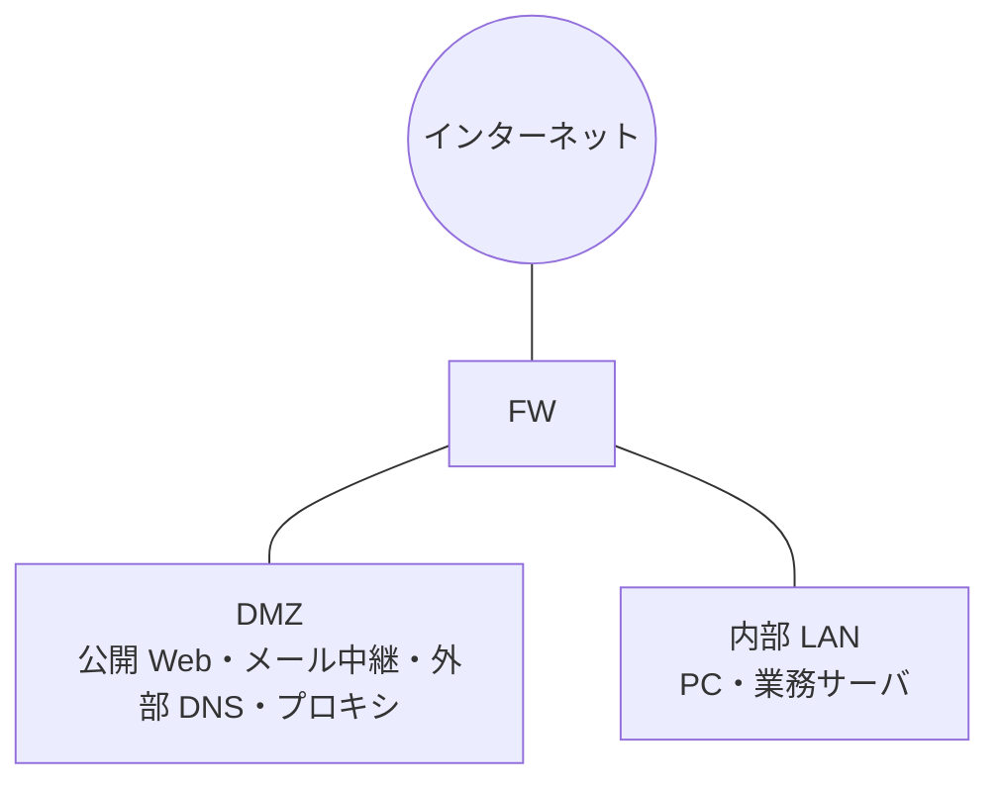

# SECURITY.md
## セキュリティ 暗記シート（FW・DMZ・NAT・攻撃と対策）

***

証明書・TLS・認証は [auth-pki.md](auth-pki.md)、DNS への攻撃は [../protocol/dns.md](../protocol/dns.md)、メールは [../protocol/mail-security.md](../protocol/mail-security.md) を参照。

## ファイアウォール（FW）

| 種類 | しくみ | ポイント |
| --- | --- | --- |
| **静的パケットフィルタリング** | 送信元・宛先の IP アドレス、ポート番号、プロトコルだけで判断。**通信の状態を覚えない** | **戻りの通信も明示的に許可**する必要がある |
| **ステートフルインスペクション** | **通信の状態（セッション）を記録**する | **行きを許可すれば、戻りは自動で許可**される。現在の主流 |
| アプリケーションゲートウェイ（プロキシ） | アプリケーションの中身まで見て中継する | 細かく制御できるが遅い |

**ルールの読み方**
- **上から順に照合**し、**最初に一致したルール**を適用する（それ以降は見ない）
- どれにも一致しなければ**すべて拒否**（最後に暗黙の拒否）
- 項目: 方向（どのインタフェースからどこへ）・送信元 IP・宛先 IP・プロトコル・宛先ポート・動作（許可 / 拒否）
- 許可は**必要最小限**に（送信元・宛先・ポートを具体的に書く）

### DMZ

**DMZ**: 外部に公開するサーバを置く、**内部 LAN と分けた区画**。公開サーバが乗っ取られても、**内部 LAN へ直接入られない**ようにする。

| 通信の向き | 方針 |
| --- | --- |
| インターネット → DMZ | **公開するサービスだけ**許可（例: Web サーバの TCP 443） |
| インターネット → 内部 LAN | **すべて拒否** |
| DMZ → 内部 LAN | **必要最小限**（例: Web サーバから DB サーバの特定ポートだけ） |
| 内部 LAN → インターネット | **プロキシ経由だけ**許可（PC から直接は出さない） |
| 内部 LAN → DMZ | 必要なサービスだけ |

### FW の冗長化

| 用語 | 内容 |
| --- | --- |
| **ステートフルフェールオーバ** | 主系と待機系で**セッション情報を同期**しておき、切り替わっても**通信が途切れない** |
| 同期しない場合 | 切替え後、確立済みの通信は**いったん切れて張り直し**になる |
| 仮想 FW | 1台の FW を論理的に分け、部署・顧客ごとに独立したルールで使う |

## NAT と NAPT

| 種類 | 変換 | 用途 |
| --- | --- | --- |
| **静的 NAT** | 内部の IP と外部の IP を **1対1** で固定 | 内部のサーバを外部に公開 |
| **NAPT**（IP マスカレード） | **IP アドレスとポート番号**を変換し、**1つのグローバル IP を多数の端末で共有** | 社内 PC のインターネット接続 |
| **宛先 NAT**（ポートフォワーディング） | 外部から来た通信の**宛先**を内部のサーバに変換 | 公開サーバを内部アドレスで運用 |

**NAPT で困ること**

| 問題 | 理由 | 対策 |
| --- | --- | --- |
| **外部から通信を始められない** | 変換テーブルは内部から通信したときに作られる | 静的 NAT・ポートフォワーディング |
| **IPsec が通らない** | ESP にはポート番号がなく、AH は IP ヘッダの書換えで検証に失敗する | **NAT トラバーサル**（ESP を UDP 4500 で包む） |
| **ペイロードに IP アドレスを書くプロトコル**（SIP・FTP）が動かない | 中に書かれたアドレスは変換されない | ALG（FW・ルータが中身も書き換える）、パッシブモード |
| **誰の通信か分からない** | 外部からは全員が同じ IP に見える | **NAPT の変換ログ**や**プロキシの認証ログ**と突き合わせる |

- IPv6 は NAPT を使わない → **FW での通信制御がより重要**になる

## 検知・防御の装置

| 装置 | 役割 | ポイント |
| --- | --- | --- |
| **IDS** | 侵入や攻撃を**検知して通知**する | 通信のコピー（**ミラーポート**）を監視。通信は止めない |
| **IPS** | 検知して**遮断**する | **通信経路上（インライン）**に置く。誤検知すると正常な通信も止まる。故障時に通信を通す**バイパス機能** |
| **WAF** | **Web アプリケーションへの攻撃**（SQL インジェクションなど）を検知・遮断 | HTTP の中身を見る。**TLS を復号した後**に置く |
| **UTM** | FW・IPS・ウイルス対策・URL フィルタなどを**1台にまとめた**装置 | 管理は楽だが、性能と単一障害点に注意 |
| **サンドボックス** | **隔離した環境で実際に動かし**、振る舞いを観察する | **未知のマルウェア**を検出できる |
| **プロキシ / SWG** | Web アクセスを中継。URL フィルタ・認証・ログ | HTTPS は**復号しないと中身を検査できない** |

| 検知方式 | しくみ | 長所・短所 |
| --- | --- | --- |
| **シグネチャ型** | **既知の攻撃パターン**と照合 | 誤検知が少ない。**未知の攻撃は検知できない** |
| **アノマリ型** | **平常時と違う振る舞い**を検知 | 未知の攻撃も検知できる。**誤検知が多い** |

- **フォールスポジティブ**: 正常な通信を攻撃と**誤って検知** / **フォールスネガティブ**: 攻撃を**見逃す**
- **仮想パッチ**: 修正パッチを当てるまでの間、**その脆弱性を狙う通信を IPS・WAF で遮断**する
- **暗号化された通信（TLS）は中身を検査できない** → LB やプロキシで**復号してから**検査する

## DoS / DDoS 攻撃

| 攻撃 | しくみ | 対策 |
| --- | --- | --- |
| **SYN Flood** | SYN だけを大量に送り、**接続待ちの状態でサーバの資源を使い切らせる** | **SYN cookie**（接続が確立するまでメモリを確保しない）、FW・LB で代理応答 |
| **リフレクション攻撃**（DRDoS） | **送信元を標的に偽装**した要求を多数のサーバに送り、**応答を標的に集中**させる。DNS・NTP・Memcached など**小さな要求で大きな応答を返す UDP サービス**が使われる | 踏み台側: オープンリゾルバにしない、NTP の monlist を無効化 / 経路上: **送信元を偽装したパケットを通さない**（uRPF） |
| UDP / ICMP Flood | 大量のパケットで回線を埋める | ISP 側での遮断（上流でないと回線が埋まる） |
| **uRPF**（送信元検証） | 受信したパケットの**送信元への経路が、受信インタフェース側にあるか**確認し、なければ捨てる | 送信元 IP の偽装を防ぐ |

- DDoS は**自社の FW では防ぎきれない**（回線が埋まる）→ ISP の DDoS 対策サービス、CDN、BGP の **RTBH・Flowspec**（[../routing/bgp-cheatsheet.md](../routing/bgp-cheatsheet.md)）

## LAN 内のなりすまし

| 攻撃 | しくみ | 対策 |
| --- | --- | --- |
| **ARP スプーフィング** | **偽の ARP 応答**で、ゲートウェイなどの IP に自分の MAC を対応付けさせ、**通信を横取り**する（中間者攻撃） | **ダイナミック ARP インスペクション**（DHCP スヌーピングの情報と照合） |
| **不正な DHCP サーバ** | 偽の DHCP サーバが、偽のゲートウェイ・DNS を配る | **DHCP スヌーピング**（信頼するポート以外からの DHCP 応答を捨てる） |
| 固定 IP の勝手な設定 | DHCP を使わず IP を手で設定して接続 | DHCP スヌーピングで、**DHCP で割り当てた IP の端末だけ**通信を許可 |
| **IP スプーフィング** | 送信元 IP を偽装 | 外部から来たのに**送信元が内部のアドレス**なら破棄、uRPF |
| 不正な端末の接続 | 許可していない PC を LAN につなぐ | **IEEE 802.1X**、MAC アドレス認証、**検疫ネットワーク** |

## 標的型攻撃とマルウェア

| 段階 | 対策 |
| --- | --- |
| **入口**（侵入） | メールのフィルタ・**サンドボックス**、送信ドメイン認証、URL フィルタ、パッチの適用 |
| **C&C 通信** | **プロキシを必ず経由**させ、**プロキシ認証**を行う（マルウェアは認証を通れないことが多い）。PC から外部への直接通信を FW で拒否。**プロキシ・DNS のログ**で不審な通信先を検知 |
| **内部の拡散** | **セグメントを分割**して FW で制限、管理者権限の分離、**EDR** で端末の挙動を監視 |
| **出口**（持ち出し） | 外部への通信を必要最小限に、通信量・通信先の監視 |

| 用語 | 内容 |
| --- | --- |
| **C&C サーバ** | マルウェアに指令を送る外部のサーバ |
| **DGA** | C&C サーバのドメイン名を**次々に自動生成**して、遮断を逃れる手法 |
| **検疫ネットワーク** | 接続時に**パッチやウイルス対策の状態を検査**し、問題があれば隔離する |
| ポリモーフィック型 | 感染のたびに自分を変化させ、パターン検知を逃れる |
| ビヘイビア法 | マルウェアの**動作**を監視して検出する |

## Web アプリケーションへの攻撃

| 攻撃 | しくみ | 対策 |
| --- | --- | --- |
| **SQL インジェクション** | 入力に SQL 文を混ぜ、データベースを不正に操作 | プレースホルダ、入力の検証、**WAF** |
| **クロスサイトスクリプティング**（XSS） | Web ページに不正なスクリプトを埋め込み、閲覧者のブラウザで実行させる | 出力時のエスケープ、WAF |
| **CSRF** | ログイン中の利用者に、意図しない操作のリクエストを送らせる | トークンによる確認 |
| OS コマンドインジェクション | 入力をシェルに渡させ、不正なコマンドを実行 | シェルを呼ばない、入力の検証 |
| セッションハイジャック | セッション ID を盗んでなりすます | TLS、Cookie の Secure 属性、セッション ID を URL に入れない |
| **パスワードリスト攻撃** | 他のサイトで漏れた ID・パスワードの組でログインを試す | **多要素認証**、使い回しの禁止 |

## ゼロトラスト

| | 境界防御（従来） | ゼロトラスト |
| --- | --- | --- |
| 考え方 | **社内は安全**、境界（FW）で守る | **社内も信頼しない**。アクセスのたびに確認する |
| 確認するもの | どのネットワークから来たか | **利用者**（IdP・多要素認証）と**端末の状態**（パッチ・証明書） |
| 背景 | ― | クラウド利用・テレワークで、守るものが**境界の外**に出た |

- 関連: **ZTNA**（アプリケーション単位で接続を許可）、**SASE**（[../wan-vpn/sd-wan.md](../wan-vpn/sd-wan.md)）

## ログと運用

| 論点 | ポイント |
| --- | --- |
| **時刻同期（NTP）** | 複数の機器のログを**時刻で突き合わせる**ため、全機器の時刻を合わせる |
| ログの集約 | **Syslog サーバ**に集める（機器が乗っ取られてもログが残る）。**SIEM** で相関分析 |
| **端末の特定** | FW・プロキシのログの IP アドレスから、**DHCP のリースログ**・認証ログで**どの PC・誰か**を特定する |
| **ミラーポート** | 通信をコピーして監視装置へ送る。**帯域を超えた分は取りこぼす** |
| **インシデント対応** | 検知 → **封じ込め（ネットワークから切り離す）** → 復旧 → 原因の分析と手順の見直し |
| 証拠の保全 | 感染した PC は**電源を切らずに LAN から切り離す**（メモリ上の証拠を残す） |

## 午後でよく問われるポイント

| 問われ方 | 答えの型 |
| --- | --- |
| DMZ に公開サーバを置く理由 | 公開サーバが侵害されても、**内部 LAN へ直接アクセスされない**ようにするため |
| ステートフルインスペクションの利点 | **戻りの通信を自動で許可**でき、戻り用のルールを書かなくてよい |
| PC から外部への直接通信を FW で拒否する理由 | **マルウェアの C&C 通信をプロキシ経由に限定**し、プロキシで検査・記録するため |
| プロキシ認証の効果 | **認証情報を持たないマルウェアの通信を遮断**できる。**誰の通信か**をログで特定できる |
| HTTPS を復号する理由 | **暗号化された通信の中身を検査**するため（そのままではマルウェアや URL を検査できない） |
| IPS をインラインに置く注意点 | **誤検知で正常な通信を遮断**するおそれ、IPS の**故障時に通信が止まる**（バイパス機能が必要） |
| NAPT 配下の通信元を特定する方法 | **NAPT の変換ログ（やプロキシのログ）と時刻で突き合わせる** → だから NTP が必要 |
| リフレクション攻撃で UDP が使われる理由 | **コネクションレスで送信元を偽装しやすい**ため |
| FW を冗長化したのに通信が切れる理由 | **セッション情報を同期していない**ため、切替え後に通信を張り直す必要がある |
| 感染 PC への最初の対応 | **ネットワークから切り離す**（拡散・情報の持ち出しを止める） |
| セグメントを分ける理由 | マルウェアの**内部での拡散範囲を限定**するため |

関連: [auth-pki.md](auth-pki.md) / [../protocol/dns.md](../protocol/dns.md) / [../protocol/http.md](../protocol/http.md) / [../protocol/mail-security.md](../protocol/mail-security.md) / [../operation/monitoring.md](../operation/monitoring.md) / [../wan-vpn/ipsec.md](../wan-vpn/ipsec.md)
