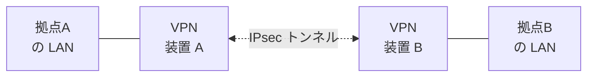
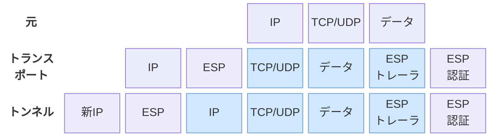
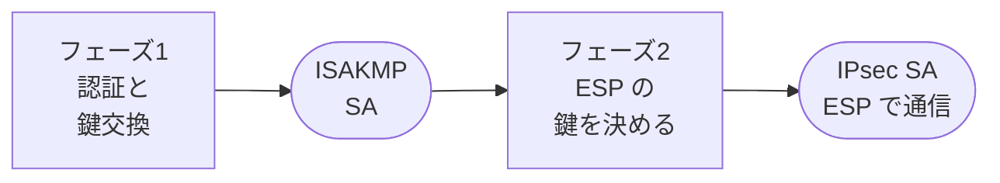
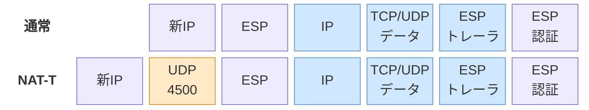

# IPSEC.md
## IPsec 暗記シート

***

## ひとことで

**IPsec**（Security Architecture for IP）は、**ネットワーク層（IP）で暗号化と認証を行う**しくみ。主に**インターネット VPN**（拠点間・リモートアクセス）で使う。IP の上で動くので、**上位が TCP でも UDP でも使える**（アプリケーションに依存しない）。

- 試験でも実務でも、基本は「**ESP ＋ IKE、トンネルモード**」の組合せ
- **IKE** で相手を認証して鍵を作り、**ESP** で実際の通信を暗号化する

- LAN の中は平文、**VPN 装置の間（インターネット上）だけ暗号化**される

## 3つのプロトコル

| プロトコル | 番号 | 役割 |
| --- | --- | --- |
| **AH**（Authentication Header） | **IPプロトコル番号 51番** | **改ざん検知**を行うが、**暗号化はできない**。IP ヘッダも検査の対象なので **NAT を通せない** |
| **ESP**（Encapsulated Security Payload） | **IPプロトコル番号 50番** | **改ざん検知と暗号化**が可能 |
| **IKE**（Internet Key Exchange） | **UDP 500番**（NAT トラバーサル時は **UDP 4500番**） | 相手の認証と**鍵交換**を行い、**SA を確立**する。鍵の素材は **DH（Diffie-Hellman）** で安全に共有する |

- **IPプロトコル番号**は IP ヘッダにある 8bit の欄で、次に続くプロトコルを示す（6 ＝ TCP、17 ＝ UDP、47 ＝ GRE、50 ＝ ESP、51 ＝ AH）
- ESP と AH は **TCP・UDP ではない**ので、**ポート番号を持たない**
- FW で IPsec を通すには「**UDP 500、UDP 4500、ESP（プロトコル番号 50）**」を許可する

### ESP で守れること

| 機能 | 内容 | 使うもの |
| --- | --- | --- |
| 機密性 | 盗聴されても中身が分からない | 共通鍵暗号（AES など） |
| 完全性 | **改ざんを検知**する | **HMAC**（ハッシュ値。ESP 認証データに入る） |
| 送信元の認証 | 正しい相手から届いたことを確かめる | HMAC（鍵を知っている相手しか作れない） |
| **リプレイ防止** | 盗聴したパケットの**再送を検知**して捨てる | ESP ヘッダの**シーケンス番号** |

## トランスポートモードとトンネルモード

- 紫は付け足される部分、**水色は暗号化される部分**

| 項目 | トランスポートモード | **トンネルモード** |
| --- | --- | --- |
| IP ヘッダ | **元の IP ヘッダをそのまま使う** | **新しい IP ヘッダを付ける**（宛先は相手の VPN 装置） |
| **暗号化される部分** | **IPパケットのペイロード部分** ＋ ESP トレーラ | **元のIPヘッダを含むIPパケット全体** ＋ ESP トレーラ |
| 改ざん検知の範囲 | ESP ヘッダ 〜 ESP トレーラ | ESP ヘッダ 〜 ESP トレーラ（**新 IP ヘッダは対象外**） |
| 隠せるもの | 中身だけ（通信している端末の IP アドレスは見える） | **端末の IP アドレスも隠せる**（外から見えるのは VPN 装置のアドレスだけ） |
| 使いどころ | 端末と端末の間（エンドツーエンド）。**L2TP/IPsec、GRE over IPsec** | **拠点間 VPN**、リモートアクセス VPN |

- トンネルモードなら、LAN の**プライベートアドレスのまま**インターネットを越えられる（外側の新 IP ヘッダにグローバルアドレスを使う）

### ESP の各部分

| 部分 | 中身 | 役割 |
| --- | --- | --- |
| **ESP ヘッダ** | **SPI**（セキュリティパラメータインデックス）、**シーケンス番号** | SPI で「どの SA のパケットか」を受信側が見分ける。シーケンス番号でリプレイを防ぐ |
| **ESP トレーラ** | パディング、パディング長、次ヘッダ | 暗号のブロック長に合わせる詰め物と、中身のプロトコル（TCP・UDP など）の情報 |
| **ESP 認証データ** | **HMAC**（ハッシュ値） | 改ざん検知と送信元の認証 |

## SA（Security Association）

**SA** は「この相手とは、この暗号方式・この鍵で通信する」という**取決め（論理的なコネクション）**。

| SA | 作る場面 | 向き | 用途 |
| --- | --- | --- | --- |
| **ISAKMP SA**（IKEv2 では **IKE SA**） | IKE フェーズ1 | **双方向で1本** | IKE 自身のやり取り（フェーズ2 の交渉）を暗号化する |
| **IPsec SA**（IKEv2 では **Child SA**） | IKE フェーズ2 | **片方向**（上りと下りで**2本**） | 実際の通信（ESP）を暗号化する |

- IPsec SA は**1方向のみ**なので、双方向の通信には**最低2本**必要
- IPsec SA は **SPI** で識別する（受信側が SPI を見て、復号に使う鍵を選ぶ）
- SA には**ライフタイム（有効期間）**がある。切れる前に鍵を作り直す ＝ **リキー（Rekey）**。ライフタイムは時間（秒）またはデータ量で決め、ISAKMP SA と IPsec SA で別々に持つ

## IKE のしくみ

### IKEv1

**ISAKMP**（SA の確立と鍵交換の枠組み）を基に作られたバージョン。

| フェーズ | モード | メッセージ数 | 内容 |
| --- | --- | --- | --- |
| **フェーズ1**（Phase1）: 相手の認証と **ISAKMP SA** の確立 | **メインモード**（Main Mode） | **6つ** | ID を**暗号化して**送る。事前共有鍵では相手を **IP アドレスで識別**する → **両端とも固定 IP アドレス**が必要 |
| 〃 | **アグレッシブモード**（Aggressive Mode） | **3つ** | ID を**平文で**送る。ID に FQDN などを使える → **片側が動的 IP アドレスでも接続できる**。安全性はメインモードより低い |
| **フェーズ2**（Phase2）: **IPsec SA** の確立 | **クイックモード**（Quick Mode） | **3つ** | ISAKMP SA で暗号化して、ESP に使う暗号方式と鍵を決める |

- メインモードは「対向機器の IP アドレスも認証する」、アグレッシブモードは「対向機器の IP アドレスは認証しない」と覚える

### IKEv2

- IKEv1 を**シンプルに**作り直したバージョン。**IKEv1 とは互換性がない**
- **Phase や Mode の概念はなく**、**4つのメッセージ**（IKE_SA_INIT の往復 ＋ IKE_AUTH の往復）で **IKE SA と IPsec SA（Child SA）**を確立する
- **NAT トラバーサル**、相手の死活確認（**DPD** に当たる機能）、**EAP** による利用者認証を**標準で備える**
- ID に FQDN などを使えるので、**動的 IP アドレスの拠点**でもモードを気にせず接続できる

### IKE で決めること

| 情報 | 用途 | 例 |
| --- | --- | --- |
| **暗号化方式** | 暗号化 | AES（古いものは DES、3DES） |
| **ハッシュ方式** | メッセージ認証（改ざん検知） | SHA-2（古いものは MD5、SHA-1） |
| **認証方式** | 対向機器の認証 | **事前共有鍵（PSK）**、**デジタル証明書** |
| **DH グループ** | 鍵の素材の交換 | グループ番号が大きいほど鍵が長い |
| **ライフタイム** | SA の有効期間 | 秒 または データ量 |

- 両端で**設定が一致しないと SA を確立できない**（つながらないときにまず疑う点）
- **PFS**（前方秘匿性）: フェーズ2 でも **DH 鍵交換をやり直す**設定。フェーズ1 の鍵が漏れても、IPsec SA の鍵は守られる

| 認証方式 | 内容 | ポイント |
| --- | --- | --- |
| **事前共有鍵**（PSK） | 両端に**同じ文字列**を設定しておく | 手軽。拠点が増えると鍵の管理が大変。漏れると成りすまされる |
| **デジタル証明書** | 証明書と秘密鍵で認証する | 拠点が多くても管理しやすい。**失効**させれば接続を止められる。CA が必要 |

## NAT トラバーサル

**NAPT のある環境で IPsec を通すしくみ**。ESP のパケットに **UDP ヘッダ（ポート 4500番）**を付け足す。

### なぜ必要か

1. **ESP が NAPT に対応していない**: ESP は L3 のプロトコルで**ポート番号を持たない**。NAPT は IP アドレスとポート番号を書き換えて端末を区別するので、**ESP は変換できない**（元の TCP・UDP ヘッダは暗号化されていて読めない）
2. **IKE の UDP 500番**が NAPT の影響を受ける（送信元ポートが 500番以外に変わると、受け付けない実装がある）
3. **AH は NAT そのものを通せない**（IP ヘッダが書き換わると、改ざんと判定される）

### しくみ

1. IKE の最初のやり取りで、**途中に NAT があるかを検出**する（IP アドレスとポート番号のハッシュ値を送り合い、届いた値と比べる）
2. NAT があれば、IKE を **UDP 500 → 4500番**に切り替える
3. ESP のパケットにも **UDP ヘッダ（4500番）**を付ける（オレンジの部分）→ NAPT は**この UDP ヘッダのポート番号**を書き換えて通す
4. NAPT の変換表が消えないよう、**定期的にキープアライブ**を送る

- UDP ヘッダの分、パケットが **8Byte 大きくなる**

## 通す通信の決め方

| 方式 | しくみ | ポイント |
| --- | --- | --- |
| **ポリシーベース** | 「送信元・宛先のアドレスが条件に合う通信を暗号化する」と**ポリシー（セレクタ）**で決める | 設定が単純。**経路制御とは無関係**に動くので、**動的ルーティングを使えない** |
| **ルートベース** | **トンネルインタフェース**を作り、**ルーティングでそこへ向けた通信**を暗号化する | **OSPF・BGP を流せる**。経路の切替えで**冗長化しやすい** |

- IPsec（トンネルモード）は**ユニキャストの IP パケットしか通せない** → **マルチキャスト**（OSPF の Hello など）を通すには **GRE over IPsec** を使う（→ [OSPF 暗記シート](../routing/ospf.md)）

## MTU と MSS

IPsec は**ヘッダを付け足す**ので、パケットが大きくなる。

| 付け足すもの | 大きさ |
| --- | --- |
| 新 IP ヘッダ（トンネルモード） | 20Byte |
| ESP ヘッダ（SPI ＋ シーケンス番号） | 8Byte |
| 初期化ベクトル、ESP トレーラ、ESP 認証データ | 暗号方式で変わる（合わせて 30〜50Byte ほど） |
| UDP ヘッダ（NAT トラバーサル時） | 8Byte |

- 合計の値は**問題文で与えられる**ので、それを使って計算する
- MTU 1,500Byte のパケットに付け足すと 1,500Byte を超え、**フラグメント（分割）**が起きる → 分割と組立ての負荷で**遅くなる**
- **DF ビット**が立っていると分割できず、ルータは ICMP（**Fragmentation Needed**）を返して捨てる。この **ICMP が FW で止められている**と、送信元がいつまでも気付かず**通信できない**（経路 MTU 探索の失敗）

| 対策 | 内容 |
| --- | --- |
| **MSS の調整** | VPN 装置が **TCP の SYN に入っている MSS を小さい値に書き換える**。端末が最初から小さいセグメントで送るので、分割が起きない |
| MTU を小さくする | トンネルインタフェースの MTU を小さくする |
| 暗号化の前に分割する | 暗号化の後で分割すると、**受信側の VPN 装置が組立てをしてから復号**することになり負荷が高い |

**計算の型**: MSS ＝ 回線の MTU − IPsec で増える分 − 40（IP ヘッダ 20 ＋ TCP ヘッダ 20）

例）MTU 1,500Byte、IPsec で 60Byte 増える → 1,500 − 60 − 40 ＝ **1,400Byte**

- MSS の調整が効くのは **TCP だけ**。UDP は分割されるか、アプリケーション側で小さく送る

## 拠点の構成と冗長化

### 動的 IP アドレスの拠点

- 拠点の WAN 側が**動的 IP アドレス**だと、本社側は**相手のアドレスを設定できない**
- → **本社は固定 IP アドレス**にし、**拠点側から接続を始める**（本社からは始められない）
- → IKEv1 なら**アグレッシブモード**、または **IKEv2** を使い、ID（FQDN など）で拠点を識別する

### トポロジ

| トポロジ | トンネル数（拠点 n） | 特徴 |
| --- | --- | --- |
| **ハブ＆スポーク** | **n − 1** | 拠点間の通信は**本社を経由**する。設定は少ないが、**本社の機器と回線に負荷が集中**する |
| **フルメッシュ** | **n(n − 1) / 2** | 拠点同士が直接通信できる。**拠点が増えると設定が急に増える** |

### 死活監視と冗長化

| しくみ | 内容 |
| --- | --- |
| **DPD**（Dead Peer Detection） | IKE で相手に確認メッセージを送り、**応答がなければ相手が落ちたと判断**して SA を消す |
| なぜ要るか | 相手が再起動しても、こちらに**古い SA が残っている**と、届かないパケットを暗号化して送り続けてしまう |
| 回線・装置の冗長化 | トンネルを**主系と予備系の2本**張り、**動的ルーティング**（OSPF・BGP）や監視で切り替える（ルートベースが向く） |
| VPN 装置を **VRRP** で冗長化 | 相手側には、接続先として**仮想 IP アドレス**を設定する。切り替わったら SA を張り直す |

## リモートアクセスでの使い方

| 方式 | しくみ | ポイント |
| --- | --- | --- |
| **IPsec VPN** | PC の VPN クライアントと VPN 装置の間で IPsec | **専用ソフトが必要**。利用者の認証を足す（IKEv1 は XAUTH、IKEv2 は EAP）。NAPT 越えは **NAT トラバーサル** |
| **L2TP/IPsec** | L2TP（UDP 1701番）でトンネルを作り、**IPsec（トランスポートモード）で暗号化** | L2TP 自体には暗号化の機能がない。PPP の利用者認証を使える |
| **SSL-VPN** | **TLS**（TCP 443番）で暗号化 | HTTPS と同じポートなので **FW や NAPT を通りやすい**。ブラウザだけで使える方式もある |

## 試験でよく問われるポイント

### プロトコルとモード

| 論点 | 覚えること |
| --- | --- |
| 番号 | **ESP ＝ 50番**（暗号化 ＋ 改ざん検知）、**AH ＝ 51番**（改ざん検知のみ）、**IKE ＝ UDP 500番** |
| トンネルモード | 元の IP ヘッダごと暗号化し、**新しい IP ヘッダ**を付ける。拠点間 VPN はこちら |

### SA と IKE

| 論点 | 覚えること |
| --- | --- |
| SA | **ISAKMP SA は双方向で1本**、**IPsec SA は片方向で2本**。IPsec SA は **SPI** で識別する |
| IKEv1 のモード | **メインモードは固定 IP アドレス同士**、**アグレッシブモードは片側が動的 IP アドレスでも可** |
| IKEv2 | **4つのメッセージ**。NAT トラバーサルなどを標準で備える |

### NAT・MTU

| 論点 | 覚えること |
| --- | --- |
| NAT トラバーサル | ESP にポート番号がないので、**UDP 4500番のヘッダを付けて** NAPT を通す |
| MSS の調整 | IPsec のヘッダ追加による**フラグメントを防ぐ** |

### ルーティング・冗長化

| 論点 | 覚えること |
| --- | --- |
| 動的ルーティング | IPsec は**マルチキャストを通せない** → **GRE over IPsec** |
| DPD | 相手の障害を検知し、**予備のトンネルへ切り替える** |

### 答えの型

| 問われ方 | 答えの型 |
| --- | --- |
| NAT トラバーサルが必要な理由 | 「ESP には**ポート番号がなく**、NAPT で変換できないから」 |
| NAT トラバーサルで行うこと | 「ESP のパケットに **UDP ヘッダを付け足して**、NAPT を通過できるようにする」 |
| アグレッシブモードを使う理由 | 「拠点側の IP アドレスが**動的に割り当てられ**、IP アドレスで相手を識別できないから」 |
| 接続を拠点側から始める理由 | 「本社側は、拠点の **IP アドレスが分からない**から」 |
| MSS を小さくする理由 | 「IPsec のヘッダが付いてパケット長が MTU を超え、**フラグメントが起きるのを防ぐ**ため」 |
| GRE を組み合わせる理由 | 「IPsec は**マルチキャストを通せない**ので、GRE でユニキャストに包んで OSPF を流すため」 |
| DPD を使う理由 | 「相手の障害を検知して**不要な SA を消し**、予備の経路へ切り替えるため」 |
| 証明書認証にする利点 | 「拠点ごとに**失効させられる**。事前共有鍵の配布・管理が要らない」 |
| ハブ＆スポークの欠点 | 「拠点間の通信が本社を通るので、**本社の機器と回線に負荷が集中**する」 |

関連: [wan-vpn.md](wan-vpn.md) / [sd-wan.md](sd-wan.md) / [../routing/ospf.md](../routing/ospf.md)（GRE over IPsec） / [../security/auth-pki.md](../security/auth-pki.md) / [../protocol/well-known-ports.md](../protocol/well-known-ports.md)
