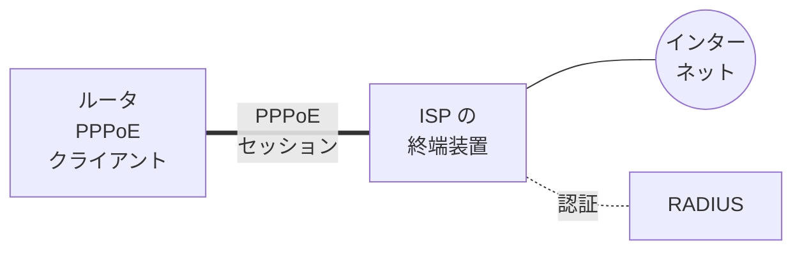
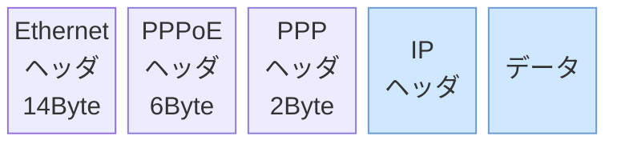

# PPP.md
## PPP / PPPoE

***

## PPP (Point-to-Point Protocol)

* WAN（専用線やISDN）など **1:1 の接続で使用されるデータリンク層**のプロトコル
* **PAP や CHAP による認証**機能が組み込まれており、正しいデバイスからの接続要求かを検証可能
* まずはリンクを確立し、次に認証を行う

| 認証方式 | 内容 |
| --- | --- |
| **PAP** (Password Authentication Protocol) | IDとパスワードを**平文**でやり取りすることで認証 |
| **CHAP** (Challenge Handshake Authentication Protocol) | チャレンジ&レスポンス方式で認証。定期的に**チャレンジ（乱数）**を対向機器に送り、対向機器は**パスワード + チャレンジ**を **MD5** でハッシュ化して返送。これより**盗聴に強い**認証が可能となる |

* IEEE802.1X等で使用される **EAP は、PPP を拡張**して追加の認証機能などを実装したもの
* VPNのL2トンネリングプロトコルである **PPTP** (Point-to-Point Tunneling Protocol) に応用されている

## PPPoE (PPP over Ethernet)

* **Ethernet上でPPPを利用するためのL2プロトコル**
  * Ethernetフレーム(L2)にPPPフレームを**カプセル化**することにより、IPパケット(L3データ)を運ぶ
* WANでもEthernetが普及したが、**Ethernetは認証機能を持たない**ためPPPと併せて使用される
  * ISPのユーザー名とパスワードを使って認証することで接続が確立される
* ダイアルアップ接続や専用線、その後ADSLでも利用、現在では一部の家庭用光回線（フレッツ光など）で利用

### 構成

- 家のルータと ISP の終端装置の間に、**Ethernet の上で1対1の PPP セッション**を張る
- 終端装置は、ルータから届いた ID・パスワードを **RADIUS サーバ**に問い合わせて認証し、IP アドレスを割り当てる
- Ethernet だけでは**誰がつないでいるか確かめられない** → PPP の**認証・アドレス割当て・接続の記録**を使うために PPPoE にする

### 接続の流れ

| 段階 | 内容 |
| --- | --- |
| ① ディスカバリ | **PADI**（ブロードキャストで終端装置を探す）→ **PADO** → **PADR** → **PADS**（**セッション ID** が決まる） |
| ② LCP | PPP の**リンクを確立**する（MRU などを決める） |
| ③ 認証 | **PAP / CHAP** で ID・パスワードを確認する |
| ④ IPCP | **IP アドレス**などを割り当てる |

| フレーム | 構成 |
| --- | --- |
| 標準のEthernetフレーム | **Ethernet Header (14バイト)** / IP Header (20バイト、オプションで最大60) / Data |
| PPPフレーム | **PPP Header (2バイト)** / IP Header (20バイト、オプションで最大60) / Data |
| PPPoEフレーム | **Ethernet Header (14バイト)** / **PPPoE Header (6バイト)** / PPP Header (2バイト) / IP Header (20バイト、オプションで最大60) / Data |

* PPPヘッダーは主に上位プロトコル（IPv4など）識別の役割を果たす
* PPPフレームが PPPoE および Ethernet により**カプセル化**されている

- 紫の2つ（PPPoE 6 ＋ PPP 2 ＝ **8Byte**）が、普通の Ethernet より増える分
- そのぶん MTU は **1500 − 8 ＝ 1,492Byte**、MSS は **1,452Byte** に下がる → MSS を小さく調整する（[../protocol/tcp-qos.md](../protocol/tcp-qos.md)）
- PPPoE の終端装置に通信が集まって混雑しやすい → PPP を使わない **IPoE** が広まった（[sd-wan.md](sd-wan.md)）

関連: [wan-vpn.md](wan-vpn.md) / [../lan/ieee802x.md](../lan/ieee802x.md)（IEEE 802.1X認証）
