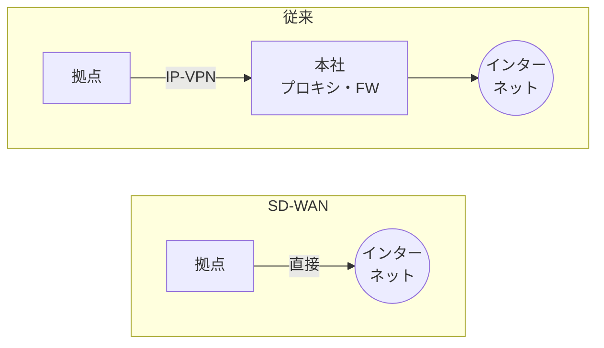

# SD-WAN.md
## SD-WAN 暗記シート

***

## ひとことで

**SD-WAN**（Software-Defined WAN）は、**SDN の考え方を WAN に応用**したもの。**コントローラが拠点の機器を一元管理**し、インターネット回線や IP-VPN など**複数の回線の上に IPsec のトンネル（オーバーレイ）を張って**、**アプリケーションごとに最適な回線を選んで**通信させる。

| 用語 | 意味 |
| --- | --- |
| **アンダーレイ** | 土台になる**物理的な回線**（インターネット回線・IP-VPN・LTE/5G など） |
| **オーバーレイ** | アンダーレイの上に作る**論理的なネットワーク**（拠点間の **IPsec トンネル**） |
| **SD-WAN エッジ** | 各拠点に置く SD-WAN 機器（ルータ）。トンネルの終端と経路の選択を行う |
| **コントローラ** | 経路情報や **IPsec の鍵**をエッジに配る（コントロールプレーン） |
| **オーケストレータ**（マネージャ） | 設定・監視の**管理画面**。テンプレートでの一括設定、ゼロタッチプロビジョニング（マネジメントプレーン） |

## 登場した背景

| 従来の課題 | SD-WAN での解決 |
| --- | --- |
| **クラウド（SaaS）の利用が増え、本社経由のインターネット接続が混雑**（本社の回線・プロキシがボトルネック） | **ローカルブレイクアウト**で拠点から直接インターネットへ |
| IP-VPN・広域イーサネットなどの**閉域網はコストが高い** | 安価な**インターネット回線**を組み合わせて使う |
| 拠点ごとに機器を**個別に設定**する手間（技術者の派遣が必要） | **コントローラで一元管理**、**ゼロタッチプロビジョニング** |
| 回線の品質が変わっても**経路は固定** | **回線品質を監視して自動で切り替え** |

## 3つのプレーン

| プレーン | 担当 | 役割 |
| --- | --- | --- |
| マネジメントプレーン | オーケストレータ | 設定・ポリシーの作成と配布、監視・可視化 |
| コントロールプレーン | **コントローラ** | 経路情報・トンネルの接続先・**IPsec の鍵**をエッジに配る |
| データプレーン | **エッジ** | 実際の通信を**拠点間の IPsec トンネルで直接**転送する |

- 通信そのものは**コントローラを経由せず**、エッジ同士が直接やり取りする
- コントローラが止まっても、**張られているトンネルでの通信はしばらく続く**製品が多い（設定変更や新しいトンネルの確立はできない）→ コントローラも冗長化する

## 従来の WAN との比較

| 項目 | IP-VPN | インターネット VPN | **SD-WAN** |
| --- | --- | --- | --- |
| 回線 | 通信事業者の**閉域網** | **インターネット** | **複数の回線を組み合わせる**（インターネット＋IP-VPN＋LTE など） |
| 品質 | 帯域・品質が**比較的安定**（帯域保証のメニューもある） | **ベストエフォート** | 回線の品質を**監視して良い回線を選ぶ** |
| コスト | 高い | 安い | 安い回線を活用できる |
| 暗号化 | 閉域なので通常は不要 | **IPsec** | **IPsec**（鍵はコントローラが配る） |
| 設定 | 事業者が網を提供 | 拠点ごとに IPsec を**個別設定**（拠点が増えると大変） | **一元管理**・テンプレート・ゼロタッチ |
| 経路制御 | 宛先 IP ごと | 宛先 IP ごと | **アプリケーションごと** |

## 主な機能

### アプリケーション識別と経路制御（アプリケーションアウェアルーティング）

- 通信の中身（**DPI**）、宛先の IP アドレス・ドメイン名（**DNS・TLS の SNI**）などから**アプリケーションを識別**する
- アプリケーションごとに**どの回線・どの経路を使うか**をポリシーで決める

| アプリケーションの例 | 経路の例 |
| --- | --- |
| Web 会議・IP 電話（遅延・揺らぎに弱い） | **遅延・ジッタが小さい回線** |
| 基幹システム（重要・機密） | **IP-VPN** 経由で本社・データセンターへ |
| 信頼できる SaaS（Microsoft 365 など） | **ローカルブレイクアウト**で直接インターネットへ |
| そのほかの Web 閲覧 | 本社やクラウドのプロキシ（SWG）経由で検査してからインターネットへ |

- **最初のパケットだけでは識別できない**ことがある（最初の数パケットはデフォルトの経路を通る）→ DNS の問合せやアドレスのリストで事前に判定する製品もある

### 回線品質の監視と自動切替え

- エッジ同士がトンネルごとに**プローブ（監視パケット）**を送り、**遅延・ジッタ（揺らぎ）・パケットロス**を常時測定する
- アプリケーションごとに**品質のしきい値（SLA）**を決めておき、**しきい値を超えたら別の回線に自動で切り替え**る
- 回線が**完全に切れる前の品質劣化（ブラウンアウト）**でも切り替えられる
- 品質を補う機能: **FEC**（誤り訂正の冗長データを付ける）、**パケット複製**（同じパケットを2つの回線に送り、先に届いた方を使う）

### 複数回線の同時利用

- 複数の回線を**同時に使って帯域を増やす**（フロー単位で振り分け）
- 1本の回線が故障しても**残りの回線で通信を続ける**

### ローカルブレイクアウト（インターネットブレイクアウト）

- **従来**: 拠点の通信も本社を経由してインターネットへ出る → **本社の回線・プロキシが混雑**
- **SD-WAN**: 拠点から直接インターネットへ出す（**ローカルブレイクアウト**）

| 項目 | 内容 |
| --- | --- |
| 目的 | **本社の回線・プロキシの負荷を減らし**、SaaS への通信を速くする |
| 対象 | **信頼できる特定の SaaS**（宛先のドメイン・IP アドレスで指定）に限定するのが一般的 |
| 課題 | 拠点から直接出る通信は**本社のセキュリティ対策（FW・プロキシ）を通らない** |
| 対策 | 拠点の **SD-WAN エッジの FW 機能**、または**クラウドのセキュリティサービス（SWG など、SASE）**を通す |
| 注意 | SaaS の **IP アドレスやドメインは変わる** → 事業者が公開するリストを定期的に反映する |

### ゼロタッチプロビジョニング（ZTP）

1. 設定していない機器を拠点に送り、**現地では回線と電源をつなぐだけ**
2. 機器がインターネット経由で**オーケストレータ（コントローラ）に接続**する
3. **シリアル番号や証明書で正しい機器か確認**される
4. 拠点用の**設定が自動でダウンロード**され、トンネルが張られる

→ **拠点に技術者を派遣しなくてよい**。拠点の追加が速い

### そのほか

| 機能 | 内容 |
| --- | --- |
| 一元管理・可視化 | 全拠点の回線品質・アプリケーションごとの通信量をダッシュボードで見る |
| テンプレート | 同じ種類の拠点に同じ設定を一括で適用する |
| セグメンテーション | 部署・用途ごとに**論理的にネットワークを分ける**（VRF など） |
| QoS | 重要なアプリケーションの通信を優先する |
| セキュリティ機能 | FW・IPS・URL フィルタなどをエッジに統合している製品もある |

## トポロジとトンネル数

| トポロジ | 内容 | トンネル数（拠点 n、各拠点の回線 1本） |
| --- | --- | --- |
| **ハブ＆スポーク** | すべての拠点が**本社（ハブ）とだけ**トンネルを張る。拠点間の通信は本社経由 | **n − 1** |
| **フルメッシュ** | **すべての拠点同士**が直接トンネルを張る。拠点間の通信が速い | **n(n − 1) / 2** |
| パーシャルメッシュ | 通信の多い拠点同士だけを直接つなぐ | その間 |

- 各拠点に回線が2本あり、**回線の組合せごと**にトンネルを張ると、拠点の組ごとに **2 × 2 = 4本**
- フルメッシュでも、**IPsec の設定や鍵はコントローラが自動で配る**ので、拠点ごとの手作業は増えない（インターネット VPN との大きな違い）

例）10拠点のフルメッシュ → 10 × 9 ÷ 2 ＝ **45本**。各拠点2回線で全組合せなら 45 × 4 ＝ **180本**

## 回線（アンダーレイ）の選び方

| 回線 | 特徴 |
| --- | --- |
| インターネット回線（光） | 安価・高速だが**ベストエフォート** |
| └ **PPPoE** | 通信事業者の網の終端装置が混雑しやすく、**夜間などに遅くなる**ことがある |
| └ **IPoE** | 終端装置を通らず混雑しにくい（IPv6。IPv4 は IPv4 over IPv6 で通す） |
| IP-VPN・広域イーサネット | 閉域網。品質が安定。既存の網と組み合わせて使う |
| LTE / 5G | 工事が不要ですぐ使える。**バックアップ回線**や仮設拠点向け |

- 冗長化するなら、**別の通信事業者**・**別の物理的な経路**（局舎・引込み）の回線を組み合わせる（同じ事業者だと同時に故障することがある）
- 機器の冗長化: エッジを2台にして、LAN 側を **VRRP** などで冗長化する

## 設計・運用の注意点

| 論点 | ポイント |
| --- | --- |
| **MTU** | IPsec などのカプセル化でパケットが大きくなる → **TCP の MSS を小さく調整**する（MSS クランプ） |
| **NAT 越え** | インターネット回線の先が NAPT だと IPsec（ESP）が通らない → **NAT トラバーサル（UDP 4500）**を使う |
| セキュリティ | ローカルブレイクアウトの通信の検査、エッジ機器自体の管理（脆弱性対応） |
| コントローラ | クラウド上のコントローラへの**到達性**と冗長化 |
| ログ・可視化 | どの通信がどの回線を通ったかを確認できるようにする |
| 既存網との接続 | 既存の IP-VPN の拠点とは**ゲートウェイ**を介して接続し、段階的に移行する |
| 製品依存 | コントロールプレーンのプロトコルは**製品ごとに独自**で、異なるメーカーの機器は混在できないことが多い |

## SASE と SSE

| 用語 | 意味 |
| --- | --- |
| **SASE**（Secure Access Service Edge） | **ネットワーク（SD-WAN）とセキュリティ機能をクラウドで一体化**して提供する考え方 |
| **SSE**（Security Service Edge） | SASE のうち**セキュリティの部分** |
| **SWG** | クラウドのプロキシ。URL フィルタ・マルウェア検査（HTTPS を検査するにはルート証明書を PC に入れる） |
| **CASB** | クラウドサービスの利用状況を可視化・制御する |
| **ZTNA** | ゼロトラストの考え方で、**利用者・端末を確認してからアプリケーション単位で接続**を許可する（VPN の代わり） |
| FWaaS | クラウドで提供されるファイアウォール |

→ ローカルブレイクアウトした通信も、**クラウドのセキュリティサービスを通す**ことで本社と同じ対策ができる

## SDN との関係

| 項目 | SDN | SD-WAN |
| --- | --- | --- |
| 対象 | データセンター・LAN | **拠点間の WAN** |
| 考え方 | 制御（コントローラ）と転送（スイッチ）を分離して集中管理 | 同じ考え方を WAN に応用 |
| プロトコル | **OpenFlow** など | **製品ごとの独自プロトコル**が多い（トンネルは IPsec） |

## 試験でよく問われるポイント

- **コントローラが経路情報・IPsec の鍵を配り**、拠点の機器を**一元管理**する
- **アンダーレイ（物理回線）とオーバーレイ（IPsec トンネル）**の区別
- **アプリケーションを識別**して、**アプリケーションごとに回線を選ぶ**
- **遅延・ジッタ・パケットロスを監視**し、しきい値を超えたら**自動で切り替え**
- **ローカルブレイクアウト**: 本社の回線・プロキシの負荷を減らす。ただし**拠点からの通信のセキュリティ対策が必要**（SWG・SASE）
- **ゼロタッチプロビジョニング**: 現地に技術者が不要
- **フルメッシュのトンネル数 n(n−1)/2**、回線が複数なら組合せの数を掛ける
- 通信は**エッジ同士が直接**行い、コントローラは経由しない
- 回線の冗長化は**別の事業者・別の物理経路**で

関連: [wan-vpn.md](wan-vpn.md) / [ipsec.md](ipsec.md) / [mpls.md](mpls.md) / [../redundancy/vrrp.md](../redundancy/vrrp.md) / [../operation/qos.md](../operation/qos.md)
